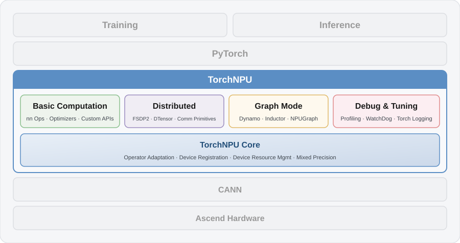

<h1 align="center">TorchNPU</h1>

<p align="center">
  <strong>PyTorch Adapter Plugin for Ascend NPU</strong>
</p>

<p align="center">
  English | <a href="./README.zh.md">简体中文</a>
</p>

<p align="center">
  <a href="#supported-pytorch-versions">Supported Versions</a> ·
  <a href="#installation">Installation</a> ·
  <a href="#quick-start">Quick Start</a> ·
  <a href="./COMPATIBILITY.en.md">Version Compatibility</a> ·
  <a href="./SUPPORT.en.md">Support</a> ·
  <a href="./CONTRIBUTING.en.md">Contribution</a> ·
  <a href="https://www.hiascend.com/developer/software/ai-frameworks/pytorch/document">Docs</a> ·
  <a href="https://www.hiascend.com/en/developer/software/ai-frameworks/pytorch">Community</a>
</p>

<p align="center">
  
  
  <a href="./LICENSE"></a>
  <a href="https://pypi.org/project/torch-npu/"></a>
  
  <a href="https://gitcode.com/Ascend/pytorch"></a>
  <a href="https://github.com/Ascend/pytorch"></a>
  
  
  <a href="https://github.com/Ascend/pytorch/actions/workflows/pytorch_ci_trigger_pr.yml"></a>
</p>

---

## Overview

As the core component of the Ascend for PyTorch community, **TorchNPU** is a deep learning adapter plugin developed by Ascend for PyTorch. It enables the PyTorch framework to directly invoke Ascend NPUs and provides developers with the powerful compute capabilities of Ascend AI Processors.

Ascend provides an end-to-end AI computing infrastructure for industry applications and services based on Huawei Ascend AI Processors and software. For more information about Ascend, visit the [Ascend Community](https://www.hiascend.com/en/).

## Key Features

TorchNPU fully inherits and reuses the mature capabilities of upstream PyTorch and, on this basis, is deeply adapted and optimized for Ascend NPUs. The following figure shows the main functional modules of TorchNPU:

<div align="center">
  
</div>

**Key Modules:**

- **Basic Compute:** Extensive support for PyTorch native APIs and custom APIs, covering mainstream AI scenarios and providing a consistent experience, helps you quickly implement models and algorithms.
- **Distributed:** Supports accelerating distributed training with FSDP2. Core compute APIs support DTensor and collective communication primitives such as AllGather, AllReduce, and AllToAll, as well as point-to-point communication primitives such as Send and Recv.
- **Graph Mode:** Significantly accelerates model training and inference through "dynamic graph capture + static graph optimization + efficient code generation", and supports offloading execution via NPUGraph. This feature is supported in v2.6.0 and later.
- **Debugging & Tuning:** Supports profiling to analyze compute, communication, and memory usage, and supports real-time monitoring and analysis of communication anomalies via WatchDog.
- **TorchNPU Core:** Supports virtual memory management to reduce memory fragmentation and cross-stream memory reuse optimization in distributed scenarios, and integrates operators and device resources into PyTorch through PrivateUse1.

## Latest News

- 📢 [2026-06-30] Advance notice on standardizing the naming conventions of components in the Ascend for PyTorch community. [🔗 Learn more](https://www.hiascend.com/productbulletins/detail/791)
- 📢 [2026-04-30] TorchNPU 26.0.0 is released, adding support for PyTorch 2.10.0 and Python 3.13, and new features such as group dispatch for P2P communication and DTensor strategy extensions. [🔗 Learn more](https://www.hiascend.com/productbulletins/detail/779)

## Supported PyTorch Versions

This branch adapts to multiple PyTorch versions from a single source tree. The list of supported PyTorch versions is declared in [version.txt](./version.txt), which is the single source of truth and is updated synchronously with version adaptation.

For the version compatibility of released packages (TorchNPU/PyTorch/CANN/Python), see [Version Compatibility](./COMPATIBILITY.en.md).

## Installation

### From Binary

Take installing TorchNPU 2.12.0 as an example. Run the following commands to install it. To download other versions, see the community download page [TorchNPU Download](https://www.hiascend.com/developer/software/ai-frameworks/pytorch/download).

#### Install CANN

Install CANN 9.1.0 and the NPU driver and firmware that match your hardware, and select a compatible Python version based on [Version Compatibility](./COMPATIBILITY.en.md). For detailed steps, see the [CANN Installation Guide](https://www.hiascend.com/cann/download).

#### Install PyTorch

Run the following command to install PyTorch 2.12.0:

```bash
pip install torch==2.12.0 --index-url https://download.pytorch.org/whl/cpu
```

#### Install TorchNPU

Run the following command to install TorchNPU 2.12.0:

```bash
pip install torch-npu==2.12.0
```

### From Source

For detailed steps on compiling TorchNPU from source, see [Source Installation](./docs/en/installation_guide/building_from_source.md).

## Quick Start

### Initialize Environment

```shell
# Default path. Modify it based on the actual installation location.
source /usr/local/Ascend/cann/set_env.sh
```

### Run Example

```python
import torch
import torch_npu

x = torch.randn(2, 2).npu()
y = torch.randn(2, 2).npu()
z = x.mm(y)
print(z)
```

> Starting from TorchNPU 2.5.1, `import torch_npu` is no longer mandatory (auto-registration), but it is recommended to import it explicitly in your code to ensure device initialization.

If output similar to the following is displayed, the execution is successful:

```text
tensor([[-0.0515,  0.3664],
        [-0.1258, -0.5425]], device='npu:0')
```

For complete model migration and training tutorials, see [Quick Start](https://www.hiascend.com/document/detail/en/Pytorch/latest/fastexperience/docs/en/quick_start/quick_start.md).

## Community

The Ascend for PyTorch community is managed by the Technical Committee (TC), under which multiple Special Interest Groups (SIGs) are established. Each SIG is responsible for the development, maintenance, and community collaboration of a specific technical area. The following table introduces the TC and current SIGs. Click the corresponding links for details.

|   TC/SIG Name | Description                                                                                                                                                                                                                                                                                         |                                                 Link                                                  |
|:---------------:|:---------------------------------------------------------------------------------------------------------------------------------------------------------------------------------------------------------------------------------------------------------------------------------------------------|:-----------------------------------------------------------------------------------------------------:|
|       TC        | Oversees the technical direction and major technical decisions of the Ascend for PyTorch project, SIG governance, and release reviews. | [🔗 Learn more](https://gitcode.com/Ascend/community/blob/master/AscendForPyTorch/README.md) |
|    Core SIG     | Focuses on the PyTorch core adaptation layer on the Ascend NPU platform, and is responsible for the design, implementation, and maintenance of the `TorchNPU` extension library and its operator plugin `OpPlugin`.                                                                                 |    [🔗 Learn more](https://gitcode.com/Ascend/community/tree/master/AscendForPyTorch/sigs/core)     |
| Distributed SIG | Focuses on building efficient, easy-to-use, and scalable parallel training capabilities based on the PyTorch distributed training framework (torch.distributed) on the Ascend NPU hardware, delivering ultimate performance for LLM, multimodal model, and reinforcement learning scenarios.          | [🔗 Learn more](https://gitcode.com/Ascend/community/tree/master/AscendForPyTorch/sigs/distributed) |
| Graph Mode SIG  | Focuses on core technologies such as Dynamo, Inductor, and NPUGraph, aiming to bridge the gap between "ease of use" and "high performance" through automated graph capture and compilation optimization.                                                                                            | [🔗 Learn more](https://gitcode.com/Ascend/community/tree/master/AscendForPyTorch/sigs/graph-mode)  |
|  Usability SIG  | Committed to improving the usability experience of Ascend for PyTorch, including documentation, tutorials, and examples.                                                                                                                                                                            |  [🔗 Learn more](https://gitcode.com/Ascend/community/tree/master/AscendForPyTorch/sigs/usability)  |

Each SIG has its own regular meetings, mailing lists, and contribution guides. Click the corresponding SIG links to view detailed contact information, work goals, and participation guidelines. Everyone is welcome to contribute to the community. If you have any questions or suggestions, submit a [GitCode Issue](https://gitcode.com/Ascend/pytorch/issues), and we will reply as soon as possible. Thank you for your support.

## Security Statement

For system security hardening, recommended running user, file permission control, and other information about TorchNPU, see [Security Statement](SECURITYNOTE.en.md).

## Disclaimer

This plugin is for debugging and development purposes only. Users are responsible for ensuring the security of the command lines they enter and for properly controlling permissions on data generated during use. By using this plugin, you agree to and accept the above statement.

## License

For the license for using TorchNPU, see the [LICENSE](LICENSE) file. For the license for TorchNPU documentation, see the [LICENSE](./docs/LICENSE) file.

## Acknowledgments

Thanks for every PR from the community! We welcome developers to contribute code to the TorchNPU plugin.
