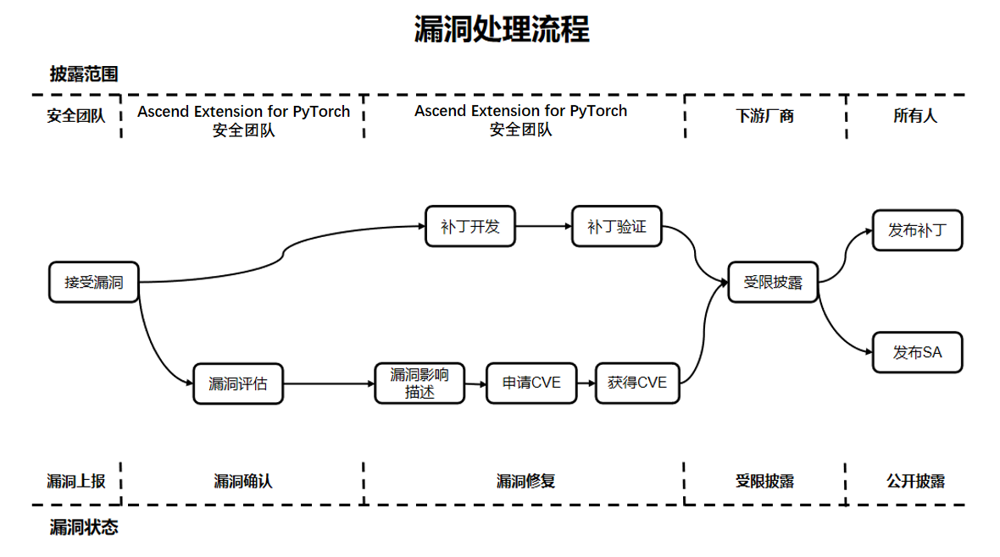

# TorchNPU Plugin Security Note

## System Security Hardening

You are advised to configure ASLR (level 2), also known as **full address space layout randomization**, in the system. The configuration method is as follows:

    echo 2 > /proc/sys/kernel/randomize_va_space

## Running User Recommendation

For security and least-privilege purposes, it is not recommended to use TorchNPU as an administrator-type account such as root.

## File Permission Control

1. You are advised to take security measures such as permission control for sensitive files, including files required by training, files saved during training, users' private data, and commercial assets. Examples include write permission control of dataset files in a multi-user shared dataset scenario and permission control of data files generated in scenarios such as the profiler. For the recommended permissions, refer to [File Permission Reference](#file-permission-reference).

2. The profiler tool in TorchNPU generates performance record files. The generated files have permission 640, and the folders have permission 750. You can control the permissions of the generated files as required.

3. Perform permission control during installation and use. You are advised to set permissions according to [File Permission Reference](#file-permission-reference). To save installation/uninstallation logs, add the --log FILE parameter to the installation/uninstallation command. Pay attention to permission control of the FILE file and its directory.

4. The permissions of files generated when the PyTorch framework is running depend on system settings, such as files saved by the torch.save API. It is recommended that the user who runs the script control the permissions of the generated files as required. For the recommended permissions, refer to [File Permission Reference](#file-permission-reference). You can use umask to control default permissions and reduce security risks such as privilege escalation. It is recommended that you set umask in the host machine (including the host) and container to 0027 or above to improve security.

**File permission reference:**<a id="file-permission-reference"></a>

|   Type                             |   Maximum Linux Permission Reference   |
|----------------------------------- |-----------------------|
|  User home directory                         |   750 (rwxr-x---)     |
|  Program files (including script files and library files)       |   550 (r-xr-x---)     |
|  Program file directory                       |   550 (r-xr-x---)     |
|  Configuration file                           |   640 (rw-r-----)     |
|  Configuration file directory                       |   750 (rwxr-x---)     |
|  Log files (archived or completed recording)       |   440 (r--r-----)     |
|  Log files (recording)                  |   640 (rw-r-----)    |
|  Log file directory                       |   750 (rwxr-x---)     |
|  Debug files                         |   640 (rw-r-----)      |
|  Debug file directory                      |   750 (rwxr-x---)     |
|  Temporary file directory                       |   750 (rwxr-x---)     |
|  Maintenance upgrade file directory                   |   770 (rwxrwx---)      |
|  Service data files                       |   640 (rw-r-----)      |
|  Service data file directory                   |   750 (rwxr-x---)      |
|  Key components, private keys, certificates, and ciphertext file directories   |   700 (rwx------)      |
|  Key components, private keys, certificates, and encrypted files      |   600 (rw-------)     |
|  Encryption/decryption APIs and scripts              |   500 (r-x------)      |

## Debugging Tool Statement

TorchNPU integrates the performance analysis tool profiler:

- Integration reason: to align with the native PyTorch support capabilities, provide performance analysis capabilities for NPU PyTorch framework development, and accelerate the performance analysis and debugging process.
- Usage scenario: collection is disabled by default. If you need to perform performance analysis, add the TorchNPU Profiler API to the model training script. Performance data is collected during training, and a visualized performance data file is directly output after the training is complete.
- Risk note: using this function generates performance data on the local host. You need to enhance the protection of the related performance data. Use this function only when model performance analysis is required, and disable it in time after the analysis. For details about the profiler tool, refer to [Introduction to the PyTorch Performance Analysis Tool](https://www.hiascend.com/document/detail/zh/Pytorch/730/ptmoddevg/trainingmigrguide/performance_tuning_0014.html).

## Data Security Statement

1. Data needs to be loaded and saved when PyTorch is used. Some APIs use the risky module pickle, which may cause data risks. Examples include torch.load, torch.jit.load, and torch.distributed.scatter_object_list. For details about the risks, refer to [torch.load](https://pytorch.org/docs/main/generated/torch.load.html#torch.load) and [collective-functions](https://pytorch.org/docs/main/distributed.html#collective-functions).
2. TorchNPU relies on the basic capabilities of CANN to implement functions such as AOE performance tuning, operator dump, and logging. You need to pay attention to the permission control of the files generated by these functions and enhance the protection of the related data.

## Build Security Statement

TorchNPU supports source code compilation and installation. During compilation, it downloads the dependent third-party libraries and executes build shell scripts. The compilation process generates temporary program files and a compilation directory. You can control the permissions of files in the source code directory as required to reduce security risks.

## Running Security Statement

1. You are advised to write the training script based on the resources of the running environment. If the training script does not match the resources, for example, the dataset loading memory exceeds the memory capacity limit, or the data generated locally by the training script exceeds the disk space, errors may occur and the process may exit unexpectedly.
2. When PyTorch and TorchNPU run abnormally, they exit the process and print error information. This is normal. You are advised to locate the specific error cause based on the error message, including setting operators to execute synchronously, viewing CANN logs, and parsing the generated Core Dump files.
3. The distributed features of PyTorch and TorchNPU are only applicable to internal communication. For performance reasons, these distributed features do not include any authorization protocol and send unencrypted messages. For details about the distributed features of PyTorch and security precautions, refer to [using-distributed-features](https://github.com/pytorch/pytorch/security#using-distributed-features).

## Public Network Address Statement

[Public network addresses](#public-network-addresses) exist in the configuration files and scripts of TorchNPU.

**Public network addresses:**<a id="public-network-addresses"></a>

| Type   | Open Source Code Address                                                                                                                                                                                                                         | File Name                                    | Public IP Address/Public URL Address/Domain Name/Email Address                                                         | Purpose Description                           |
|------|--------------------------------------------------------------------------------------------------------------------------------------------------------------------------------------------------------------------------------|----------------------------------------|--------------------------------------------------------------------------------|--------------------------------|
| Self-developed   | Not involved                                                                                                                                                                                                                            | .gitmodules                            | <https://gitcode.com/ascend/op-plugin.git>                                       | Dependent open source code repository                       |
| Self-developed   | Not involved                                                                                                                                                                                                                            | .gitmodules                            | <https://gitcode.com/GitHub_Trending/go/googletest.git>                                       | Dependent open source code repository                       |
| Self-developed   | Not involved                                                                                                                                                                                                                            | .gitmodules                            | <https://gitcode.com/ascend/torchair.git>                                          | Dependent open source code repository                       |
| Self-developed   | Not involved                                                                                                                                                                                                                            | .gitmodules                            | <https://gitcode.com/ascend/Tensorpipe.git>                                      | Dependent open source code repository                       |
| Self-developed   | Not involved                                                                                                                                                                                                                            | .gitmodules                            | <https://gitcode.com/GitHub_Trending/fm/fmt.git>                                              | Dependent open source code repository                       |
| Self-developed   | Not involved                                                                                                                                                                                                                            | .gitmodules                            | <https://gitcode.com/GitHub_Trending/js/json.git>                                    | Dependent open source code repository                       |
| Self-developed   | Not involved                                                                                                                                                                                                                            | .gitmodules                            | <https://gitcode.com/gh_mirrors/to/torch-mlir.git>                                    | Dependent open source code repository                      |
| Self-developed   | Not involved                                                                                                                                                                                                                            | .gitmodules                            | <https://gitcode.com/cann/runtime.git>                                      | Dependent open source code repository                       |
| Self-developed   | Not involved                                                                                                                                                                                                                            | .gitmodules                            | <https://gitcode.com/cann/ge.git>                                              | Dependent open source code repository                       |
| Self-developed   | Not involved                                                                                                                                                                                                                            | .gitmodules                            | <https://gitcode.com/cann/graph-autofusion.git>                                    | Dependent open source code repository                      |
| Self-developed   | Not involved                                                                                                                                                                                                                            | ci\docker\X86\Dockerfile               | <https://mirrors.huaweicloud.com/repository/pypi/simple>                         | Docker configuration file, used for configuring the pip source            |
| Self-developed   | Not involved                                                                                                                                                                                                                            | ci\docker\X86\Dockerfile               | <https://download.pytorch.org/whl/cpu>                                           | Docker configuration source, used for configuring the torch download link        |
| Self-developed   | Not involved                                                                                                                                                                                                                            | ci\docker\ARM\Dockerfile               | <https://mirrors.huaweicloud.com/repository/pypi/simple>                         | Docker configuration file, used for configuring the pip source            |
| Self-developed   | Not involved                                                                                                                                                                                                                            | ci\docker\X86\Dockerfile               | <https://mirrors.wlnmp.com/centos/Centos7-aliyun-altarch.repo>                   | Docker configuration file, used for configuring the yum source            |
| Self-developed   | Not involved                                                                                                                                                                                                                            | ci\docker\ARM\Dockerfile               | <https://mirrors.wlnmp.com/centos/Centos7-aliyun-altarch.repo>                   | Docker configuration file, used for configuring the yum source            |
| Self-developed   | Not involved                                                                                                                                                                                                                            | .github\workflows\\_build-and-test.yml | <https://mirrors.huaweicloud.com/repository/pypi/simple>                         | Workflow configuration file, used for configuring the pip source          |
| Self-developed   | Not involved                                                                                                                                                                                                                            | setup.cfg                              | <https://gitcode.com/ascend/pytorch>                                             | URL input parameter for packaging the whl package                  |
| Self-developed   | Not involved                                                                                                                                                                                                                            | setup.cfg                              | <https://gitcode.com/ascend/pytorch/tags>                                        | download_url input parameter for packaging the whl package         |
| Self-developed   | Not involved                                                                                                                                                                                                                            | third_party\op-plugin\ci\build.sh      | <https://gitcode.com/ascend/pytorch.git>                                         | The compilation script pulls code from the TorchNPU repository address for compilation    |
| Self-developed   | Not involved                                                                                                                                                                                                                            | third_party\op-plugin\ci\exec_ut.sh    | <https://gitcode.com/ascend/pytorch.git>                                         | The UT script pulls code from the TorchNPU repository address for UT testing |
| Open source introduction | <https://github.com/pytorch/pytorch/blob/release/2.11/test/nn/test_convolution.py> <br> <https://github.com/pytorch/pytorch/blob/release/2.11/test/test_mps.py> <br> <https://github.com/pytorch/pytorch/blob/release/2.11/test/test_serialization.py> | test\url.ini                           | <https://download.pytorch.org/test_data/legacy_conv2d.pt>                        | Used by the test script to download the related pt files               |
| Open source introduction | <https://github.com/pytorch/pytorch/blob/release/2.11/test/test_serialization.py>                                                                                                                                                      | test\url.ini                           | <https://download.pytorch.org/test_data/legacy_serialized.pt>                    | Used by the test script to download the related pt files               |
| Open source introduction | <https://github.com/pytorch/pytorch/blob/release/2.11/test/test_serialization.py>                                                                                                                                                      | test\url.ini                           | <https://download.pytorch.org/test_data/gpu_tensors.pt>                          | Used by the test script to download the related pt files               |
| Open source introduction | <https://github.com/pytorch/pytorch/blob/release/2.11/test/onnx/test_utility_funs.py>                                                                                                                                                  | test\url.ini                           | <https://github.com/pytorch/pytorch/issues/new?template=bug-report.yml>          | Link to the issue                       |
| Open source introduction | <https://github.com/pytorch/pytorch/blob/release/2.11/test/test_nn.py> <br> <https://github.com/pytorch/pytorch/blob/release/2.11/test/test_serialization.py>                                                                                  | test\url.ini                           | <https://download.pytorch.org/test_data/linear.pt>                               | Used by the test script to download the related pt files               |
| Self-developed   | Not involved                                                                                                                                                                                                                            | torch_npu\npu\config.yaml              | <https://raw.githubusercontent.com/brendangregg/FlameGraph/master/flamegraph.pl> | Download path of the flame graph script                      |
| Self-developed   | Not involved                                                                                                                                                                                                                            | test\requirements.txt                  | <https://download.pytorch.org/whl/cpu>                                   | Download link, used for downloading the CPU version of torch           |
| Self-developed   | Not involved                                                                                                                                                                                                                            | test\requirements.txt                  | <https://data.pyg.org/whl/torch-2.10.0+cpu.html>                                  | Download link, used for downloading the CPU version of torch-scatter   |
| Self-developed   | Not involved                                                                                                                                                                                                                            | requirements.txt                       | <https://download.pytorch.org/whl/cpu>                                   | Download link, used for downloading the CPU version of torch           |
| Self-developed   | Not involved                                                                                                                                                                                                                            | test\get_synchronized_files.sh         | <https://github.com/pytorch/pytorch.git>                                         | Download link, used for downloading the test cases of PyTorch          |

## Public API Statement

TorchNPU is a PyTorch adaptation plugin. It allows you to use PyTorch for training and inference on Ascend devices. After the adaptation, TorchNPU allows you to use native PyTorch APIs. In addition to native PyTorch APIs, TorchNPU provides some custom APIs, including custom operators, affinity libraries, and other APIs, and supports the connection between PyTorch APIs and custom APIs. For details, refer to [Custom APIs](https://www.hiascend.com/document/detail/zh/Pytorch/730/apiref/torchnpuCustomsapi/docs/context/overview.md) and [PyTorch Native API List](https://www.hiascend.com/document/detail/zh/Pytorch/730/apiref/PyTorchNativeapi/docs/zh/native_apis/pytorch_2-9-0/overview.md).

Following the [PyTorch community public API specification](https://github.com/pytorch/pytorch/wiki/Public-API-definition-and-documentation), TorchNPU provides external custom APIs. If a function seems to meet the criteria of a public API and is presented in the documentation, it is a public API. Otherwise, before using the function, you can ask in the community whether the function is actually public or accidentally exposed, because these unexposed APIs may be modified or deleted in the future.

The TorchNPU project is developed using C++ and Python. Currently, except for the Libtorch scenario, official APIs are provided only as Python APIs. In the binary package of TorchNPU, dynamic libraries do not provide services directly, and the exposed APIs are for internal use only. It is not recommended to use these APIs.

## Communication Security Hardening

The PyTorch distributed training service requires communication between devices. By default, the ports opened for communication listen on 0.0.0.0. To reduce security risks, you are advised to perform security hardening for this scenario, for example, configuring a firewall using iptables, restricting external access to the ports used by distributed training before starting distributed training, and clearing the firewall rules after the distributed training is complete.

1. Reference script template for setting and removing firewall rules
    - To set firewall rules, refer to the following script:

        ```bash
        #!/bin/bash
        set -x

        # Port number to be restricted
        port={port_number}

        # Clear old rules
        iptables -D INPUT -p tcp -j {rule_name}
        iptables -F {rule_name}
        iptables -X {rule_name}

        # Create a new rule chain
        iptables -t filter -N {rule_name}

        # In the multi-node scenario, set a whitelist to allow other nodes to access the listening port of the master node
        # Add a rule to the rule chain to allow a specific IP address range
        iptables -t filter -A {rule_name} -i eno1 -p tcp --dport $port -s {IP_allowed_for_external_access} -j ACCEPT

        # Block external addresses from accessing the distributed training port
        # Add a rule to the PORT-LIMIT-RULE rule chain to deny other IP addresses
        iptables -t filter -A {rule_name} -i {NIC_to_be_restricted} -p tcp --dport $port -j DROP

        # Pass traffic to the rule chain
        iptables -I INPUT -p tcp -j {rule_name}
        ```

    - To remove firewall rules, refer to the following script:

        ```bash
        #!/bin/bash
        set -x
        # Clear rules
        iptables -D INPUT -p tcp -j {rule_name}
        iptables -F {rule_name}
        iptables -X {rule_name}
        ```

2. Reference script example for setting and removing firewall rules
    1. Set a firewall for a specific port. The port number in the script is the port to be restricted. For the port number in PyTorch distributed training, refer to [Communication Matrix Information](#communication-matrix-information). The NIC name to be restricted is the NIC used by the server for distributed communication. The allowed external access IP is the IP address of the distributed training server. You can view the NIC and server IP through ifconfig. In the following example output, eth0 is the NIC name, and 192.168.1.1 is the server IP address:

        ```bash
        # ifconfig
        eth0
            inet addr:192.168.1.1 Bcast:192.168.1.255 Mask:255.255.255.0
            inet6 addr: fe80::230:64ee:ef1a:c1a/64 Scope:Link
        ```

    2. Assume that the master node address of the server is 192.168.1.1, another server for distributed training is 192.168.1.2, and the training port is 29510.
        - To set firewall rules, refer to the following script:

            ```bash
            #!/bin/bash
            set -x

            # Set the listening port
            port=29510

            # Clear old rules
            iptables -D INPUT -p tcp -j PORT-LIMIT-RULE
            iptables -F PORT-LIMIT-RULE
            iptables -X PORT-LIMIT-RULE

            # Create a new PORT-LIMIT-RULE rule chain
            iptables -t filter -N PORT-LIMIT-RULE

            # In the multi-node scenario, set a whitelist to allow 192.168.1.2 to access the master node
            # Add a rule to the PORT-LIMIT-RULE rule chain to allow a specific IP address range
            iptables -t filter -A PORT-LIMIT-RULE -i eno1 -p tcp --dport $port -s 192.168.1.2 -j ACCEPT

            # Block external addresses from accessing the distributed training port
            # Add a rule to the PORT-LIMIT-RULE rule chain to deny other IP addresses
            iptables -t filter -A PORT-LIMIT-RULE -i eth0 -p tcp --dport $port -j DROP

            # Pass traffic to the PORT-LIMIT-RULE rule chain
            iptables -I INPUT -p tcp -j PORT-LIMIT-RULE
            ```

        - To remove firewall rules, refer to the following script:

            ```bash
            #!/bin/bash
            set -x
            # Clear rules
            iptables -D INPUT -p tcp -j PORT-LIMIT-RULE
            iptables -F PORT-LIMIT-RULE
            iptables -X PORT-LIMIT-RULE
            ```

## Communication Matrix

PyTorch provides the distributed training capability and supports training in single-node and multi-node scenarios, which requires network communication. PyTorch uses TCP for communication, and TorchNPU uses HCCL in CANN to communicate between NPU devices. The communication ports are described in [Communication Matrix Information](#communication-matrix-information). You need to pay attention to and ensure the security of communication between nodes. You can use iptables and other methods to mitigate security risks. Refer to [Communication Security Hardening](#communication-security-hardening) to perform network security hardening.

 Communication matrix information<a id="communication-matrix-information"></a>

| Item                  |  PyTorch                             |  HCCL                                |
| --------------------- | ------------------------------------ | ------------------------------------ |
| Source device                | Server running the TorchNPU process              | Server running the TorchNPU process             |
| Source IP                  | Device IP address                            | Device IP address                            |
| Source port                | Automatically assigned by the operating system. The assignment range is determined by the operating system configuration      | The default value is 60000, and the value range is [1024,65520]. You can use the HCCL_IF_BASE_PORT environment variable to specify the start port number of the host NIC. After the configuration, the system occupies 16 ports starting from this port by default      |
| Destination device              | Server running the TorchNPU process              | Server running the TorchNPU process              |
| Destination IP                | Device IP address                            | Device IP address                            |
| Destination port (listening)      | Default values are 29500/29400. You can set the port number     | The default value is 60000, and the value range is [1024,65520]. You can use the HCCL_IF_BASE_PORT environment variable to specify the start port number of the host NIC. After the configuration, the system occupies 16 ports starting from this port by default      |
| Protocol                  | TCP                                  | TCP                                   |
| Port description              | Distributed scenario: <br> 1. torchrun/torch.distributed.launch <br> (1) When the backend is static (the default backend), the destination port (default 29500) is used for receiving and sending data, and the source port is used for receiving and sending data. Use master-addr to specify the address and master-port to specify the port. <br> (2) When the backend is c10d, the destination port (default 29400) is used for receiving and sending data, and the source port is used for receiving and sending data. Use rdzv_endpoint to specify the address and port number in the format of "address:port number". <br> 2. torch_npu_run: the destination port (default 29500) is used for receiving and sending data, and the source port is used for receiving and sending data. Use master-addr to specify the address and master-port to specify the port       | The default value is 60000, and the value range is [1024,65520]. You can use the HCCL_IF_BASE_PORT environment variable to specify the start port number of the host NIC. After the configuration, the system occupies 16 ports starting from this port by default       |
| Whether the listening port can be changed     | Yes                                    | Yes                                    |
| Authentication mode              | No authentication mode                             | No authentication mode                             |
| Encryption mode              | None                                    | None                                    |
| Plane              | Not involved                                | Not involved                                 |
| Version                  | All versions                              | All versions                               |
| Special scenario              | None                                    | None                                     |
| Remarks                  | This communication process is controlled by the open source software PyTorch and is configured as the native PyTorch setting. Refer to the [PyTorch documentation](https://pytorch.org/docs/stable/distributed.html#launch-utility). The source port is automatically assigned by the operating system, and the assignment range is determined by the operating system configuration. For example, in Ubuntu, the assignment range is specified by the /proc/sys/net/ipv4/ipv4_local_port_range file, which can be viewed through cat /proc/sys/net/ipv4/ipv4_local_port_range or sysctl net.ipv4.ip_local_port_range       | This communication process is controlled by the HCCL component in CANN, and TorchNPU does not control it. For the port range, refer to "Running-Related > Collective Communication > HCCL_IF_BASE_PORT" in [Environment Variables](https://www.hiascend.com/document/detail/zh/canncommercial/850/maintenref/envvar/envref_07_0001.html)          |

## Vulnerability Management Description

The Ascend for PyTorch community attaches great importance to the security of community versions and has set up a vulnerability management specialist responsible for handling vulnerability-related affairs. To build a more secure AI full-process tool chain, we also welcome you to participate.

### Vulnerability Handling Process

For each security vulnerability, the Ascend for PyTorch community arranges personnel to track and handle it. The end-to-end vulnerability handling process is shown in the following figure.



The following describes the vulnerability reporting, vulnerability evaluation, and vulnerability disclosure processes.

### Vulnerability Reporting

You can contact the Ascend for PyTorch community team by submitting an issue. We will arrange security vulnerability specialists to contact you as soon as possible.
Note that to ensure security, do not describe specific information involving security and privacy in the issue.

#### Report Response

1. The Ascend for PyTorch community confirms, analyzes, and reports security vulnerability problems within 3 working days, and starts the security handling process.
2. After confirming a security vulnerability problem, the Ascend for PyTorch security team distributes and follows up on the problem.
3. During the classification, determination, fixing, and release of a security vulnerability problem, we update the report in a timely manner.

### Vulnerability Evaluation

The CVSS standard is widely used in the industry to evaluate vulnerability severity. When TorchNPU uses CVSS v3.1 for vulnerability evaluation, a vulnerability attack scenario needs to be set, and the evaluation is based on the actual impact under that attack scenario. Vulnerability severity evaluation refers to evaluating the difficulty of exploiting the vulnerability and the impact on confidentiality, integrity, and availability after exploitation, and generating a score.

#### Vulnerability Evaluation Criteria

TorchNPU evaluates the severity of a vulnerability through the following vectors:

- Attack vector (AV): indicates the "remoteness" of the attack and how the vulnerability is exploited.
- Attack complexity (AC): describes the difficulty of performing the attack and the factors required for a successful attack.
- User interaction (UI): determines whether the attack requires user participation.
- Required privileges (PR): records the user authentication level required for a successful attack.
- Scope (S): determines whether the attacker can affect components with different privilege levels.
- Confidentiality (C): measures the impact of information disclosure to unauthorized parties.
- Integrity (I): measures the impact of information tampering.
- Availability (A): measures the degree to which users are affected when they need to access data or services.

#### Evaluation Principles

- Evaluate the severity of a vulnerability, not the risk.
- The evaluation must be based on an attack scenario, and under that scenario, a successful attack can cause confidentiality, integrity, or availability impact on the system.
- When a security vulnerability has multiple attack scenarios, use the scenario that causes the greatest impact, that is, the attack scenario with the highest CVSS score, as the basis.
- If a library that is embedded and called has a vulnerability, determine the attack scenario of the vulnerability based on how the library is used in the product before performing the evaluation.
- If a security defect cannot be triggered or does not affect CIA (confidentiality, integrity, and availability), the CVSS score is 0.

#### Evaluation Steps

Perform the following steps to evaluate the severity of a vulnerability:

1. Set possible attack scenarios and score based on the attack scenarios.
2. Determine the vulnerable component and impact component.

3. Select the values of base metrics.

   - For exploitability metrics (attack vector, attack complexity, required privileges, user interaction, and scope), select metric values based on the vulnerable component.

   - For impact metrics (confidentiality, integrity, and availability), reflect either the impact on the vulnerable component or the impact on the impact component, subject to the more severe result.

#### Severity Levels

| **Severity Rating** | **CVSS Score** | **Vulnerability Fix Duration** |
| ------------------------------- | --------------------- | ---------------- |
| Critical                | 9.0–10.0              | 7 days              |
| High                      | 7.0–8.9               | 14 days             |
| Medium                    | 4.0–6.9               | 30 days             |
| Low                       | 0.1–3.9               | 30 days             |

### Vulnerability Disclosure

After a security vulnerability is fixed, the Ascend for PyTorch community releases a security advisory (SA) and a security note (SN). The security advisory includes the technical details, type, reporter, CVE ID, and the versions affected by the vulnerability and the fixed versions of the vulnerability.
To protect the security of TorchNPU users, before completing the investigation, fixing, and release of the security advisory, the Ascend for PyTorch community does not publicly disclose, discuss, or confirm the security problems of the TorchNPU product.

### Appendix

#### Security Advisory (SA)

Currently, versions are being maintained, and there are no security vulnerabilities.

#### Security Note (SN)

Description of some vulnerabilities in third-party open source components: none
