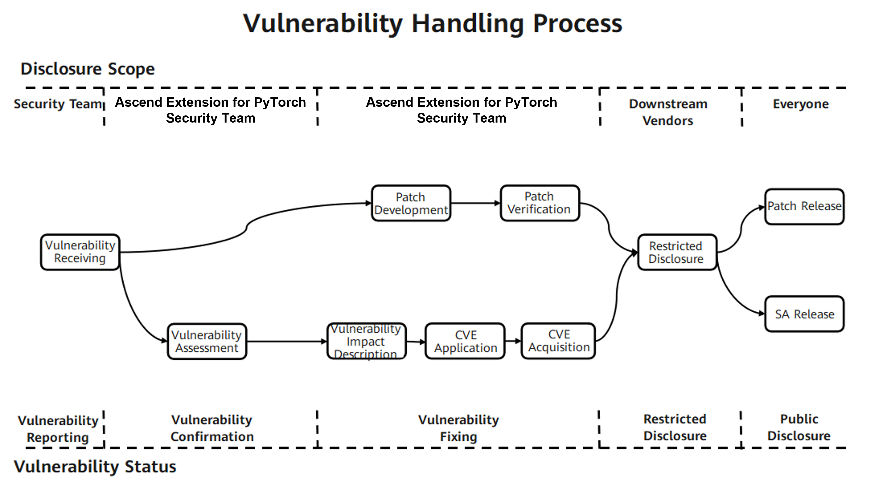

# TorchNPU Security Statement

## System Security Hardening

Enable ASLR (level 2), also known as **fully randomized address space layout randomization**, in the system. Run the following command to configure it:

    echo 2 > /proc/sys/kernel/randomize_va_space

## User Account Recommendations

For security and permission minimization purposes, do not use administrator accounts such as `root` to run TorchNPU.

## File Permission Control

1. It is recommended that you implement security measures such as permission control for sensitive files, including files required for training, files saved during training, users' private data, and business assets. For example, control the write permission of dataset files in multi-user dataset sharing scenarios, and control the permissions of data files generated in scenarios such as profiler. For the recommended permission settings, see [File Permission Reference](#file-permission-reference).

2. The profiler tool in TorchNPU generates performance record files. The generated files have permission 640 and the folder permission 750. You can manually control the permissions of the generated files as needed.

3. Proper permission control is required during installation and use. For the recommended settings, see [File Permission Reference](#file-permission-reference). If you need to save installation or uninstallation logs, add the `--log FILE` parameter after the installation or uninstallation command, and control the permissions of the FILE file and its directory.

4. The permissions of files generated when the PyTorch framework runs, such as files saved by the torch.save API, depend on system settings. It is recommended that the user executing the script control the permissions of the generated files as needed. For the recommended permission settings, see [File Permission Reference](#file-permission-reference). You can use umask to control default permissions to reduce security risks such as privilege escalation. You are advised to set umask to `0027` or stricter on hosts (including host machines) and in containers to improve security.

### File Permission Reference

| Type                                                              | Maximum Linux Permissions |
| ----------------------------------------------------------------- | ------------------------- |
| User home directory                                               | 750 (rwxr-x---)           |
| Program files (including script files and library files)          | 550 (r-xr-x---)           |
| Program file directory                                            | 550 (r-xr-x---)           |
| Configuration files                                               | 640 (rw-r-----)           |
| Configuration file directory                                      | 750 (rwxr-x---)           |
| Log files (recorded or archived)                                  | 440 (r--r-----)           |
| Log files (being recorded)                                        | 640 (rw-r-----)           |
| Log file directory                                                | 750 (rwxr-x---)           |
| Debug files                                                       | 640 (rw-r-----)           |
| Debug file directory                                              | 750 (rwxr-x---)           |
| Temporary file directory                                          | 750 (rwxr-x---)           |
| Maintenance and upgrade file directory                            | 770 (rwxrwx---)           |
| Business data files                                               | 640 (rw-r-----)           |
| Business data file directory                                      | 750 (rwxr-x---)           |
| Key component, private key, certificate, and ciphertext file directories | 700 (rwx------)           |
| Key components, private keys, certificates, and encrypted ciphertext    | 600 (rw-------)           |
| Encryption/decryption interfaces and encryption/decryption scripts | 500 (r-x------)           |

## Debugging Tool

TorchNPU integrates the performance analysis tool profiler:

- Integration reason: To match the native profiling capabilities of PyTorch, provide performance analysis capabilities for NPU PyTorch framework development, and accelerate the performance analysis and debugging process.
- Usage scenario: By default, no data is collected. If you need to perform performance analysis, add the TorchNPU Profiler API to the model training script to collect performance data during training. After training is complete, visualized performance data files are directly output.
- Risk warning: Using this feature generates performance data locally. You need to strengthen the protection of the related performance data. Use this feature only when model performance analysis is needed, and disable it in a timely manner after the analysis is complete. For details about the profiler tool, see [Introduction to the PyTorch Performance Analysis Tool](https://gitcode.com/Ascend/ModelZoo-PyTorch/blob/master/PyTorch/docs/en/performance_tuning/performance_tuning_process.md#performance-tuning-toolkit).

## Data Security

1. Data needs to be loaded and saved during the use of PyTorch. Some APIs use the risky module pickle, which may pose data risks, such as torch.load, torch.jit.load, and torch.distributed.scatter_object_list. For details about the specific risks, see [torch.load](https://pytorch.org/docs/main/generated/torch.load.html#torch.load) and [collective-functions](https://pytorch.org/docs/main/distributed.html#collective-functions).
2. TorchNPU relies on the basic capabilities of CANN to implement functions such as AOE performance tuning, operator dump, and log recording. You need to pay attention to the permission control of files generated by these functions and strengthen the protection of related data.

## Build Security

TorchNPU supports building from source. During the build process, dependent third-party libraries are downloaded and shell build scripts are executed, and temporary program files and build directories are generated. To reduce security risks, you can perform permission control on files in the source code directory as needed.

## Runtime Security

1. You are advised to write training scripts based on the resource status of the running environment. If the training script does not match the resource status, for example, the memory used to load the dataset exceeds the memory capacity limit, or the data generated locally by the training script exceeds the drive space, errors may occur and the process may exit unexpectedly.
2. When PyTorch and TorchNPU run abnormally, the process exits and error information is printed. This is expected behavior. You are advised to locate the specific cause of the error based on the error prompts, such as by setting operators to execute synchronously, viewing CANN logs, and parsing the generated Core Dump files.
3. The distributed features of PyTorch and TorchNPU are intended only for internal communication. For performance reasons, these distributed features do not include any authorization protocol and send unencrypted messages. For detailed descriptions and security precautions of PyTorch distributed features, see [using-distributed-features](https://github.com/pytorch/pytorch/security#using-distributed-features).

## Public Network Addresses

Public network addresses exist in the configuration files and scripts of TorchNPU. See [Public Network Address](#public-network-address).

### Public Network Address

| Type             | Open-Source Code Address                                                                                                                                                                                                                 | File Name                              | Public IP Address/Public URL/Domain Name/Email Address                                                | Usage Description                                                                                    |
| ---------------- | --------------------------------------------------------------------------------------------------------------------------------------------------------------------------------------------------------------------------------------- | --------------------------------------- | ----------------------------------------------------------------------------------------------------- | ---------------------------------------------------------------------------------------------------- |
| Huawei-developed | Not applicable.                                                                                                                                                          | .gitmodules                             | https://gitcode.com/ascend/op-plugin.git                                                             | Dependent open-source code repository                                                                |
| Huawei-developed | Not applicable.                                                                                                                                                          | .gitmodules                             | https://gitcode.com/GitHub_Trending/go/googletest.git                                                 | Dependent open-source code repository                                                                |
| Huawei-developed | Not applicable.                                                                                                                                                          | .gitmodules                             | https://gitcode.com/ascend/torchair.git                                                               | Dependent open-source code repository                                                                |
| Huawei-developed | Not applicable.                                                                                                                                                          | .gitmodules                             | https://gitcode.com/ascend/Tensorpipe.git                                                             | Dependent open-source code repository                                                                |
| Huawei-developed | Not applicable.                                                                                                                                                          | .gitmodules                             | https://gitcode.com/GitHub_Trending/fm/fmt.git                                                        | Dependent open-source code repository                                                                |
| Huawei-developed | Not applicable.                                                                                                                                                          | .gitmodules                             | https://gitcode.com/GitHub_Trending/js/json.git                                                       | Dependent open-source code repository                                                                |
| Huawei-developed | Not applicable.                                                                                                                                                          | .gitmodules                             | https://gitcode.com/gh_mirrors/to/torch-mlir.git                                                      | Dependent open-source code repository                                                                |
| Huawei-developed | Not applicable.                                                                                                                                                          | .gitmodules                             | https://gitcode.com/cann/runtime.git                                                                  | Dependent open-source code repository                                                                |
| Huawei-developed | Not applicable.                                                                                                                                                          | .gitmodules                             | https://gitcode.com/cann/ge.git                                                                       | Dependent open-source code repository                                                                |
| Huawei-developed | Not applicable.                                                                                                                                                          | .gitmodules                             | https://gitcode.com/cann/graph-autofusion.git                                                        | Dependent open-source code repository                                                                |
| Huawei-developed | Not applicable.                                                                                                                                                          | ci\docker\X86\Dockerfile                | https://mirrors.huaweicloud.com/repository/pypi/simple                                                | Docker configuration file used to configure the pip source                                           |
| Huawei-developed | Not applicable.                                                                                                                                                          | ci\docker\X86\Dockerfile                | https://download.pytorch.org/whl/cpu                                                                  | Docker configuration source used to configure the torch download link                                |
| Huawei-developed | Not applicable.                                                                                                                                                          | ci\docker\ARM\Dockerfile                | https://mirrors.huaweicloud.com/repository/pypi/simple                                                | Docker configuration file used to configure the pip source                                           |
| Huawei-developed | Not applicable.                                                                                                                                                          | ci\docker\X86\Dockerfile                | https://mirrors.wlnmp.com/centos/Centos7-aliyun-altarch.repo                                          | Docker configuration file used to configure the yum source                                           |
| Huawei-developed | Not applicable.                                                                                                                                                          | ci\docker\ARM\Dockerfile                | https://mirrors.wlnmp.com/centos/Centos7-aliyun-altarch.repo                                          | Docker configuration file used to configure the yum source                                           |
| Huawei-developed | Not applicable.                                                                                                                                                          | .github\workflows\\_build-and-test.yml  | https://mirrors.huaweicloud.com/repository/pypi/simple                                                | Workflow configuration file used to configure the pip source                                         |
| Huawei-developed | Not applicable.                                                                                                                                                          | setup.cfg                               | https://gitcode.com/ascend/pytorch                                                                    | URL input parameter for packaging the whl                                                            |
| Huawei-developed | Not applicable.                                                                                                                                                          | setup.cfg                               | https://gitcode.com/ascend/pytorch/tags                                                               | download_url input parameter for packaging the whl                                                   |
| Huawei-developed | Not applicable.                                                                                                                                                          | third_party\op-plugin\ci\build.sh       | https://gitcode.com/ascend/pytorch.git                                                                | The compilation script pulls code based on the TorchNPU repository address for compilation          |
| Huawei-developed | Not applicable.                                                                                                                                                          | third_party\op-plugin\ci\exec_ut.sh     | https://gitcode.com/ascend/pytorch.git                                                                | The UT script pulls code based on the TorchNPU repository address for UT tests                      |
| Open-source      | https://github.com/pytorch/pytorch/blob/release/2.14/test/nn/test_convolution.py <br> https://github.com/pytorch/pytorch/blob/release/2.14/test/test_mps.py <br> https://github.com/pytorch/pytorch/blob/main/test/test_serialization.py | test\url.ini                            | https://download.pytorch.org/test_data/legacy_conv2d.pt                                               | Used by the test script to download related PT files                                                 |
| Open-source      | https://github.com/pytorch/pytorch/blob/release/2.14/test/test_serialization.py                                                                                                                                                          | test\url.ini                            | https://download.pytorch.org/test_data/legacy_serialized.pt                                           | Used by the test script to download related PT files                                                 |
| Open-source      | https://github.com/pytorch/pytorch/blob/release/2.14/test/test_serialization.py                                                                                                                                                          | test\url.ini                            | https://download.pytorch.org/test_data/gpu_tensors.pt                                                 | Used by the test script to download related PT files                                                 |
| Open-source      | https://github.com/pytorch/pytorch/blob/release/2.14/test/onnx/test_utility_funs.py                                                                                                                                                      | test\url.ini                            | https://github.com/pytorch/pytorch/issues/new?template=bug-report.yml                                 | Issue link                                                                                           |
| Open-source      | https://github.com/pytorch/pytorch/blob/release/2.14/test/test_nn.py <br> https://github.com/pytorch/pytorch/blob/main/test/test_serialization.py                                                                                         | test\url.ini                            | https://download.pytorch.org/test_data/linear.pt                                                      | Used by the test script to download related PT files                                                 |
| Huawei-developed | Not applicable.                                                                                                                                                          | torch_npu\npu\config.yaml               | https://raw.githubusercontent.com/brendangregg/FlameGraph/master/flamegraph.pl                        | Download path of the Flame Graph script                                                              |
| Huawei-developed | Not applicable.                                                                                                                                                          | test\requirements.txt                   | https://download.pytorch.org/whl/nightly/cpu                                                         | Download link used to download the torch-cpu version                                                 |
| Huawei-developed | Not applicable.                                                                                                                                                          | requirements.txt                        | https://download.pytorch.org/whl/nightly/cpu                                                         | Download link used to download the torch-cpu version                                                 |
| Huawei-developed | Not applicable.                                                                                                                                                          | test\get_synchronized_files.sh          | https://github.com/pytorch/pytorch.git                                                                | Download link used to download PyTorch test cases                                                    |

## Public APIs

TorchNPU is a PyTorch adapter plugin that allows users to perform training and inference on Ascend devices using PyTorch. After adaptation, TorchNPU supports the native PyTorch APIs. In addition to the native PyTorch APIs, TorchNPU provides some customized APIs, including custom operators, affinity libraries, and other APIs, and supports the connection between PyTorch APIs and customized APIs. For details, see [TorchNPU Custom API Reference](https://gitcode.com/Ascend/op-plugin/blob/master/docs/en/custom_APIs/overview.md) and [PyTorch Native API List](./docs/en/api/native_api/_menu_pt_native_apis.md).

With reference to the [PyTorch community public API specification](https://github.com/pytorch/pytorch/wiki/Public-API-definition-and-documentation), TorchNPU provides external customized APIs. If a function meets the criteria of a public API and is presented in the documentation, it is a public API. Otherwise, before using the function, you can ask the community whether the function is indeed a public API or an accidentally exposed API, because these unexposed APIs may be modified or deleted in the future.

The TorchNPU project is jointly developed with C++ and Python. Currently, except for the Libtorch scenario, only Python APIs are provided as formal APIs. The dynamic libraries in the TorchNPU binary package do not directly provide services. The exposed APIs are for internal use and user calls are not recommended.

## Communication Security Hardening

The PyTorch distributed training service requires communication between devices. By default, the ports opened for communication listen on all interfaces (all-0 addresses). To reduce security risks, we recommend that you harden the security for this scenario, for example, configuring firewalls with iptables: restrict external access to the ports used for distributed training before distributed training starts, and clear the firewall rules after distributed training is complete.

1. Firewall rule setting and removal reference script template
    - To set firewall rules, see the following script:

    ```bash
    #!/bin/bash
    set -x

    # Port number to restrict
    port={port number}

    # Clear old rules
    iptables -D INPUT -p tcp -j {rule name}
    iptables -F {rule name}
    iptables -X {rule name}

    # Create a new rule chain
    iptables -t filter -N {rule name}

    # In multi-node scenarios, set a whitelist to allow other nodes to access the listening port of the master node
    # Add a rule to the rule chain to allow a specific IP address range
    iptables -t filter -A {rule name} -i eno1 -p tcp --dport $port -s {IP address allowed for external access} -j ACCEPT

    # Block external addresses from accessing the distributed training ports
    # Add a rule to the PORT-LIMIT-RULE chain to reject other IP addresses
    iptables -t filter -A {rule name} -i {NIC name to be restricted} -p tcp --dport $port -j DROP

    # Pass traffic to the rule chain
    iptables -I INPUT -p tcp -j {rule name}
    ```

    - To remove firewall rules, see the following script:

    ```bash
    #!/bin/bash
    set -x
    # Clear rules
    iptables -D INPUT -p tcp -j {rule name}
    iptables -F {rule name}
    iptables -X {rule name}
    ```

2. Firewall rule setting and removal reference script example
    1. To set the firewall for a specific port, the port number in the script is the port to be restricted. For the port number used in PyTorch distributed training, see [Communication Matrix Information](#communication-matrix-information). The NIC to be restricted is the NIC used by the server for distributed communication, and the IP address allowed for external access is the IP address of the distributed training server. You can view the NIC and server IP address with ifconfig. In the following output, eth0 is the NIC name and 192.168.1.1 is the server IP address:

        ```bash
        # ifconfig
        eth0
            inet addr:192.168.1.1 Bcast:192.168.1.255 Mask:255.255.255.0
            inet6 addr: fe80::230:64ee:ef1a:c1a/64 Scope:Link
        ```

    2. Assume that the master node address of the server is 192.168.1.1, the other server requiring distributed training is 192.168.1.2, and the training port is 29510.
        - To set firewall rules, see the following script:

        ```bash
        #!/bin/bash
        set -x

        # Set the listening port
        port=29510

        # Clear old rules
        iptables -D INPUT -p tcp -j PORT-LIMIT-RULE
        iptables -F PORT-LIMIT-RULE
        iptables -X PORT-LIMIT-RULE

        # Create a new PORT-LIMIT-RULE chain
        iptables -t filter -N PORT-LIMIT-RULE

        # In multi-node scenarios, set a whitelist to allow 192.168.1.2 to access the master node
        # Add a rule to the PORT-LIMIT-RULE chain to allow a specific IP address range
        iptables -t filter -A PORT-LIMIT-RULE -i eno1 -p tcp --dport $port -s 192.168.1.2 -j ACCEPT

        # Block external addresses from accessing the distributed training ports
        # Add a rule to the PORT-LIMIT-RULE chain to reject other IP addresses
        iptables -t filter -A PORT-LIMIT-RULE -i eth0 -p tcp --dport $port -j DROP

        # Pass traffic to the PORT-LIMIT-RULE chain
        iptables -I INPUT -p tcp -j PORT-LIMIT-RULE
        ```

        - To remove firewall rules, see the following script:

        ```bash
        #!/bin/bash
        set -x
        # Clear rules
        iptables -D INPUT -p tcp -j PORT-LIMIT-RULE
        iptables -F PORT-LIMIT-RULE
        iptables -X PORT-LIMIT-RULE
        ```

## Communication Matrix

PyTorch provides distributed training capabilities, supporting training in single-node and multi-node scenarios, which requires network communication. PyTorch uses TCP for communication, and TorchNPU uses HCCL in CANN to communicate between NPU devices. For the communication ports, see [Communication Matrix Information](#communication-matrix-information). You need to ensure the network security of inter-node communication and can use methods such as iptables to mitigate security risks. For network security hardening, see [Communication Security Hardening](#communication-security-hardening).

### Communication Matrix Information

| Component                     | PyTorch                                                                                                                                                                                                                                                                                                                                                                                                                                                                                                                     | HCCL                                                                                                                                                                                                                                                                                                                                                                                                          |
| ----------------------------- | ---------------------------------------------------------------------------------------------------------------------------------------------------------------------------------------------------------------------------------------------------------------------------------------------------------------------------------------------------------------------------------------------------------------------------------------------------------------------------------------------------------------------------- | --------------------------------------------------------------------------------------------------------------------------------------------------------------------------------------------------------------------------------------------------------------------------------------------------------------------------------------------------------------------------------------------------------------- |
| Source device                 | Server running the TorchNPU process                                                                                                                                                                                                                                                                                                                                                                                                                                                                                         | Server running the TorchNPU process                                                                                                                                                                                                                                                                                                                                                                            |
| Source IP address             | Device IP address                                                                                                                                                                                                                                                                                                                                                                                                                                                                                                            | Device IP address                                                                                                                                                                                                                                                                                                                                                                                               |
| Source port                   | Automatically allocated by the OS; the allocation range is determined by the OS configuration                                                                                                                                                                                                                                                                                                                                                                                                                                 | Default value: 60000; value range: [1024, 65520]. You can use the HCCL_IF_BASE_PORT environment variable to specify the starting port number of the Host NIC. After configuration, the system occupies 16 ports starting from this port by default.                                                                                             |
| Destination device            | Server running the TorchNPU process                                                                                                                                                                                                                                                                                                                                                                                                                                                                                         | Server running the TorchNPU process                                                                                                                                                                                                                                                                                                                                                                            |
| Destination IP address        | Device IP address                                                                                                                                                                                                                                                                                                                                                                                                                                                                                                            | Device IP address                                                                                                                                                                                                                                                                                                                                                                                               |
| Destination port (listening)  | 29500/29400 by default; you can set the port number                                                                                                                                                                                                                                                                                                                                                                                                                                                                          | Default value: 60000; value range: [1024, 65520]. You can use the HCCL_IF_BASE_PORT environment variable to specify the starting port number of the Host NIC. After configuration, the system occupies 16 ports starting from this port by default.                                                                                             |
| Protocol                      | TCP                                                                                                                                                                                                                                                                                                                                                                                                                                                                                                                          | TCP                                                                                                                                                                                                                                                                                                                                                                                                            |
| Port description              | In distributed scenarios: <br> 1. torchrun/torch.distributed.launch <br> (1) When the backend is static (the default backend), the destination port (29500 by default) is used to receive and send data, and the source port is used to receive and send data. Use master-addr to specify the address and master-port to specify the port. <br> (2) When the backend is c10d, the destination port (29400 by default) is used to receive and send data, and the source port is used to receive and send data. Use rdzv_endpoint to specify the address and port number in the format of "address:port". <br> 2. torch_npu_run: The destination port (29500 by default) is used to receive and send data, and the source port is used to receive and send data. Use master-addr to specify the address and master-port to specify the port. | Default value: 60000; value range: [1024, 65520]. You can use the HCCL_IF_BASE_PORT environment variable to specify the starting port number of the Host NIC. After configuration, the system occupies 16 ports starting from this port by default.                                                                                             |
| Can the listening port be changed | Yes                                                                                                                                                                                                                                                                                                                                                                                                                                                                                                                          | Yes                                                                                                                                                                                                                                                                                                                                                                                                            |
| Authentication mode           | No authentication                                                                                                                                                                                                                                                                                                                                                                                                                                                                                                            | No authentication                                                                                                                                                                                                                                                                                                                                                                                               |
| Encryption mode               | None                                                                                                                                                                                                                                                                                                                                                                                                                                                                                                                         | None                                                                                                                                                                                                                                                                                                                                                                                                           |
| Plane                         | Not applicable.                                                                                                                                                                                                                                                                                                                                                                                                                                                                                                              | Not applicable.                                                                                                                                                                                                                                                                                                                                                                                                |
| Version                       | All versions                                                                                                                                                                                                                                                                                                                                                                                                                                                                                                                 | All versions                                                                                                                                                                                                                                                                                                                                                                                                   |
| Special scenarios             | None                                                                                                                                                                                                                                                                                                                                                                                                                                                                                                                         | None                                                                                                                                                                                                                                                                                                                                                                                                           |
| Remarks                       | This communication process is controlled by the open-source software PyTorch and configured with native PyTorch settings. For details, see the [PyTorch documentation](https://pytorch.org/docs/stable/distributed.html#launch-utility). The source port is automatically allocated by the OS, and the allocation range is determined by the OS configuration. For example, in Ubuntu, the range is specified by the /proc/sys/net/ipv4/ipv4_local_port_range file, which can be viewed by running the cat /proc/sys/net/ipv4/ipv4_local_port_range or sysctl net.ipv4.ip_local_port_range command. | This communication process is controlled by the HCCL component in CANN, not by TorchNPU. For the port range, see "Execution Related > Collective Communication > HCCL_IF_BASE_PORT" in [HCCL_IF_BASE_PORT](https://gitcode.com/cann/hccl/blob/master/docs/en/user_guide/hccl_env/HCCL_IF_BASE_PORT.md).                                                                     |

## Vulnerability Mechanism Description

The TorchNPU community attaches great importance to the security of community versions. A dedicated vulnerability management specialist handles vulnerability-related matters. To build a more secure end-to-end AI toolchain, we also welcome your participation.

### Vulnerability Handling Process

For each security vulnerability, the TorchNPU community arranges personnel to track and handle it. The end-to-end vulnerability handling process is shown in the following figure.



The following sections focus on the processes of vulnerability reporting, vulnerability assessment, and vulnerability disclosure.

### Vulnerability Reporting

You can contact the TorchNPU community team by submitting an issue, and we will arrange dedicated security vulnerability personnel to contact you at the earliest opportunity.
Note: To ensure security, do not describe specific information involving security and privacy in the issue.

#### Reporting Response

1. The TorchNPU community will confirm, analyze, and report the security vulnerability within three working days and start the security handling process.
2. After confirming the security vulnerability, the TorchNPU security team will assign and follow up on the issue.
3. During the process of classification, confirmation, fixing, and release of the security vulnerability, we will update the report in a timely manner.

### Vulnerability Assessment

The industry generally uses the CVSS standard to assess the severity of vulnerabilities. When using CVSS v3.1 to assess a vulnerability, TorchNPU needs to define the vulnerability attack scenario and assess based on the actual impact in the attack scenario. Vulnerability severity assessment refers to assessing the difficulty of exploiting the vulnerability and the impact on confidentiality, integrity, and availability after exploitation, and generating a score.

#### Vulnerability Assessment Criteria

TorchNPU assesses the severity of a vulnerability using the following vector:

- Attack Vector (AV): Indicates the "remoteness" of the attack and how the vulnerability can be exploited.
- Attack Complexity (AC): Describes the difficulty of executing the attack and the factors required for a successful attack.
- User Interaction (UI): Determines whether the attack requires user participation.
- Required Privileges (PR): Records the user authentication level required for a successful attack.
- Scope (S): Determines whether an attacker can affect components with different privilege levels.
- Confidentiality (C): Measures the impact of information disclosure to unauthorized parties.
- Integrity (I): Measures the impact caused by information tampering.
- Availability (A): Measures the degree to which users are affected when they need to access data or services.

#### Assessment Principles

- Assess the severity of the vulnerability, not the risk.
- The assessment must be based on the attack scenario, and it must be ensured that in the scenario, a successful attack can have confidentiality, integrity, and availability impact on the system.
- When a vulnerability has multiple attack scenarios, the scenario that causes the greatest impact, that is, the scenario with the highest CVSS score, shall be used as the basis.
- For a vulnerability in an embedded and invoked library, determine the attack scenario of the vulnerability based on how the library is used in the product before assessment.
- If a security defect cannot be triggered or does not affect CIA (confidentiality, integrity, and availability), the CVSS score is 0.

#### Assessment Procedure

To assess the vulnerability severity, perform the following steps:

1. Define possible attack scenarios and score based on the attack scenarios.
2. Identify the Vulnerable Component and the Impact Component.

3. Select the values of the base metrics.

   - Exploitability metrics (attack vector, attack complexity, required privileges, user interaction, and scope): Select metric values based on the vulnerable component.

   - Impact metrics (confidentiality, integrity, and availability): Reflect the impact on either the vulnerable component or the impact component, whichever result is more severe.

#### Severity Levels

| Severity Rating | CVSS Score | Vulnerability Fix Duration |
| --------------- | ---------- | -------------------------- |
| Critical        | 9.0~10.0   | 7 days                     |
| High            | 7.0~8.9    | 14 days                    |
| Medium          | 4.0~6.9    | 30 days                    |
| Low             | 0.1~3.9    | 30 days                    |

### Vulnerability Disclosure

After a security vulnerability is fixed, the TorchNPU community releases a Security Advisory (SA) and a Security Note (SN). The Security Advisory contains the technical details, type, reporter, CVE ID, affected versions, and fixed versions of the vulnerability.
To protect the security of TorchNPU users, the TorchNPU community will not publicly disclose, discuss, or confirm security issues of TorchNPU products before investigation, fixing, and release of the Security Advisory.

### Appendix

#### Security Advisory (SA)

No security vulnerabilities in the currently maintained versions.

#### Security Note (SN)

Vulnerabilities of third-party open-source components involved: None.
