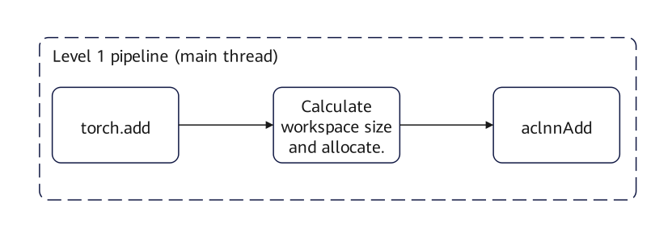
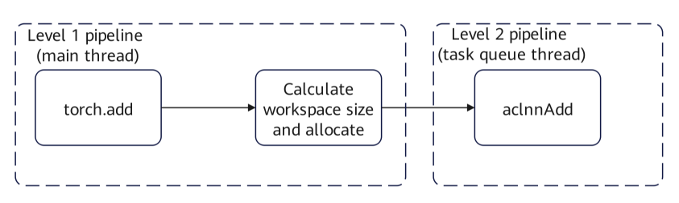
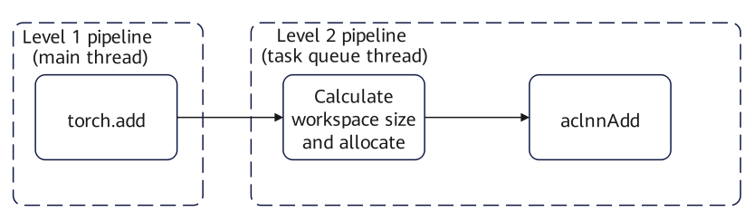

# TASK\_QUEUE\_ENABLE

## Function Description

This environment variable configures whether the `task_queue` operator dispatch queue is enabled and its optimization level.

- When set to `0`: The `task_queue` operator dispatch queue optimization is disabled. The operator dispatch tasks are shown in [Figure 1](#disabling-task-queue).

    **Figure 1**  Disabling task_queue <a id="disabling-task-queue"></a>    
    

- When set to `1` or not configured: Level 1 optimization of the `task_queue` operator dispatch queue is enabled. The operator dispatch tasks are shown in [Figure 2](#level-1-optimization).

    Level 1 optimization: The `task_queue` operator dispatch queue optimization is enabled, dividing operator dispatch tasks into two stages. A portion of the tasks (mainly the invocation of `aclnn` operators) is placed on the newly added second-level pipeline. The first-level and second-level pipelines transfer tasks through the operator queue and run in parallel with each other, reducing the overall dispatch latency through partial masking and improving end-to-end performance.

    **Figure 2**  Level 1 optimization <a id="level-1-optimization"></a>     
    

- When set to `2`: Level 2 optimization of the `task_queue` operator dispatch queue is enabled. The operator dispatch tasks are shown in [Figure 3](#level-2-optimization).

    Level 2 optimization: Includes the Level 1 optimization and further balances the task load between the first-level and second-level pipelines, mainly by migrating tasks related to `workspace` to the second-level pipeline, achieving better masking effects and greater performance gains. This configuration takes effect only in binary scenarios. You are advised to configure Level 2 optimization.

    **Figure 3**  Level 2 optimization <a id="level-2-optimization"></a>       
    

This environment variable is configured to `1` by default.

This environment variable is provided by TorchNPU. PyTorch does not have a directly corresponding environment variable.

## Configuration Example

```bash
export TASK_QUEUE_ENABLE=2
```

## Usage Constraints

- When [ASCEND\_LAUNCH\_BLOCKING](ASCEND_LAUNCH_BLOCKING.md) is set to `1`, the `task_queue` operator queue is disabled, and the `TASK_QUEUE_ENABLE` setting does not take effect.

- When `TASK_QUEUE_ENABLE` is set to `2`, the peak NPU memory usage during runtime may increase due to memory concurrency.

- After the task\_queue optimization is enabled, one device corresponds to one task\_queue by default. In multi-thread and multi-stream scenarios, tasks from multiple threads are dispatched serially through the same task\_queue. If there are cross-stream dependencies between tasks (for example, a task on streamA depends on a task on streamB), tasks could originally be dispatched in parallel across multiple threads and streams, and the dependency and the dependent task could be dispatched at the same time to release the dependency. After switching to a single queue, if the dependent task is enqueued first, the queue head is blocked because the dependency is not ready, and the dependency at the queue tail cannot be dispatched in advance, resulting in a deadlock. In this case, you need to ensure the order of task dispatch across threads to avoid dependency inversion.

## Supported Products

<!-- npu="910" id1 -->
- <term>Atlas training products</term>
<!-- end id1 -->
<!-- npu="910b" id2 -->
- <term>Atlas A2 training products</term>
<!-- end id2 -->
<!-- npu="A3" id3 -->
- <term>Atlas A3 training products</term>
<!-- end id3 -->
<!-- npu="910b" id6 -->
- <term>Atlas 800I A2</term>
<!-- end id6 -->
<!-- npu="310p" id4 -->
- <term>Atlas inference products</term>
<!-- end id4 -->
<!-- npu="950" id5 -->
- <term>Ascend 950DT products</term>
<!-- end id5 -->
