# Ascend PyTorch Profiler

## Tool Usage Navigation

Ascend PyTorch Profiler supports performance data profiling and parsing, and can be used in the following order.

| Procedure             | Corresponding Section                                                     |
| -------------------- | ------------------------------------------------------------ |
| Data Profiling             | You can choose any one of the following profiling methods based on actual requirements. Note that no more than two methods can be used for profiling in the same process.<br>[Profiling and Automatic Parsing](#profiling-and-automatic-parsing)<br>&#8226; [Profile and Parse Performance Data (torch\_npu.profiler.profile)](#profiling-and-parsing-performance-data-torch-npu-profiler-profile)<br>(Recommended) Provides complete profiling interfaces. You can freely select the content to profile by manually adding interfaces to the code.<br>&#8226; [Profile and Parse Performance Data (dynamic\_profile)](#profiling-and-parsing-performance-data-dynamic-profile)<br>(Recommended) Supports starting profiling at any time during training, and supports starting profiling without modifying user code, offering a more flexible profiling method. |
| (Optional) Extended Profiling Features | If you need to profile other data, you can use the following features.<br>[Extended Profiling Features](#extended-profiling-features)<br/>&#8226; [Profile and Parse mstx Data](#profiling-and-parsing-mstx-data)<br>&#8226; [Profile Environment Variable Information](#profiling-environment-variable-information)<br>&#8226; [Mark the Performance Data Profiling Process](#marking-the-performance-data-profiling-process)<br>&#8226; [Device Memory Visualization](#memory-visualization)<br>&#8226; [Create a Profiler Subthread for Profiling](#profiling-in-a-profiler-subthread) |
| (Optional) Data Parsing      | [Offline Parsing](#offline-parsing)<br>Generally, data profiling interfaces perform automatic parsing during profiling. Therefore, offline parsing is applicable to scenarios where unparsed raw performance data needs to be parsed. |
| Data Analysis             | After profiling and automatic parsing or offline parsing is completed, you can view the corresponding performance data files in the performance data directory. For details about the files, see [Output Result File Description](#output-result-files-description), or import the performance data into the [MindStudio Insight](https://gitcode.com/Ascend/msinsight/blob/master/docs/en/user_guide/overview.md) tool for analysis. |

## Introduction

Ascend PyTorch Profiler is a performance analysis tool developed for the PyTorch framework. By adding Ascend PyTorch Profiler to PyTorch training/online inference scripts, it collects performance data during training/online inference and directly outputs visualized performance data files after training/online inference is complete, improving the efficiency of performance analysis.

Ascend PyTorch Profiler can comprehensively profile performance data in PyTorch training/online inference scenarios, mainly including PyTorch-layer operator information, CANN-layer operator information, underlying NPU operator information, and operator memory usage information, enabling all-round analysis of the performance status during PyTorch training/online inference.

> [!NOTE]
>
> Ascend PyTorch Profiler is a Profiler tool developed specifically for the Ascend NPU environment. Its API naming and functions differ from the native interfaces. For specific usage, see this document. In addition, the Ascend NPU environment is also compatible with the native torch.profiler. To use the native interface, see [Profiling Performance Data in the Ascend NPU Environment Using the Native torch.profiler Interface](#profiling-performance-data-in-the-ascend-npu-environment-using-the-native-torchprofiler-interface).

## Before You Start

**Environment Preparation**

- Install the CANN Toolkit development kit or operator package of the matching version and configure environment variables. For details, see *[CANN Quick Installation](https://www.hiascend.com/en/cann/download)*.
- Prepare a training model developed based on PyTorch 2.1.0 or later and the matching dataset, and migrate the original PyTorch model to the Ascend AI processor according to the "[Model Migration](https://gitcode.com/Ascend/ModelZoo-PyTorch/blob/master/PyTorch/docs/en/model_migration/README.md)" section in the PyTorch Training Model Migration and Tuning Guide.

**Constraints**

Before using this tool, understand the related usage constraints:

- Permission constraints
    - You must ensure that the principle of least privilege is applied (for example, prohibit write permission for other users, such as forbidding file permissions to be set to 666 or 777).
    - Before using the performance analysis tool, ensure that the umask value of the executing user is greater than or equal to 0027; otherwise, the directory and file permissions of the collected performance data may be too broad.
    - For security and permission minimization purposes, this tool should not be used with high-privilege accounts such as root; it is recommended to run it with an ordinary user account.
    - This tool is a development and debugging tool and is not recommended for use in production environments.
    - This tool depends on CANN and the corresponding driver packages. Before using this tool, install CANN and the corresponding driver packages, and use the **source** command to run the set\_env.sh environment variable file of CANN. For security, do not modify the environment variables involved in set\_env.sh after sourcing it.
    - Ensure that performance data is saved in the current user directory that does not contain symbolic links; otherwise, security issues may arise.

- Execution constraints
    - It is not recommended to use the performance data profiling function and the Dump function at the same time. Dump operations affect system performance. If the profiling function and the Dump function are enabled at the same time, the collected performance data metrics will be inaccurate. Disable data Dump before starting profiling.
    - The Ascend PyTorch Profiler interface supports multiple profiling methods, and different profiling methods cannot be enabled at the same time.
    - Ensure that calls to the Ascend PyTorch Profiler interface and the business process to be collected are in the same process.
    - When the Ascend PyTorch Profiler interface performs profiling tasks, the relationship between processes and Devices is as follows:
        - Multi-process multi-Device scenario: A profiling process can be set for each Device.
        - Single-process multi-Device scenario: Supported. It must be used with PyTorch 2.1.0post14, 2.5.1post2, 2.6.0, and later versions.
        - Multi-process single-Device scenario: Ensure that profiling actions between multiple processes are serial, that is, profiling actions do not start at the same time, and each profiling action must include complete start and stop operations.

- Data writing constraints
    - Performance data occupies a certain amount of disk space, and there is a risk that the disk may become full, making the server unavailable. The space required for performance data is closely related to the model parameters, profiling switch configuration, and the number of collected iterations. You must ensure sufficient available disk space in the write directory.
    - It is recommended that performance data profiling last no more than 5 minutes, and that memory and disk space at least 20 times the size of the raw performance data be reserved. The raw data size refers to the total size of data in the data directory after profiling is written to disk.

## Quick Start

**Environment Preparation** <a name="environment-preparation"></a>

1. Prepare a training server based on the Ascend NPU.

2. Install the Ascend NPU driver and the CANN software of the matching version (including the Toolkit and ops packages) and configure environment variables. For details, see *[CANN Quick Installation](https://www.hiascend.com/en/cann/download)*.

3. Install the framework.

   Take the installation of PyTorch 2.9.0, Python 3.12, system architecture AArch64, and torchvision==0.24.0 as an example. For details, see *[TorchNPU Software Installation](https://gitcode.com/Ascend/pytorch/blob/master/docs/en/installation_guide/building_from_source.md)*.

   > [!note]
   >
   > It is recommended to use conda to set up the environment. Create a conda environment and install related dependencies by running the following commands, and then install PyTorch 2.9.0 according to the document at the above link:
   >
   > ```bash
   > conda create -n <conda_name>  python=3.12
   > conda activate <conda_name>
   > pip install torchvision==0.24.0
   > pip install decorator
   > pip install attrs
   > ```

**Performing Profiling**

1. In the Ascend NPU environment, create a training script (the pytorch_main.py file) and add the Ascend PyTorch Profiler interface tool. The complete code is as follows.

   <details>
   <summary><b>Click to expand the example</b></summary>

   ```python
   import argparse
   import os
   import random
   import shutil
   import time
   import warnings
   from enum import Enum

   import torch
   import torch.backends.cudnn as cudnn
   import torch.distributed as dist
   import torch.multiprocessing as mp
   import torch.nn as nn
   import torch.nn.parallel
   import torch.optim
   import torch.utils.data
   import torch.utils.data.distributed
   import torchvision.datasets as datasets
   import torchvision.models as models
   import torchvision.transforms as transforms
   from torch.optim.lr_scheduler import StepLR
   from torch.utils.data import Subset

   import torch_npu
   from torch_npu.contrib import transfer_to_npu

   model_names = sorted(name for name in models.__dict__
       if name.islower() and not name.startswith("__")
       and callable(models.__dict__[name]))

   parser = argparse.ArgumentParser(description='PyTorch ImageNet Training')
   parser.add_argument('data', metavar='DIR', nargs='?', default='imagenet',
                       help='path to dataset (default: imagenet)')
   parser.add_argument('-a', '--arch', metavar='ARCH', default='resnet18',
                       choices=model_names,
                       help='model architecture: ' +
                           ' | '.join(model_names) +
                           ' (default: resnet18)')
   parser.add_argument('-j', '--workers', default=4, type=int, metavar='N',
                       help='number of data loading workers (default: 4)')
   parser.add_argument('--epochs', default=90, type=int, metavar='N',
                       help='number of total epochs to run')
   parser.add_argument('--start-epoch', default=0, type=int, metavar='N',
                       help='manual epoch number (useful on restarts)')
   parser.add_argument('-b', '--batch-size', default=256, type=int,
                       metavar='N',
                       help='mini-batch size (default: 256), this is the total '
                            'batch size of all GPUs on the current node when '
                            'using Data Parallel or Distributed Data Parallel')
   parser.add_argument('--lr', '--learning-rate', default=0.1, type=float,
                       metavar='LR', help='initial learning rate', dest='lr')
   parser.add_argument('--momentum', default=0.9, type=float, metavar='M',
                       help='momentum')
   parser.add_argument('--wd', '--weight-decay', default=1e-4, type=float,
                       metavar='W', help='weight decay (default: 1e-4)',
                       dest='weight_decay')
   parser.add_argument('-p', '--print-freq', default=10, type=int,
                       metavar='N', help='print frequency (default: 10)')
   parser.add_argument('--resume', default='', type=str, metavar='PATH',
                       help='path to latest checkpoint (default: none)')
   parser.add_argument('-e', '--evaluate', dest='evaluate', action='store_true',
                       help='evaluate model on validation set')
   parser.add_argument('--pretrained', dest='pretrained', action='store_true',
                       help='use pre-trained model')
   parser.add_argument('--world-size', default=-1, type=int,
                       help='number of nodes for distributed training')
   parser.add_argument('--rank', default=-1, type=int,
                       help='node rank for distributed training')
   parser.add_argument('--dist-url', default='tcp://224.66.41.62:23456', type=str,
                       help='url used to set up distributed training')
   parser.add_argument('--dist-backend', default='nccl', type=str,
                       help='distributed backend')
   parser.add_argument('--seed', default=None, type=int,
                       help='seed for initializing training. ')
   parser.add_argument('--gpu', default=None, type=int,
                       help='GPU id to use.')
   parser.add_argument('--multiprocessing-distributed', action='store_true',
                       help='Use multi-processing distributed training to launch '
                            'N processes per node, which has N GPUs. This is the '
                            'fastest way to use PyTorch for either single node or '
                            'multi node data parallel training')
   parser.add_argument('--dummy', action='store_true', help="use fake data to benchmark")

   best_acc1 = 0

   def main():
       args = parser.parse_args()

       if args.seed is not None:
           random.seed(args.seed)
           torch.manual_seed(args.seed)
           cudnn.deterministic = True
           cudnn.benchmark = False
           warnings.warn('You have chosen to seed training. '
                         'This will turn on the CUDNN deterministic setting, '
                         'which can slow down your training considerably! '
                         'You may see unexpected behavior when restarting '
                         'from checkpoints.')

       if args.gpu is not None:
           warnings.warn('You have chosen a specific GPU. This will completely '
                         'disable data parallelism.')

       if args.dist_url == "env://" and args.world_size == -1:
           args.world_size = int(os.environ["WORLD_SIZE"])

       args.distributed = args.world_size > 1 or args.multiprocessing_distributed

       if torch.cuda.is_available():
           ngpus_per_node = torch.cuda.device_count()
           if ngpus_per_node == 1 and args.dist_backend == "nccl":
               warnings.warn("nccl backend >=2.5 requires GPU count>1, see https://github.com/NVIDIA/nccl/issues/103 perhaps use 'gloo'")
       else:
           ngpus_per_node = 1

       if args.multiprocessing_distributed:
           # Since we have ngpus_per_node processes per node, the total world_size
           # needs to be adjusted accordingly
           args.world_size = ngpus_per_node * args.world_size
           # Use torch.multiprocessing.spawn to launch distributed processes: the
           # main_worker process function
           mp.spawn(main_worker, nprocs=ngpus_per_node, args=(ngpus_per_node, args))
       else:
           # Simply call main_worker function
           main_worker(args.gpu, ngpus_per_node, args)

   def main_worker(gpu, ngpus_per_node, args):
       global best_acc1
       args.gpu = gpu

       if args.gpu is not None:
           print("Use GPU: {} for training".format(args.gpu))

       if args.distributed:
           if args.dist_url == "env://" and args.rank == -1:
               args.rank = int(os.environ["RANK"])
           if args.multiprocessing_distributed:
               # For multiprocessing distributed training, rank needs to be the
               # global rank among all the processes
               args.rank = args.rank * ngpus_per_node + gpu
           dist.init_process_group(backend=args.dist_backend, init_method=args.dist_url,
                                   world_size=args.world_size, rank=args.rank)
       # create model
       if args.pretrained:
           print("=> using pre-trained model '{}'".format(args.arch))
           model = models.__dict__[args.arch](pretrained=True)
       else:
           print("=> creating model '{}'".format(args.arch))
           model = models.__dict__[args.arch]()
       if not torch.cuda.is_available() and not torch.backends.mps.is_available():
           print('using CPU, this will be slow')
       elif args.distributed:
           # For multiprocessing distributed, DistributedDataParallel constructor
           # should always set the single device scope, otherwise,
           # DistributedDataParallel will use all available devices.
           if torch.cuda.is_available():
               if args.gpu is not None:
                   torch.cuda.set_device(args.gpu)
                   model.cuda(args.gpu)
                   # When using a single GPU per process and per
                   # DistributedDataParallel, we need to divide the batch size
                   # ourselves based on the total number of GPUs of the current node.
                   args.batch_size = int(args.batch_size / ngpus_per_node)
                   args.workers = int((args.workers + ngpus_per_node - 1) / ngpus_per_node)
                   model = torch.nn.parallel.DistributedDataParallel(model, device_ids=[args.gpu])
               else:
                   model.cuda()
                   # DistributedDataParallel will divide and allocate batch_size to all
                   # available GPUs if device_ids are not set
                   model = torch.nn.parallel.DistributedDataParallel(model)
       elif args.gpu is not None and torch.cuda.is_available():
           torch.cuda.set_device(args.gpu)
           model = model.cuda(args.gpu)
       elif torch.backends.mps.is_available():
           device = torch.device("mps")
           model = model.to(device)
       else:
           # DataParallel will divide and allocate batch_size to all available GPUs
           if args.arch.startswith('alexnet') or args.arch.startswith('vgg'):
               model.features = torch.nn.DataParallel(model.features)
               model.cuda()
           else:
               model = torch.nn.DataParallel(model).cuda()

       if torch.cuda.is_available():
           if args.gpu:
               device = torch.device('cuda:{}'.format(args.gpu))
           else:
               device = torch.device("cuda")
       elif torch.backends.mps.is_available():
           device = torch.device("mps")
       else:
           device = torch.device("cpu")
       # define loss function (criterion), optimizer, and learning rate scheduler
       criterion = nn.CrossEntropyLoss().to(device)

       optimizer = torch.optim.SGD(model.parameters(), args.lr,
                                   momentum=args.momentum,
                                   weight_decay=args.weight_decay)

       """Sets the learning rate to the initial LR decayed by 10 every 30 epochs"""
       scheduler = StepLR(optimizer, step_size=30, gamma=0.1)

       # optionally resume from a checkpoint
       if args.resume:
           if os.path.isfile(args.resume):
               print("=> loading checkpoint '{}'".format(args.resume))
               if args.gpu is None:
                   checkpoint = torch.load(args.resume)
               elif torch.cuda.is_available():
                   # Map model to be loaded to specified single gpu.
                   loc = 'cuda:{}'.format(args.gpu)
                   checkpoint = torch.load(args.resume, map_location=loc)
               args.start_epoch = checkpoint['epoch']
               best_acc1 = checkpoint['best_acc1']
               if args.gpu is not None:
                   # best_acc1 may be from a checkpoint from a different GPU
                   best_acc1 = best_acc1.to(args.gpu)
               model.load_state_dict(checkpoint['state_dict'])
               optimizer.load_state_dict(checkpoint['optimizer'])
               scheduler.load_state_dict(checkpoint['scheduler'])
               print("=> loaded checkpoint '{}' (epoch {})"
                     .format(args.resume, checkpoint['epoch']))
           else:
               print("=> no checkpoint found at '{}'".format(args.resume))

       # Data loading code
       if args.dummy:
           print("=> Dummy data is used!")
           train_dataset = datasets.FakeData(1281167, (3, 224, 224), 1000, transforms.ToTensor())
           val_dataset = datasets.FakeData(50000, (3, 224, 224), 1000, transforms.ToTensor())
       else:
           traindir = os.path.join(args.data, 'train')
           valdir = os.path.join(args.data, 'val')
           normalize = transforms.Normalize(mean=[0.485, 0.456, 0.406],
                                        std=[0.229, 0.224, 0.225])

           train_dataset = datasets.ImageFolder(
               traindir,
               transforms.Compose([
                   transforms.RandomResizedCrop(224),
                   transforms.RandomHorizontalFlip(),
                   transforms.ToTensor(),
                   normalize,
               ]))

           val_dataset = datasets.ImageFolder(
               valdir,
               transforms.Compose([
                   transforms.Resize(256),
                   transforms.CenterCrop(224),
                   transforms.ToTensor(),
                   normalize,
               ]))

       if args.distributed:
           train_sampler = torch.utils.data.distributed.DistributedSampler(train_dataset)
           val_sampler = torch.utils.data.distributed.DistributedSampler(val_dataset, shuffle=False, drop_last=True)
       else:
           train_sampler = None
           val_sampler = None

       train_loader = torch.utils.data.DataLoader(
           train_dataset, batch_size=args.batch_size, shuffle=(train_sampler is None),
           num_workers=args.workers, pin_memory=True, sampler=train_sampler)

       val_loader = torch.utils.data.DataLoader(
           val_dataset, batch_size=args.batch_size, shuffle=False,
           num_workers=args.workers, pin_memory=True, sampler=val_sampler)

       if args.evaluate:
           validate(val_loader, model, criterion, args)
           return

       for epoch in range(args.start_epoch, args.epochs):
           if args.distributed:
               train_sampler.set_epoch(epoch)

           # train for one epoch
           train(train_loader, model, criterion, optimizer, epoch, device, args)

           # evaluate on validation set
           acc1 = validate(val_loader, model, criterion, args)

           scheduler.step()

           # remember best acc@1 and save checkpoint
           is_best = acc1 > best_acc1
           best_acc1 = max(acc1, best_acc1)

           if not args.multiprocessing_distributed or (args.multiprocessing_distributed
                   and args.rank % ngpus_per_node == 0):
               save_checkpoint({
                   'epoch': epoch + 1,
                   'arch': args.arch,
                   'state_dict': model.state_dict(),
                   'best_acc1': best_acc1,
                   'optimizer' : optimizer.state_dict(),
                   'scheduler' : scheduler.state_dict()
               }, is_best)

   def train(train_loader, model, criterion, optimizer, epoch, device, args):
       batch_time = AverageMeter('Time', ':6.3f')
       data_time = AverageMeter('Data', ':6.3f')
       losses = AverageMeter('Loss', ':.4e')
       top1 = AverageMeter('Acc@1', ':6.2f')
       top5 = AverageMeter('Acc@5', ':6.2f')
       progress = ProgressMeter(
           len(train_loader),
           [batch_time, data_time, losses, top1, top5],
           prefix="Epoch: [{}]".format(epoch))

       # switch to train mode
       model.train()

       end = time.time()
       experimental_config = torch_npu.profiler._ExperimentalConfig(
           profiler_level=torch_npu.profiler.ProfilerLevel.Level0,
           data_simplification=False)
       with torch_npu.profiler.profile(
           activities=[
               torch_npu.profiler.ProfilerActivity.CPU,
               torch_npu.profiler.ProfilerActivity.NPU
               ],
           schedule=torch_npu.profiler.schedule(wait=0, warmup=0, active=1, repeat=1, skip_first=1),
           on_trace_ready=torch_npu.profiler.tensorboard_trace_handler("./profiling_data"),
           experimental_config=experimental_config) as prof:
           for i, (images, target) in enumerate(train_loader):
               # measure data loading time
               data_time.update(time.time() - end)

               # move data to the same device as model
               images = images.to(device, non_blocking=True)
               target = target.to(device, non_blocking=True)

               # compute output
               output = model(images)
               loss = criterion(output, target)

               # measure accuracy and record loss
               acc1, acc5 = accuracy(output, target, topk=(1, 5))
               losses.update(loss.item(), images.size(0))
               top1.update(acc1[0], images.size(0))
               top5.update(acc5[0], images.size(0))

               # compute gradient and do SGD step
               optimizer.zero_grad()
               loss.backward()
               optimizer.step()

               # measure elapsed time
               batch_time.update(time.time() - end)
               end = time.time()

               prof.step()

               if i % args.print_freq == 0:
                   progress.display(i + 1)

   def validate(val_loader, model, criterion, args):

       def run_validate(loader, base_progress=0):
           with torch.no_grad():
               end = time.time()
               for i, (images, target) in enumerate(loader):
                   i = base_progress + i
                   if args.gpu is not None and torch.cuda.is_available():
                       images = images.cuda(args.gpu, non_blocking=True)
                   if torch.backends.mps.is_available():
                       images = images.to('mps')
                       target = target.to('mps')
                   if torch.cuda.is_available():
                       target = target.cuda(args.gpu, non_blocking=True)

                   # compute output
                   output = model(images)
                   loss = criterion(output, target)

                   # measure accuracy and record loss
                   acc1, acc5 = accuracy(output, target, topk=(1, 5))
                   losses.update(loss.item(), images.size(0))
                   top1.update(acc1[0], images.size(0))
                   top5.update(acc5[0], images.size(0))

                   # measure elapsed time
                   batch_time.update(time.time() - end)
                   end = time.time()

                   if i % args.print_freq == 0:
                       progress.display(i + 1)

       batch_time = AverageMeter('Time', ':6.3f', Summary.NONE)
       losses = AverageMeter('Loss', ':.4e', Summary.NONE)
       top1 = AverageMeter('Acc@1', ':6.2f', Summary.AVERAGE)
       top5 = AverageMeter('Acc@5', ':6.2f', Summary.AVERAGE)
       progress = ProgressMeter(
           len(val_loader) + (args.distributed and (len(val_loader.sampler) * args.world_size < len(val_loader.dataset))),
           [batch_time, losses, top1, top5],
           prefix='Test: ')

       # switch to evaluate mode
       model.eval()

       run_validate(val_loader)
       if args.distributed:
           top1.all_reduce()
           top5.all_reduce()

       if args.distributed and (len(val_loader.sampler) * args.world_size < len(val_loader.dataset)):
           aux_val_dataset = Subset(val_loader.dataset,
                                    range(len(val_loader.sampler) * args.world_size, len(val_loader.dataset)))
           aux_val_loader = torch.utils.data.DataLoader(
               aux_val_dataset, batch_size=args.batch_size, shuffle=False,
               num_workers=args.workers, pin_memory=True)
           run_validate(aux_val_loader, len(val_loader))

       progress.display_summary()

       return top1.avg

   def save_checkpoint(state, is_best, filename='checkpoint.pth.tar'):
       torch.save(state, filename)
       if is_best:
           shutil.copyfile(filename, 'model_best.pth.tar')

   class Summary(Enum):
       NONE = 0
       AVERAGE = 1
       SUM = 2
       COUNT = 3

   class AverageMeter(object):
       """Computes and stores the average and current value"""
       def __init__(self, name, fmt=':f', summary_type=Summary.AVERAGE):
           self.name = name
           self.fmt = fmt
           self.summary_type = summary_type
           self.reset()

       def reset(self):
           self.val = 0
           self.avg = 0
           self.sum = 0
           self.count = 0

       def update(self, val, n=1):
           self.val = val
           self.sum += val * n
           self.count += n
           self.avg = self.sum / self.count

       def all_reduce(self):
           if torch.cuda.is_available():
               device = torch.device("cuda")
           elif torch.backends.mps.is_available():
               device = torch.device("mps")
           else:
               device = torch.device("cpu")
           total = torch.tensor([self.sum, self.count], dtype=torch.float32, device=device)
           dist.all_reduce(total, dist.ReduceOp.SUM, async_op=False)
           self.sum, self.count = total.tolist()
           self.avg = self.sum / self.count

       def __str__(self):
           fmtstr = '{name} {val' + self.fmt + '} ({avg' + self.fmt + '})'
           return fmtstr.format(**self.__dict__)

       def summary(self):
           fmtstr = ''
           if self.summary_type is Summary.NONE:
               fmtstr = ''
           elif self.summary_type is Summary.AVERAGE:
               fmtstr = '{name} {avg:.3f}'
           elif self.summary_type is Summary.SUM:
               fmtstr = '{name} {sum:.3f}'
           elif self.summary_type is Summary.COUNT:
               fmtstr = '{name} {count:.3f}'
           else:
               raise ValueError('invalid summary type %r' % self.summary_type)

           return fmtstr.format(**self.__dict__)

   class ProgressMeter(object):
       def __init__(self, num_batches, meters, prefix=""):
           self.batch_fmtstr = self._get_batch_fmtstr(num_batches)
           self.meters = meters
           self.prefix = prefix

       def display(self, batch):
           entries = [self.prefix + self.batch_fmtstr.format(batch)]
           entries += [str(meter) for meter in self.meters]
           print('\t'.join(entries))

       def display_summary(self):
           entries = [" *"]
           entries += [meter.summary() for meter in self.meters]
           print(' '.join(entries))

       def _get_batch_fmtstr(self, num_batches):
           num_digits = len(str(num_batches // 1))
           fmt = '{:' + str(num_digits) + 'd}'
           return '[' + fmt + '/' + fmt.format(num_batches) + ']'

   def accuracy(output, target, topk=(1,)):
       """Computes the accuracy over the k top predictions for the specified values of k"""
       with torch.no_grad():
           maxk = max(topk)
           batch_size = target.size(0)

           _, pred = output.topk(maxk, 1, True, True)
           pred = pred.t()
           correct = pred.eq(target.view(1, -1).expand_as(pred))

           res = []
           for k in topk:
               correct_k = correct[:k].reshape(-1).float().sum(0, keepdim=True)
               res.append(correct_k.mul_(100.0 / batch_size))
           return res

   if __name__ == '__main__':
       main()
   ```

   </details><br>

   > [!NOTE]
   >
   > Performance data occupies a certain amount of disk space, and there is a risk that the disk may become full, making the server unavailable. The space required for performance data is closely related to the model parameters, profiling switch configuration, and the number of collected iterations. You must ensure sufficient available disk space in the write directory.

2. Run the training script command. The tool collects performance data during model training.

   ```bash
   python pytorch_main.py -a resnet50 -b 32 --gpu 1 --dummy
   ```

3. View the collected PyTorch training performance data result files.

   After training ends, a performance data result directory of the Ascend PyTorch Profiler interface is generated in the directory specified by the **torch_npu.profiler.tensorboard_trace_handler** interface, as shown in the following example.

   ```ColdFusion
   └── msprof_1784298_20260114085947065_ascend_pt
   ├── ASCEND_PROFILER_OUTPUT
   │   ├── analysis.db
   │   ├── ascend_pytorch_profiler.db
   │   ├── kernel_details.csv
   │   ├── operator_details.csv
   │   ├── step_trace_time.csv
   │   └── trace_view.json
   ├── FRAMEWORK
   ├── logs
   ├── PROF_000001_20260114085947066_FLRBJLNFMBIDRPMB
   │   ├── device_1
   │   │   ├── data
   ...
   │   ├── host
   │   │   ├── data
   ...
   │   ├── mindstudio_profiler_log
   ...
   │   └── mindstudio_profiler_output
   │       ├── api_statistic_20260114085954.csv
   │       ├── msprof_20260114085953.json
   │       ├── op_summary_20260114085954.csv
   │       ├── README.txt
   │       └── task_time_20260114085954.csv
   ├── profiler_info.json
   └── profiler_metadata.json
   ```

## Profiling and Automatic Parsing <a id="profiling-and-automatic-parsing"></a>

### Profile and Parse Performance Data (torch_npu.profiler.profile) <a id="profiling-and-parsing-performance-data-torch-npu-profiler-profile"></a>

**Feature Description**

Use the torch\_npu.profiler.profile series of interfaces to profile and parse performance data.

**Precautions**

None

**Usage Example**

1. Add the following sample code to the training script (such as the train\_\*.py file) or online inference script to configure performance data profiling parameters, and then start training/online inference.

    > [!NOTE]
    >
    > - For detailed descriptions of the torch\_npu.profiler.profile interface and parameters in the following sample code, see [Ascend PyTorch Profiler Interface Description](#ascend-pytorch-profiler-interface-description).
    > - The following provides two sample codes that call the **torch\_npu.profiler.profile** interface in different ways. You can use either one.

    - Example 1: Use the with statement to call the torch\_npu.profiler.profile interface, which automatically creates a Profiler and collects performance data of the code segment within the with block.

        ```python
        import torch
        import torch_npu

        ...

        # Add the Profiling profiling extension configuration parameters. For detailed parameter introduction, see the parameter description below.
        experimental_config = torch_npu.profiler._ExperimentalConfig(
            export_type=torch_npu.profiler.ExportType.Text,
            profiler_level=torch_npu.profiler.ProfilerLevel.Level0,
            aic_metrics=torch_npu.profiler.AiCMetrics.AiCoreNone
        )

        # Add the Profiling profiling basic configuration parameters. For detailed parameter introduction, see the parameter description below.
        with torch_npu.profiler.profile(
            activities=[
                torch_npu.profiler.ProfilerActivity.CPU,
                torch_npu.profiler.ProfilerActivity.NPU
                ],
            schedule=torch_npu.profiler.schedule(wait=0, warmup=0, active=1, repeat=1, skip_first=0, skip_first_wait=0),    # Used in conjunction with prof.step().
            on_trace_ready=torch_npu.profiler.tensorboard_trace_handler("./result"),
            profile_memory=False,
            with_modules=False,
            experimental_config=experimental_config) as prof:

            # Start profiling.
            for step in range(steps):    # Training function.
                train_one_step()    # Training function.
                prof.step()    # Used in conjunction with schedule.
        ```

    - Example 2: Create a torch\_npu.profiler.profile object and control performance data profiling through the start and stop interfaces. You can customize the location where profiling starts.

        ```python
        import torch
        import torch_npu
        ...

        # Add the Profiling profiling extension configuration parameters. For detailed parameter introduction, see the parameter description below.
        experimental_config = torch_npu.profiler._ExperimentalConfig(
            export_type=torch_npu.profiler.ExportType.Text,
            profiler_level=torch_npu.profiler.ProfilerLevel.Level0,
            aic_metrics=torch_npu.profiler.AiCMetrics.AiCoreNone
        )

        # Add the Profiling profiling basic configuration parameters. For detailed parameter introduction, see the parameter description below.
        prof = torch_npu.profiler.profile(
            activities=[
                torch_npu.profiler.ProfilerActivity.CPU,
                torch_npu.profiler.ProfilerActivity.NPU
                ],
            schedule=torch_npu.profiler.schedule(wait=0, warmup=0, active=1, repeat=1, skip_first=0, skip_first_wait=0),
            on_trace_ready=torch_npu.profiler.tensorboard_trace_handler("./result"),
            profile_memory=False,
            with_modules=False,
            experimental_config=experimental_config)

        prof.start()    # Start profiling.
        for step in range(steps):    # Training function.
            train_one_step()    # Training function.
            prof.step()    # Used in conjunction with schedule.
        prof.stop()    # Stop profiling.
        ```

    The above two examples mainly use the tensorboard\_trace\_handler to export performance data. You can also use the following prof.export\_chrome\_trace method to export a single performance data file "chrome\_trace\_\{pid\}.json". Because the performance data exported by tensorboard\_trace\_handler includes the performance data exported by prof.export\_chrome\_trace, you can choose either method based on actual requirements.

    ```python
    import torch
    import torch_npu
    import os

    ...

    with torch_npu.profiler.profile() as prof:

        # Start profiling.
        for step in range(steps):    # Training function.
            train_one_step()    # Training function.
    prof.export_chrome_trace(f'./chrome_trace_{os.getpid()}.json')    # Specify the export path of the chrome_trace_{pid}.json file.
    ```

2. Parse the performance data.

    Supports automatic parsing (refer to the **tensorboard\_trace\_handler** and **prof.export\_chrome\_trace** in the above sample code) and [Offline Parsing](#offline-parsing).

3. View the performance data result files and analyze the performance data.

    For detailed descriptions of the performance data result files, see [Output Result File Description](#output-result-files-description).

    See *[MindStudio Insight System Tuning](https://gitcode.com/Ascend/msinsight/blob/master/docs/en/user_guide/system_tuning.md)* to visualize and analyze the parsed performance data files.

    You can use the [Performance Analysis Tool (msprof-analyze)](https://gitcode.com/Ascend/msprof-analyze/blob/master/docs/en/quick_start/msprof-analyze_quick_start.md) to assist in analyzing performance data.

### Profile and Parse Performance Data (dynamic\_profile) <a id="profiling-and-parsing-performance-data-dynamic-profile"></a>

**Feature Description**

dynamic\_profile enables dynamic profiling. Its main function is to allow the profiling process to be started at any time during model training/online inference.

The interfaces related to dynamic profiling include:

- torch_npu.profiler.dynamic_profile.init
- torch_npu.profiler.dynamic_profile.step
- torch_npu.profiler.dynamic_profile.start
- torch_npu-profiler.dynamic_profile.set_state

For details, see *[torch_npu.profiler Interface List](https://gitcode.com/Ascend/op-plugin/blob/master/docs/en/custom_APIs/torch_npu-profiler/torch_npu-profiler_list.md)*.

**Table 1**  Description of dynamic profiling methods

| Dynamic Profiling Method                                  | Description                                                 |
| ------------------------------------------------------------ | ------------------------------------------------------------ |
| [Environment Variable Method](#environment-variable-method)               | Supported only in training scenarios. Profiling configuration is controlled by modifying the configuration file profiler_config.json, without modifying user code. |
| [Modifying the user training/online inference script to add the dynamic_profile interface](#adding-dynamic-profile-interface-method) | Supported in training/online inference scenarios. The start of Profiling is controlled by modifying the configuration file profiler_config.json, and the dynamic_profile interface needs to be added to the user script in advance. |
| [Modifying the user training/online inference script to add the dp.start() function of dynamic_profile](#adding-dp-start-function-of-dynamic-profile-method) | Supported in training/online inference scenarios. The start of Profiling is controlled by adding the dp.start() interface to the user script in advance. You can customize the position where the dp.start() interface is added, which is suitable when the profiling scope needs to be narrowed. |

> [!NOTE]
>
> Only one of the above methods can be used. Do not enable dynamic\_profile with two or more methods at the same time.

**Usage Example (Environment Variable Method)** <a name="environment-variable-method"></a>

1. Configure the following environment variables.

   ```bash
   export PROF_CONFIG_PATH="/path/to/profiler_config_path"
   ```

   After configuring this environment variable and starting training, dynamic\_profile automatically creates the template file profiler\_config.json in profiler\_config\_path. You can customize the configuration items based on the template file.

   > [!NOTE]
   >
   > - This method is supported only in training scenarios.
   > - In this method, dynamic\_profile does not support profiling data of the first iteration (step0).
   > - This method relies on the native torch Optimizer.step\(\) to divide the Profiling steps during training and does not support custom Optimizer scenarios.
   > - The path specified by PROF\_CONFIG\_PATH can be customized (read and write permissions are required). The path format only supports strings consisting of letters, digits, and underscores, and does not support symbolic links, for example, "/home/xxx/profiler\_config\_path".

2. Start the training task.
3. Open a new command line window and modify the profiler\_config.json configuration file to enable the Profiling task.

   The configuration file contains the performance data profiling parameters of Profiler. You can refer to [profiler\_config.json File Description](#profiler-config-json-file-description) to modify the configuration file parameters to perform different Profiling tasks.

   > [!NOTE]
   >
   > - dynamic\_profile determines whether the file has been modified by checking the status of the profiler\_config.json file:
   > - dynamic\_profile polls every 2s. If a change to the profiler\_config.json file is detected, the profiling process is started. After that, the running interval between adjacent steps is recorded and used as the new polling interval, with a minimum value of 1s.
   > - If the profiler\_config.json file is modified while dynamic\_profile profiling is in progress, the dynamic\_profile profiling of the last file modification is started again after the profiling process ends.
   > - It is recommended to use shared storage for the profiler\_config\_path of dynamic\_profile.
   > - The maintenance logs of dynamic\_profile are automatically recorded in the profiler\_config\_path directory. For details, see [Introduction to the Maintenance Logs of dynamic\_profile Dynamic Profiling](#dynamic-profile-profiling-maintenance-log-introduction).
   > - The value of the start\_step parameter must be greater than the training/online inference step that has been executed and must not exceed the maximum step. For example, if the total number of steps is 10 and step3 has been executed, start\_step can only be configured between 3\~10. Note that because the training/online inference task continues to run during configuration, configure a value greater than step3.

4. Parse the performance data.

    Both automatic parsing and manual parsing are supported. See the analyse parameter in [Table 1](#profiler-config-parameters-description).

5. View the performance data result files and analyze the performance data.

    For detailed descriptions of the performance data result files, see [Output Result File Description](#output-result-files-description).

    See *[MindStudio Insight System Tuning](https://gitcode.com/Ascend/msinsight/blob/master/docs/en/user_guide/system_tuning.md)* to visualize and analyze the parsed performance data files.

    You can use the [Performance Analysis Tool (msprof-analyze)](https://gitcode.com/Ascend/msprof-analyze/blob/master/docs/en/quick_start/msprof-analyze_quick_start.md) to assist in analyzing performance data.

**Usage Example (Adding the dynamic_profile Interface to the User Training/Online Inference Script)** <a name="adding-dynamic-profile-interface-method"></a>

1. Add the following sample code to the training script (such as the train\_\*.py file) or online inference script.

    ```python
    # Load the dynamic_profile module.
    from torch_npu.profiler import dynamic_profile as dp
    # Set the path of the Profiling configuration file.
    dp.init("profiler_config_path")
    ...
    for step in steps:
        train_one_step()
        # Divide steps.
        dp.step()
    ```

    During **init**, `dynamic_profile` automatically creates the template file `profiler_config.json` in `profiler_config_path`. You can customize the configuration items based on the template file.

    The `profiler_config_path` path format only supports strings consisting of letters, digits, and underscores, and does not support symbolic links.

2. Start the training/online inference task.
3. Open a new command line window and modify the profiler\_config.json configuration file to enable the Profiling task.

   The configuration file contains the performance data profiling parameters of Profiler. You can refer to [profiler\_config.json File Description](#profiler-config-json-file-description) to modify the configuration file parameters to perform different Profiling tasks.

   > [!NOTE]
   >
   > - dynamic\_profile determines whether the file has been modified by checking the status of the profiler\_config.json file:
   > - dynamic\_profile polls every 2s. If a change to the profiler\_config.json file is detected, the profiling process is started. After that, the running interval between adjacent steps is recorded and used as the new polling interval, with a minimum value of 1s.
   > - If the profiler\_config.json file is modified while dynamic\_profile profiling is in progress, the dynamic\_profile profiling of the last file modification is started again after the profiling process ends.
   > - It is recommended to use shared storage for the profiler\_config\_path of dynamic\_profile.
   > - The maintenance logs of dynamic\_profile are automatically recorded in the profiler\_config\_path directory. For details, see [Introduction to the Maintenance Logs of dynamic\_profile Dynamic Profiling](#dynamic-profile-profiling-maintenance-log-introduction).
   > - The value of the start\_step parameter must be greater than the training/online inference step that has been executed and must not exceed the maximum step. For example, if the total number of steps is 10 and step3 has been executed, start\_step can only be configured between 3\~10. Note that because the training/online inference task continues to run during configuration, configure a value greater than step3.

4. Both automatic parsing and manual parsing are supported. See the analyse parameter in [Table 1](#profiler-config-parameters-description).
5. View the performance data result files and analyze the performance data.

    For detailed descriptions of the performance data result files, see [Output Result File Description](#output-result-files-description).

    See *[MindStudio Insight System Tuning](https://gitcode.com/Ascend/msinsight/blob/master/docs/en/user_guide/system_tuning.md)* to visualize and analyze the parsed performance data files.

    You can use the [Performance Analysis Tool (msprof-analyze)](https://gitcode.com/Ascend/msprof-analyze/blob/master/docs/en/quick_start/msprof-analyze_quick_start.md) to assist in analyzing performance data.

**Usage Example (Adding the dp.start() Function of dynamic_profile to the User Training/Online Inference Script)** <a name="adding-dp-start-function-of-dynamic-profile-method"></a>

1. Add the following sample code to the training script (such as the train_*.py file) or online inference script.

   ```python
   # Load the dynamic_profile module.
   from torch_npu.profiler import dynamic_profile as dp
   # Set the Profiling configuration file path of the init interface.
   dp.init("profiler_config_path")
   ...
   for step in steps:
       if step==5:
           # Set the Profiling configuration file path of the start interface.
           dp.start("start_config_path")
       train_one_step()
       # Divide steps. Code that needs profiling must be between the dp.start() and dp.step() interfaces.
       dp.step()
   ```

   start\_config\_path is also specified as profiler\_config.json, but you need to manually create the configuration file according to [profiler_config.json File Description](#profiler-config-json-file-description) and configure parameters as required by the scenario. A specific file name must be specified here, for example, `dp.start("/home/xx/start_config_path/profiler_config.json")`.

   The path formats of profiler\_config\_path and start\_config\_path only support strings consisting of letters, digits, and underscores, and do not support symbolic links.

   > [!NOTE]
   >
   > - After `dp.start()` is added, when the training/online inference task reaches `dp.start()`, profiling is automatically performed according to the profiler\_config.json file specified by start\_config\_path. The `dp.start()` function does not detect modifications to the profiler\_config.json file and only triggers one profiling task during training/online inference.
   > - After adding `dp.start()` and starting training/online inference:
   > - If `dp.start()` does not specify the profiler\_config.json configuration file, or the configuration file does not take effect due to an error, profiling is performed according to the profiler\_config.json file configuration in the profiler\_config\_path directory after `dp.start()` is reached.
   > - If the script reaches `dp.start()` while the dynamic\_profile configured by `dp.init()` is in effect, `dp.start()` does not take effect.
   > - If the script reaches `dp.start()` after the dynamic\_profile profiling configured by `dp.init()` ends, the `dp.start()` profiling is executed, and a new performance data file directory is generated in the prof\_dir directory.
   > - If the profiler\_config.json file in the profiler\_config\_path directory is modified while the dynamic\_profile configured by `dp.start()` is in effect, `dp.init()` starts after the `dp.start()` profiling is completed and generates a new performance data file directory in the prof\_dir directory.
   > - It is recommended to use shared storage for the profiler\_config_path of dynamic\_profile.
   > - The value of the start\_step parameter must be greater than the training/online inference step that has been executed and must not exceed the maximum step. For example, if the total number of steps is 10 and step3 has been executed, start\_step can only be configured between 3~10. Note that because the training/online inference task continues to run during configuration, configure a value greater than step3.

2. Start the training/online inference task.
3. Parse the performance data.

    Both automatic parsing and manual parsing are supported. See the analyse parameter in [Table 1](#profiler-config-parameters-description).

4. View the performance data result files and analyze the performance data.

    For detailed descriptions of the performance data result files, see [Output Result File Description](#output-result-files-description).

    See *[MindStudio Insight System Tuning](https://gitcode.com/Ascend/msinsight/blob/master/docs/en/user_guide/system_tuning.md)* to visualize and analyze the parsed performance data files.

    You can use the [Performance Analysis Tool (msprof-analyze)](https://gitcode.com/Ascend/msprof-analyze/blob/master/docs/en/quick_start/msprof-analyze_quick_start.md) to assist in analyzing performance data.

## Extended Profiling Features <a id="extended-profiling-features"></a>

### Profile and Parse mstx Data <a id="profiling-and-parsing-mstx-data"></a>

**Feature Description**

To address the issues of large data volume and complex analysis processes in traditional Profiling for large-scale cluster scenarios, mstx enables the custom instrumentation function. You can customize the profiling time period or the start and end time points of key functions to identify key functions, iterations, and other information, quickly locating performance problems.

The usage process is as follows:

1. Add the Ascend PyTorch Profiler interface to the PyTorch script and enable the custom instrumentation function through the `mstx` parameter of [experimental\_config](#experimental-parameters-description).
2. (Optional) Set the profiler\_level switch to Level\_none (you can configure the corresponding level based on actual profiling requirements) together with the domain filtering attributes of mstx\_domain\_include or mstx\_domain\_exclude to profile instrumentation data.
3. In the PyTorch script, call the [torch\_npu.npu.mstx](https://gitcode.com/Ascend/op-plugin/blob/master/docs/en/custom_APIs/torch_npu-npu/torch_npu-npu_list.md) series of interfaces for the events you want to profile, to profile the duration of the corresponding events.

**Precautions**

If the user code only involves pure CPU-side operations, there is no need to pass the stream parameter when calling the [torch\_npu.npu.mstx](https://gitcode.com/Ascend/op-plugin/blob/master/docs/en/custom_APIs/torch_npu-npu/torch_npu-npu_list.md) series of interfaces. If the user code contains device operations and the device-side duration needs to be observed, the stream parameter must be passed.

**Usage Example**

- Record only the Host-side range duration (thread-level):

  ```python
  torch_npu.npu.mstx.range_push("dataloader", None)    # Set the second input parameter to None or leave it unset, and only the range duration on the host side is recorded.
  dataloader()
  torch_npu.npu.mstx.range_pop()
  ```

- Instrument on the computation stream to record the Host-side range duration and the corresponding Device-side range duration (thread-level):

  ```python
  stream = torch_npu.npu.current_stream()
  torch_npu.npu.mstx.range_push("matmul", stream)    # Set the second input parameter to a valid stream to record the range duration on the host side and the corresponding range duration on the device side.
  torch.matmul()    # Illustration of a compute stream operation.
  torch_npu.npu.mstx.range_pop()
  ```

- Record only the Host-side range duration (process-level):

  ```python
  id = torch_npu.npu.mstx.range_start("dataloader", None)    # Set the second input parameter to None or leave it unset, and only the range duration on the host side is recorded.
  dataloader()
  torch_npu.npu.mstx.range_end(id)
  ```

- Instrument on the computation stream to record the Host-side range duration and the corresponding Device-side range duration (process-level):

  ```python
  stream = torch_npu.npu.current_stream()
  id = torch_npu.npu.mstx.range_start("matmul", stream)    # Set the second input parameter to a valid stream to record the range duration on the host side and the corresponding range duration on the device side.
  torch.matmul()    # Illustration of a compute stream operation.
  torch_npu.npu.mstx.range_end(id)
  ```

- Customize instrumentation for selected APIs or functions (called with the with statement):

  ```python
  with torch_npu.npu.mstx.annotate('my_code_range', cur_stream):
      time.sleep(1)
  ```

- Customize instrumentation for selected APIs or functions (called with a decorator):

  ```python
  @torch_npu.npu.mstx.annotate()
  def sleep_one():
      print("sleep start")
      time.sleep(1)
      print("sleep end")
  ```

- Instrument on the collective communication stream:

  ```python
  from torch.distributed.distributed_c10d import _world

  if (torch.__version__ != '1.11.0') :
      stream_id = _world.default_pg._get_backend(torch.device('npu'))._get_stream_id(False)
      collective_stream = torch.npu.Stream(stream_id=stream_id, device_type=20, device_index=device_id)    # Set device_index to the device_id value of the actual service.
  else:
      stream_id = _world.default_pg._get_stream_id(False)
      current_stream = torch.npu.current_stream()
      cdata = current_stream._cdata & 0xffff000000000000
      collective_stream = torch.npu.Stream(_cdata=( stream_id + cdata), device_index=device_id)    # Set device_index to the device_id value of the actual service.
  id = torch_npu.npu.mstx.range_start("allreduce", collective_stream)    # Set the second input parameter to a valid stream to record the range duration on the host side and the corresponding range duration on the device side.
  torch.allreduce()    # Illustration of a collective communication stream operation.
  torch_npu.npu.mstx.range_end(id)
  ```

- Instrument on the P2P communication stream:

  ```python
  from torch.distributed.distributed_c10d import _world

  if (torch.__version__ != '1.11.0') :
      stream_id = _world.default_pg._get_backend(torch.device('npu'))._get_stream_id(True)
      p2p_stream = torch.npu.Stream(stream_id=stream_id, device_type=20, device_index=device_id)    # Set device_index to the device_id value of the actual service.
  else:
      stream_id = _world.default_pg._get_stream_id(True)
      current_stream = torch.npu.current_stream()
      cdata = current_stream._cdata & 0xffff000000000000
      p2p_stream = torch.npu.Stream(_cdata=( stream_id + cdata), device_index=device_id)    # Set device_index to the device_id value of the actual service.
  id = torch_npu.npu.mstx.range_start("send", p2p_stream)    # Set the second input parameter to a valid stream to record the range duration on the host side and the corresponding range duration on the device side.
  torch.send()
  torch_npu.npu.mstx.range_end(id)
  ```

- To profile the data in the above scenarios, you need to configure the torch\_npu.profiler.profile interface and enable the mstx switch. See the following example:

  ```python
  import torch
  import torch_npu

  experimental_config = torch_npu.profiler._ExperimentalConfig(
      profiler_level=torch_npu.profiler.ProfilerLevel.Level_none,
      mstx=True,    # The original parameter name msprof_tx is changed to mstx, and the new version is still compatible with the original parameter name msprof_tx.
      export_type=[
          torch_npu.profiler.ExportType.Db
          ])
  with torch_npu.profiler.profile(
      schedule=torch_npu.profiler.schedule(wait=0, warmup=0, active=1, repeat=1, skip_first=0, skip_first_wait=0),
      on_trace_ready=torch_npu.profiler.tensorboard_trace_handler("./result"),
      experimental_config=experimental_config) as prof:

      for step in range(steps):
          train_one_step()    # User code, including calls to the mstx interface.
          prof.step()
  ```

- Profile data based on the domain:

  ```python
  import torch
  import torch_npu
  import time
  experimental_config = torch_npu.profiler._ExperimentalConfig(
      data_simplification=False,
      # Enable mstx and set the domain filtering attribute of mstx_domain_include or mstx_domain_exclude.
      mstx=True,
      mstx_domain_include=['default','domain1']    # Configure the profiling of trace data of 'default' and 'domain1'.
      # mstx_domain_exclude=['domain2']    # Configure not to profile the trace data of 'domain2'. Do not configure it together with mstx_domain_include.
  )
  with torch_npu.profiler.profile(
      activities=[torch_npu.profiler.ProfilerActivity.CPU, torch_npu.profiler.ProfilerActivity.NPU],
      schedule=torch_npu.profiler.schedule(wait=0, warmup=0, active=1, repeat=1, skip_first=0, skip_first_wait=0),
      on_trace_ready=torch_npu.profiler.tensorboard_trace_handler("./result"),
      experimental_config=experimental_config) as prof:
      for i in range(5):
          # Mark the mstx trace point of the default domain.
          torch_npu.npu.mstx.mark("mark_with_default_domain")
          range_id = torch_npu.npu.mstx.range_start("range_with_default_domain")
          time.sleep(1)    # Simulate user code.
          torch_npu.npu.mstx.range_end(range_id)
          ...    # User code.
          # Mark the mstx trace point of the user-defined domain1.
          torch_npu.npu.mstx.mark("mark_with_domain1", domain = "domain1")
          range_id1 = torch_npu.npu.mstx.range_start("range_with_domain1", domain="domain1")
          time.sleep(1)    # Simulate user code.
          torch_npu.npu.mstx.range_end(range_id1, domain="domain1")
          ...    # User code.
          # Mark the mstx trace point of the user-defined domain2.
          torch_npu.npu.mstx.mark("mark_with_domain2", domain = "domain2")
          range_id2 = torch_npu.npu.mstx.range_start("range_with_domain2", domain="domain2")
          time.sleep(1)    # Simulate user code.
          torch_npu.npu.mstx.range_end(range_id2, domain="domain2")
          prof.step()
  ```

**Output Result File Description**

Open the instrumentation data with the MindStudio Insight tool. The visualization effect is as follows:

**Figure 1**  Example of instrumentation results

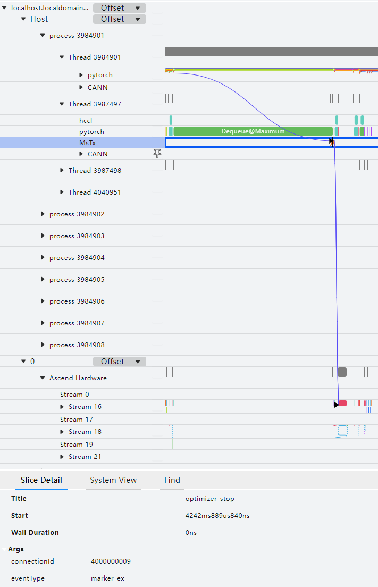

By default, the mstx function collects performance data of communication operators, dataloader duration, and checkpoint saving interface duration. The data content formats are as follows:

- Format: \{"streamId": "\{pg streamId\}","count": "\{count\}","dataType": "\{dataType\}",\["srcRank": "\{srcRank\}"\],\["destRank": "\{destRank\}"\],"groupName": "\{groupName\}","opName": "\{opName\}"\}

    Example: \{"streamId": "32","count": "25701386","dataType": "fp16","groupName": "group\_name\_43","opName": "HcclAllreduce"\}

    - streamId: Stream ID used to execute the instrumentation task.
    - count: Number of input data items.
    - dataType: Data type of the input data.
    - srcRank: Rank ID of the data sender in the communicator. Only the hcclRecv operator has srcRank.
    - destRank: Rank ID of the data receiver in the communicator. Only the hcclSend operator has destRank.
    - groupName: Communicator name.
    - opName: Operator name.

- dataloader
- save\_checkpoint

In addition, the mstx function can also obtain performance data of the four key phases of the PyTorch model — dataloader, forward, step, and save\_checkpoint — through **mstx\_torch\_plugin**. For details, see *[mstx\_torch\_plugin](https://gitcode.com/Ascend/mstt/blob/master/profiler/example/mstx_torch_plugin/README.md)*.

With this function, you can view the execution and scheduling of user-defined instrumentation from the framework side to the CANN layer and then to the NPU side, helping identify the key functions or events you want to observe and locate performance problems.

For detailed descriptions of the mstx profiling result data, see [msproftx Data Description](https://gitcode.com/Ascend/msprof/blob/master/docs/en/user_guide/profile_data_file_references.md).

### Profile Environment Variable Information <a id="profiling-environment-variable-information"></a>

**Feature Description**

When performance data is collected through the Ascend PyTorch Profiler interface, environment variable information is collected by default. The environment variables currently supported for profiling are as follows:

- "ASCEND\_GLOBAL\_LOG\_LEVEL"
- "HCCL\_RDMA\_TC"
- "HCCL\_RDMA\_SL"
- "ACLNN\_CACHE\_LIMIT"

**Precautions**

None

**Usage Example**

1. Configure the environment variables in the environment, as shown in the following example:

    ```bash
    export ASCEND_GLOBAL_LOG_LEVEL=1
    export HCCL_RDMA_TC=0
    export HCCL_RDMA_SL=0
    export ACLNN_CACHE_LIMIT=4096
    ```

    Configure the environment variables based on actual requirements.

2. Execute the Ascend PyTorch Profiler interface to profile data.

**Output Description**

- When the export\_type of the experimental\_config parameter is configured as torch\_npu.profiler.ExportType.Text, the environment variable information configured in the above steps is saved in the profiler\_metadata.json file in the \{worker\_name\}\_\{timestamp\}\_ascend\_pt directory and in the META\_DATA table in the ascend\_pytorch\_profiler\_\{Rank\_ID\}.db file.
- When the export\_type of the experimental\_config parameter is configured as torch\_npu.profiler.ExportType.Db, the environment variable information is written to the META\_DATA table in the ascend\_pytorch\_profiler\_\{Rank\_ID\}.db file.

### Mark the Performance Data Profiling Process <a id="marking-the-performance-data-profiling-process"></a>

**Feature Description**

Mark the performance data profiling process in the form of custom string keys and string values.

**Precautions**

None

**Usage Example**

```python
with torch_npu.profiler.profile(...)  as prof:
    prof.add_metadata(key, value)
```

add\_metadata and add\_metadata\_json can be configured under torch\_npu.profiler.profile. They must be added after profiler initialization and before finalize, that is, in the code of the performance data profiling process.

**Table 1**  Description of the add\_metadata interface

| Class/Function Name | Description |
|--|--|
|add_metadata|Adds a string marker. Values:<br>&#8226; *key*: String key.<br/>&#8226; *value*: String value.<br/>Example: prof.add_metadata("test_key1", "test_value1")|
|add_metadata_json|Adds a string marker in JSON format. Values:<br/>&#8226; *key*: String key.<br/>&#8226; *value*: String value, in JSON format.<br/>Example: prof.add_metadata_json("test_key2", json.dumps({"key1": test_value1, "key2": test_value2}))|

**Output Description**

The metadata data passed in when calling this interface is written to the profiler\_metadata.json file in the root directory of the Ascend PyTorch Profiler profiling results.

### Device Memory Visualization <a id="memory-visualization"></a>

**Feature Description**

This function classifies and visually displays the data occupied by the training process during model training. Visualization files are mainly exported through the `export_memory_timeline` interface.

**Interface Description**

`export_memory_timeline` is used to export the memory event information of a given device from the collected data and export a timeline graph.

Interface parameters:

- output_path: Required parameter. Configures the exported result file, of the string type. The configuration format is: path = "{path}/{file_name}.html", where {path} is the result file path and \{file_name} is the result file name. If the path or file does not exist, it is automatically created.
- device: Required parameter. Specifies the device ID to be exported (Device ID or Rank ID), of the string type. The configuration format is: device = "npu:{ID}", where {ID} must be configured as a device ID that already exists in the collected data. Currently, only one value can be specified.

Using `export_memory_timeline`, you can export files in three formats. Each file is controlled by the suffix of `output_path`:

- For HTML-compatible plots, use the suffix `.html`. The memory timeline graph will be embedded in the HTML file as a PNG file.
- For plot points composed of [timestamp, [sizes by category]], where timestamp is the timestamp and sizes is the memory usage of each category, the memory timeline graph will be saved as a `.json` file or a compressed `.json.gz` file, depending on the suffix.
- For raw memory information, use the suffix `raw.json.gz`. Each raw memory event consists of (timestamp, action, numbytes, category), where action is one of [PREEXISTING, CREATE, INCREMENT_VERSION, DESTROY], and category is one of [PARAMETER, OPTIMIZER_STATE, INPUT, TEMPORARY, ACTIVATION, GRADIENT, AUTOGRAD_DETAIL, UNKNOWN].

**Precautions**

To export the html file, install matplotlib in the Python environment first and set the corresponding torch\_npu.profiler.profile parameter to True. In addition, using this function generates a data file with the suffix ascend\_pt in the current directory.

**Usage Example**

The operation example is as follows:

```python
import torch
import torch_npu
...

def trace_handler(prof: torch_npu.profiler.profile):
    prof.export_memory_timeline(output_path="./memory_timeline.html", device="npu:0")

with torch_npu.profiler.profile(
    activities=[
        torch_npu.profiler.ProfilerActivity.CPU,
        torch_npu.profiler.ProfilerActivity.NPU
    ],
    schedule=torch_npu.profiler.schedule(wait=0, warmup=0, active=4, repeat=1, skip_first=0, skip_first_wait=0),
    on_trace_ready=trace_handler,
    record_shapes=True,           # Set to True.
    profile_memory=True,          # Set to True.
    with_stack=True,              # Set either with_stack or with_modules to True.
    with_modules=True
) as prof:
    for _ in range(steps):
        ...
        prof.step()
```

**Output Result File Description**

After profiling is performed and memory\_timeline.html is exported, the visualization effect is as follows:

**Figure 1**  memory\_timeline
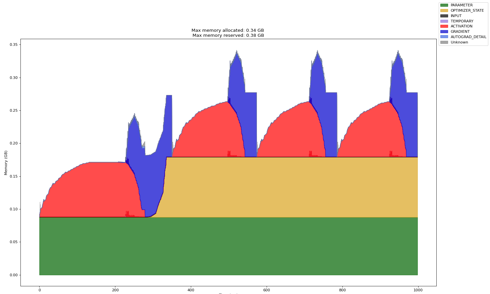

- Time\(ms\): The horizontal axis, indicating the memory occupation duration of tensor types, in ms.
- Memory\(GB\): The vertical axis, indicating the memory size occupied by tensor types, in GB.
- Max memory allocated: Total maximum memory allocated, in GB.
- Max memory reserved: Total maximum memory reserved, in GB.
- PARAMETER: Model parameters and model weights.
- OPTIMIZER\_STATE: Optimizer state. For example, the Adam optimizer records some states during model training.
- INPUT: Input data.
- TEMPORARY: Temporary occupation, defined here as memory that is requested and then released under a single operator, usually tensors that store intermediate values.
- ACTIVATION: Activation values obtained in forward computation.
- GRADIENT: Gradient values.
- AUTOGRAD\_DETAIL: Memory usage generated during backward computation.
- UNKNOWN: Unknown type.

### Create a Profiler Subthread for Profiling <a id="profiling-in-a-profiler-subthread"></a>

**Feature Description**

In inference scenarios, it is common to call torch operators in a single process with multiple threads. In this case, because Profiler cannot detect the subthreads created by users, it cannot profile framework-side data such as torch operators issued by these subthreads. Therefore, you need to call the torch\_npu.profiler.profile.enable\_profiler\_in\_child\_thread and torch\_npu.profiler.profile.disable\_profiler\_in\_child\_thread interfaces in the created subthreads to register the Profiler profiling callback function and profile framework-side data such as torch operators issued by the subthreads.

**Precautions**

None

**Usage Example**

The operation example is as follows:

```python
import threading
import torch
import torch_npu

# Inference model definition.
...

def infer(device, child_thread):
    torch.npu.set_device(device)

    if child_thread:
        # Start profiling framework-side data such as torch operators of the child thread.
        torch_npu.profiler.profile.enable_profiler_in_child_thread(with_modules=True)

    for _ in range(5):
        outputs = model(input_data)

    if child_thread:
        # Stop profiling framework-side data such as torch operators of the child thread.
        torch_npu.profiler.profile.disable_profiler_in_child_thread()


if __name__ == "__main__":
    experimental_config = torch_npu.profiler._ExperimentalConfig(
        aic_metrics=torch_npu.profiler.AiCMetrics.PipeUtilization,
        profiler_level=torch_npu.profiler.ProfilerLevel.Level1
    )

    prof = torch_npu.profiler.profile(
        activities=[torch_npu.profiler.ProfilerActivity.CPU, torch_npu.profiler.ProfilerActivity.NPU],
        on_trace_ready=torch_npu.profiler.tensorboard_trace_handler("./result"),
        record_shapes=True,
        profile_memory=True,
        with_stack=False,
        with_flops=False,
        with_modules=True,
        experimental_config=experimental_config)

    prof.start()

    threads = []
    for i in range(1, 3):
        # Create two child threads to run inference tasks on device1 and device2 respectively.
        t = threading.Thread(target=infer, args=(i, True))
        t.start()
        threads.append(t)

    # The main thread runs inference tasks on device0, which are collected normally by Profiler, not by the enable_profiler_in_child_thread interface.
    infer(0, False)

    for t in threads:
        t.join()

    prof.stop()
```

**Output Result File Description**

After subthread profiling is completed, the generated subthread performance data is as follows:

**Figure 1**  Subthread performance data
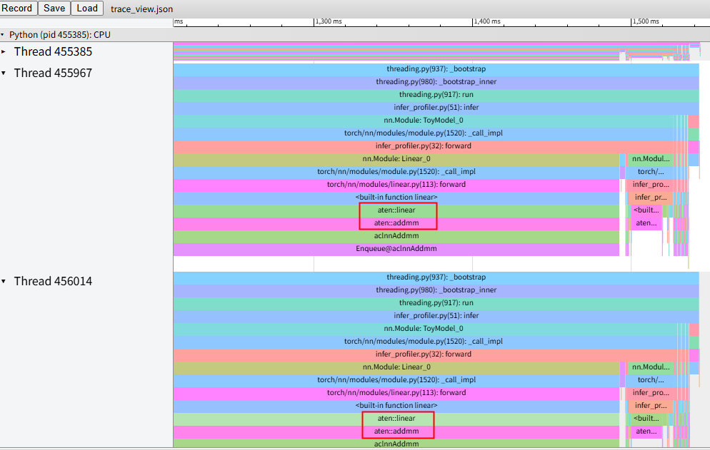

In the preceding figure, Thread 455385 is the main thread, which can be collected by Profiler normally and does not need attention in this feature scenario. In the other two threads, the timeline with the aten prefix is the torch operator data collected by this feature.

## Offline Parsing <a id="offline-parsing"></a>

**Feature Description**

When the performance data collected using the Ascend PyTorch Profiler interface is large, directly using the on\_trace\_ready interface for automatic parsing in the current environment may cause excessive resource occupation and stuttering. In this case, you can remove the on\_trace\_ready interface and set the write directory through the environment variable ASCEND\_WORK\_PATH (for example: export ASCEND\_WORK\_PATH=xx/xx), and perform offline parsing after performance data profiling is complete.

**Precautions**

None

**Usage Example**

1. Create a *{file_name}*.py file (*{file_name}* is customizable) and edit the code as follows.

    ```python
    from torch_npu.profiler.profiler import analyse

    if __name__ == "__main__":
        analyse(profiler_path="./result_data", max_process_number=1, export_type=['text'])
    ```

    **Table 1**  Parameter description

    | Parameter          | Optional/Required | Description                                                 |
    | ------------------ | --------- | ------------------------------------------------------------ |
    | profiler_path      | Required | PyTorch performance data path. The path format only supports strings consisting of letters, digits, and underscores, and does not support symbolic links. The PyTorch performance data directory {worker_name}\_{timestamp}_ascend_pt is saved in the specified directory. |
    | max_process_number | Optional | Maximum number of processes for offline parsing. The value range is 1~number of CPU cores, and the default value is half of the number of CPU cores. If the value is set to exceed the number of CPU cores of the environment, the number of CPU cores is used. If an invalid value is set, the default value (half of the number of CPU cores) is used. |
    | export_type        | Optional | Sets the format of the exported performance data result files, of the List type. Values:<br>&#8226; text: Parses into timeline and summary files in json and csv formats, as well as db format files that aggregate all performance data (ascend_pytorch_profiler\_{Rank_ID}.db, analysis.db).<br>&#8226; db: Parses only into .db format files that aggregate all performance data (ascend_pytorch_profiler_{Rank_ID}.db, analysis.db), displayed using the MindStudio Insight tool. Only supported for export by the on_trace_ready interface and offline parsing export, and the Toolkit package supporting db format export must be installed.<br>If an invalid value is set or the parameter is not configured, the export_type field in profiler_info.json is read to determine the export format.<br>For the parsed result data, see [Output Result File Description](#output-result-files-description). |

    > [!NOTE]
    >
    > - The offline parsing interface supports parallel parsing of multiple performance data directories. When the performance data volume is large and there are many data directories, parsing may fail due to insufficient environment memory. In this case, you can control resource occupation by customizing the maximum number of processes (max\_process\_number).
    >
    > - The logs of the parsing process are stored in the \{worker\_name\}\_\{timestamp\}\_ascend\_pt/logs directory.

2. After saving the file, run the following command to parse the performance data:

    ```bash
    python3 {file_name}.py
    ```

3. View the performance data result files and analyze the performance data.

    For detailed descriptions of the performance data result files, see [Output Result File Description](#output-result-files-description).

    See *[MindStudio Insight System Tuning](https://gitcode.com/Ascend/msinsight/blob/master/docs/en/user_guide/system_tuning.md)* to visualize and analyze the parsed performance data files.

    You can use the [Performance Analysis Tool (msprof-analyze)](https://gitcode.com/Ascend/msprof-analyze/blob/master/docs/en/quick_start/msprof-analyze_quick_start.md) to assist in analyzing performance data.

## Output Result File Description <a id="output-result-files-description"></a>

### Data Directory Description <a id="data-directory-description"></a>

The performance data write directory structure is as follows:

- Directory structure when the tensorboard\_trace\_handler function is called:

  > [!NOTE]
  >
  > - The performance data files output by PyTorch frameworks in this scenario are basically the same. The data of the two frameworks is introduced together below, and individual differences will be described in the comments.
  > - You do not need to open the following data files. You can use the [MindStudio Insight](https://gitcode.com/Ascend/msinsight/blob/master/docs/en/user_guide/overview.md) tool to view and analyze performance data.
  > - If a null StepID value appears in kernel\_details.csv, you can view the Step information of the operator through the trace\_view.json file, or profile Profiling data again.
  > - The following data is collected based on the actual environment. If the environment does not have the corresponding conditions, the corresponding data or files will not be generated. For example, if the model has no AI CPU operators, the corresponding data\_preprocess.csv file will not be generated even if profiling is performed.

  ```text
  └── localhost.localdomain_139247_20230628101435_ascend_pt    // Performance data result directory. Naming format: {worker_name}_{timestamp}_ascend_{framework}. By default, {worker_name} is {hostname}_{pid}, {timestamp} is a timestamp, and {framework} is the abbreviation of the PyTorch framework (pt).
      ├── profiler_info_{Rank_ID}.json    // Used to record Profiler-related metadata. In the PyTorch single-device scenario, the file name does not display {Rank_ID}.
      ├── profiler_metadata.json    // Used to save the information added by users through the add_metadata interface and other Profiler-related metadata.
      ├── ASCEND_PROFILER_OUTPUT    // Directory of performance data collected and parsed by the Ascend PyTorch Profiler interface.
      │   ├── analysis.db    // Generated by default in scenarios with communication, such as PyTorch multi-device or clusters.
      │   ├── task_time.csv    // Generated when the torch_npu.profiler.ProfilerActivity.NPU switch is enabled and profiler_level is configured as Level0, Level1, or Level2.
      │   ├── api_statistic.csv    // Generated when profiler_level is configured as Level1 or Level2.
      │   ├── ascend_pytorch_profiler_{Rank_ID}.db    // Generated by default in PyTorch scenarios. In the single-device scenario, the file name does not display {Rank_ID}.
      │   ├── communication.json    // In scenarios with communication, such as multi-device or clusters, provides a visual data basis for performance analysis. Generated when profiler_level is configured as Level1 or Level2.
      │   ├── communication_matrix.json    // In scenarios with communication, such as multi-device or clusters, provides a visual data basis for performance analysis. Basic information file of communication sub-operators. Generated when profiler_level is configured as Level1 or Level2.
      │   ├── data_preprocess.csv    // Generated when profiler_level is configured as Level2.
      │   ├── hccs.csv    // Generated when sys_interconnection is set to True to enable it.
      │   ├── kernel_details.csv    // Generated when activities is configured as the NPU type.
      │   ├── l2_cache.csv    // Generated when l2_cache is set to True to enable it.
      │   ├── memory_record.csv    // Generated when profile_memory is set to True to enable it.
      │   ├── nic.csv    // Generated when sys_io is set to True to enable it.
      │   ├── npu_module_mem.csv    // Generated when profile_memory is set to True to enable it.
      │   ├── operator_details.csv    // Generated automatically by default.
      │   ├── operator_memory.csv    // Generated when profile_memory is set to True to enable it.
      │   ├── op_statistic.csv    // Call count and duration data of AI Core and AI CPU operators.
      │   ├── pcie.csv    // Generated when sys_interconnection is set to True to enable it.
      │   ├── roce.csv    // Generated when sys_io is set to True to enable it.
      │   ├── step_trace_time.csv    // Time statistics of computation and communication in iterations.
      │   ├── soc_pmu.csv    // Generated when the torch_npu.profiler.ProfilerActivity.NPU and l2_cache switches are enabled.
      │   └── trace_view.json    // Records the time information of the entire AI task.
      ├── FRAMEWORK    // Raw performance data on the framework side. No need to pay attention to it.
      ├── logs    // Logs of the parsing process.
      ├── PLATFORM_{timestamp}    // NUMA performance data results. Currently used for internal visualization plotting. Users do not need to pay attention to it.
          ├── platform.db
          └── metrics.csv
      └── PROF_000001_20230628101435646_FKFLNPEPPRRCFCBA    // Performance data of the CANN layer. Naming format: PROF_{number}_{timestamp}_{string}. When data_simplification is set to True, only the raw performance data in this directory is retained and other data is deleted.
            ├── analyze    // In scenarios with communication, such as multi-device or clusters, generated when profiler_level is configured as Level1 or Level2.
            ├── device_{Rank_ID}    //  Raw performance data on the device side collected by CANN Profiling.
            ├── host    // Raw performance data on the host side collected by CANN Profiling.
            ├── mindstudio_profiler_log    // Log files parsed by CANN Profiling.
            └── mindstudio_profiler_output    // Performance data parsed by CANN Profiling.
  ├── localhost.localdomain_139247_20230628101435_ascend_pt_op_arg    // Directory of operator information statistics files in PyTorch scenarios. Generated when record_op_args is set to True to enable it.
  ```

  The Ascend PyTorch Profiler interface associates and integrates framework-side data with CANN Profiling data to form performance data files such as trace, Kernel, and memory. They are saved in the ASCEND\_PROFILER\_OUTPUT directory, including the json and csv format [timeline and summary data](#timeline-and-summary-data), [ascend\_pytorch\_profiler\_\{Rank\_ID\}.db data](#ascend-pytorch-profiler-rank-id-db-data), and [analysis.db data](#analysis-db-data).

  The PROF directory contains the performance data collected by CANN Profiling, mainly saved in the mindstudio\_profiler\_output directory and msprof\_\*.db files. For data descriptions, see [Performance Data File Reference](https://gitcode.com/Ascend/msprof/blob/master/docs/en/user_guide/profile_data_file_references.md).

For details about the PLATFORM directory, see [PLATFORM_{timestamp}](https://gitcode.com/Ascend/msprof/blob/master/docs/en/user_guide/profile_data_file_references.md).

- In PyTorch scenarios, when the export\_chrome\_trace method is called, the Ascend PyTorch Profiler interface writes the parsed trace data to the \*.json file, where \* is the file name. If the file does not exist, it is automatically created in the specified path.

### Timeline and Summary Data <a id="timeline-and-summary-data"></a>

**trace\_view.json**

**Figure 1**  trace\_view
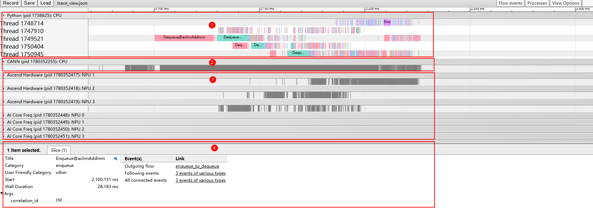

As shown in Figure 1, the trace data mainly displays the following areas:

- Area 1: Upper-layer application data, including the duration information of upper-layer application operators.
- Area 2: CANN layer data, mainly including the duration data of the AscendCL, GE, and Runtime components.
- Area 3: Underlying NPU data, mainly including the duration data of the Task Scheduler component, iteration trajectory data, and other Ascend AI processor system data.
- Area 4: Displays the detailed information of each operator and interface in the trace. It is displayed when you click each trace event.

> [!NOTE]
>
> trace\_view.json can be opened using the MindStudio Insight tool, `chrome://tracing/`, and `https://ui.perfetto.dev/`.

**Figure 2**  trace\_view (record\_shapes)


When record\_shapes is enabled, the upper-layer application operators in trace\_view display the Input Dims and Input type information.

**Figure 3**  trace\_view (with\_stack)
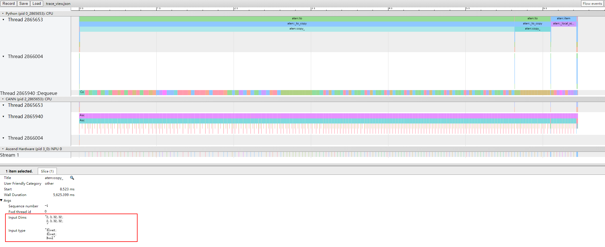

When with\_stack is enabled, the upper-layer application operators in trace\_view display the Call stack information.

**Figure 4**  trace\_view (GC)
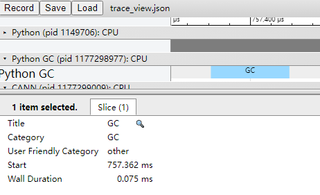

In the profiling result in Figure 4, the time period of the Python GC layer is the execution time of this GC.

When GC is executed, the current process is blocked and must wait for GC to complete. If GC takes too long, you can adjust the GC parameters (refer to gc.set\_threshold in [Garbage Collector](https://docs.python.org/zh-cn/3/library/gc.html)) to alleviate the process blocking caused by GC.

**kernel\_details.csv**

**Figure 5**  kernel\_details
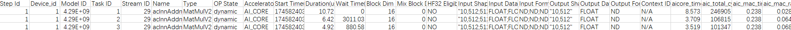

The file contains the information of all operators executed on the NPU. If the user frontend calls schedule for Step marking, the Step Id field is added. However, if warmup (not 0) is set in schedule and operators are asynchronously executed after each Step of training/online inference, the operators asynchronously executed during the warmup phase may be collected, resulting in no Step Id field in kernel\_details.csv.

The field information is shown in Table 1.

> [!NOTE]
>
> When the aic\_metrics parameter of experimental\_config is configured, the kernel\_details.csv file adds corresponding fields based on the aic\_metrics configuration of the experimental\_config parameter. For the main added content, see [experimental\_config Parameter Description](#experimental_config-parameter-description). For detailed descriptions of the related fields in the file, see [op\_summary (Operator Detailed Information)](https://gitcode.com/Ascend/msprof/blob/master/docs/en/user_guide/profile_data_file_references.md).

**Table 1**  kernel\_details<a name="table1"></a>

| Field Name | Field Description |
|--|--|
|Step Id|Iteration ID.|
|Device_id|Device ID.|
|Model ID|Model ID.|
|Task ID|ID of the Task.|
|Stream ID|Stream ID where the Task resides.|
|Name|Operator name.|
|Type|Operator type.|
|OP State|Dynamic or static information of the operator. dynamic indicates a dynamic operator, and static indicates a static operator. Communication operators do not have this status and display N/A. This field is reported only at Level1, not at Level0.|
|Accelerator Core|AI accelerator core type, including AI Core, AI CPU, and so on.|
|Start Time(us)|Time when the operator starts execution, in us.|
|Duration(us)|Execution duration of the current operator, in us.|
|Wait Time(us)|Waiting time for operator execution, in us.|
|Block Num|Number of running splits, corresponding to the number of cores used when the task is executed.|
|Mix Block Num|Some operators are executed on both the AI Core and Vector Core. The Block Num of the primary accelerator is described in the Block Num field, and the Block Num of the secondary accelerator is described in this field. This field is not collected by default at Level0.<br>Supported only on Atlas A2 products and Atlas A3 products.|
|HF32 Eligible|Indicates whether the HF32 precision mark is used. YES indicates used, and NO indicates not used.|
|Input Shapes|Shape of the operator input.|
|Input Data Types|Data type of the operator input.|
|Input Formats|Data format of the operator input.|
|Output Shapes|Shape of the operator output.|
|Output Data Types|Data type of the operator output.|
|Output Formats|Data format of the operator output.|

**memory\_record.csv**

**Figure 6**  memory\_record
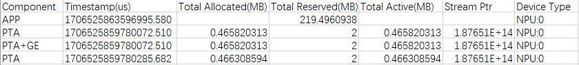

The file contains the device memory occupation records of TorchNPU and GE, mainly recording the memory requested by components such as TorchNPU and GE and the occupation time. The field information is shown in [Table 2](#table2).

**Table 2**  memory\_record<a name="table2"></a>

| Field Name | Field Description |
|--|--|
|Component|Component, including: TorchNPU and GE components, APP process level, WORKSPACE (generated when the environment variable TASK_QUEUE_ENABLE=2 is configured before performance data profiling), and so on.|
|Timestamp(us)|Timestamp, recording the start time of device memory occupation, in us.|
|Total Allocated(MB)|Total memory allocated, in MB.|
|Total Reserved(MB)|Total memory reserved, in MB.|
|Total Active(MB)|Total memory requested by the Stream (including unreleased memory reused by other streams), in MB.|
|Stream Ptr|Memory address of the AscendCL stream, used to mark different AscendCL streams.|
|Device Type|Device type and device ID, involving only the NPU.|

**operator\_memory.csv**

**Figure 7**  operator\_memory
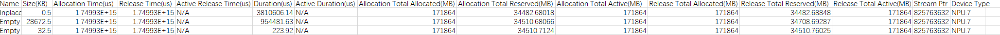

The file contains the memory occupation details of operators, mainly recording the memory required for operators to execute on the NPU and the occupation time, where the memory is requested by TorchNPU and GE. The field information is shown in [Table 3](#table3).

> [!NOTE]
>
> If negative values or null values appear in the operator\_memory.csv file, see the descriptions of negative values and null values in [operator\_memory (Memory Occupation Details of CANN Operators)](https://gitcode.com/Ascend/msprof/blob/master/docs/en/user_guide/profile_data_file_references.md).

**Table 3**  operator\_memory<a name="table3"></a>

| Field Name | Field Description |
|--|--|
|Name|Operator name.|
|Size(KB)|Size of the memory occupied by the operator, in KB.|
|Allocation Time(us)|Time when the Tensor memory is allocated, in us.|
|Release Time(us)|Time when the Tensor memory is released, in us.|
|Active Release Time(us)|Time when the memory is actually returned to the memory pool, in us.|
|Duration(us)|Memory occupation time (Release Time-Allocation Time), in us.|
|Active Duration(us)|Actual memory occupation time (Active Release Time-Allocation Time), in us.|
|Allocation Total Allocated(MB)|Total memory allocated when the operator memory is allocated (when the operator name in the Name field starts with aten, it is TorchNPU memory; when the operator name starts with cann, it is GE memory), in MB.|
|Allocation Total Reserved(MB)|Total memory occupied when the operator memory is allocated (when the operator name in the Name field starts with aten, it is TorchNPU memory; when the operator name starts with cann, it is GE memory), in MB.|
|Allocation Total Active(MB)|Total memory requested by the current stream when the operator memory is allocated (including unreleased memory reused by other streams), in MB.|
|Release Total Allocated(MB)|Total memory allocated when the operator memory is released (when the operator name in the Name field starts with aten, it is TorchNPU memory; when the operator name starts with cann, it is GE memory), in MB.|
|Release Total Reserved(MB)|Total memory occupied when the operator memory is released (when the operator name in the Name field starts with aten, it is TorchNPU memory; when the operator name starts with cann, it is GE memory), in MB.|
|Release Total Active(MB)|Total memory reused by other Streams in the memory when the operator memory is released (when the operator name in the Name field starts with aten, it is TorchNPU memory; when the operator name starts with cann, it is GE memory), in MB.|
|Stream Ptr|Memory address of the AscendCL stream, used to mark different AscendCL streams.|
|Device Type|Device type and device ID, involving only the NPU.|

**npu\_module\_mem.csv**

**Figure 8**  npu\_module\_mem
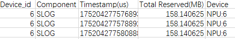

The npu\_module\_mem.csv data is automatically collected during the profiling process and contains component-level memory occupation. It mainly records the memory occupied by components at the current moment when they execute on the NPU. The field information is shown in [Table 4](#table4).

**Table 4**  npu\_module\_mem<a name="table4"></a>

| Field Name | Field Description |
|--|--|
|Device_id|Device ID.|
|Component|Component name.|
|Timestamp(us)|Timestamp, indicating the memory occupied by the component at the current moment, in us.|
|Total Reserved(MB)|Size of the memory occupied, in MB.|
|Device|Device type and device ID, involving only the NPU.|

**operator\_details.csv**

**Figure 9**  operator\_details
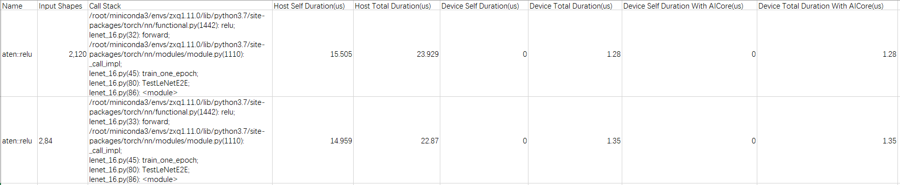

The information contained in the operator\_details.csv file is shown in [Table 5](#table5).

**Table 5**  operator\_details<a name="table5"></a>

| Field | Description |
|--|--|
|Name|Operator name.|
|Input Shapes|Shape information.|
|Call Stack|Function call stack information, controlled by the with_stack field.|
|Host Self Duration(us)|Duration of the operator on the Host side (excluding other operators called internally), in us.|
|Host Total Duration(us)|Duration of the operator on the Host side, in us.|
|Device Self Duration(us)|Duration of the operator on the Device side (excluding other operators called internally), in us.|
|Device Total Duration(us)|Duration of the operator on the Device side, in us.|
|Device Self Duration With AICore(us)|Duration of the operator executed on the AI Core on the Device side (excluding operators called internally), in us.|
|Device Total Duration With AICore(us)|Duration of the operator executed on the AI Core on the Device side, in us.|

**step\_trace\_time.csv**

**Figure 10**  step\_trace\_time
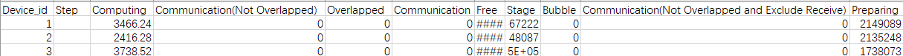

Time statistics of computation and communication in iterations, containing the information shown in [Table 6](#table6).

**Table 6**  step\_trace\_time<a name="table6"></a>

| Field | Description |
|--|--|
|Device_id|Device ID.|
|Step|Number of iterations.|
|Computing|Total computation time of operators on the NPU, in us.|
|Communication(Not Overlapped)|Communication time, that is, the total communication time minus the overlapped computation and communication time, in us.|
|Overlapped|Overlapped time of computation and communication, in us. More overlap indicates better parallelism between computation and communication. Ideally, communication is fully overlapped with computation.|
|Communication|Total communication time of operators on the NPU, in us.|
|Free|Total iteration time minus computation and communication time, in us. It may include initialization, data loading, CPU computation, and so on.|
|Stage|Stage time, representing the time excluding the receive operator time, in us.|
|Bubble|Total receive time, in us.|
|Communication(Not Overlapped and Exclude Receive)|Total communication time minus the overlapped computation and communication time and the receive operator time, in us.|
|Preparing|Time from the start of an iteration to the running of the first computation or communication operator, in us.|

**task\_time.csv**

The task\_time.csv file records the scheduling duration during AI task running. For examples and field descriptions, refer to [task_time (Task Scheduling Information)](https://gitcode.com/Ascend/msprof/blob/master/docs/en/user_guide/profile_data_file_references.md). The actual results may differ slightly; the actual situation prevails.

**data\_preprocess.csv**

The data\_preprocess.csv file records AI CPU data. For examples and field descriptions, refer to [aicpu (Detailed Duration of AI CPU Operators)](https://gitcode.com/Ascend/msprof/blob/master/docs/en/user_guide/profile_data_file_references.md). The actual results may differ slightly; the actual situation prevails.

**l2\_cache.csv**

For examples and field descriptions, refer to [l2\_cache (L2 Cache Hit Rate)](https://gitcode.com/Ascend/msprof/blob/master/docs/en/user_guide/profile_data_file_references.md). The actual results may differ slightly; the actual situation prevails.

**op\_statistic.csv**

For examples and field descriptions, refer to [op\_statistic (Operator Call Count and Duration)](https://gitcode.com/Ascend/msprof/blob/master/docs/en/user_guide/profile_data_file_references.md). The actual results may differ slightly; the actual situation prevails.

**api\_statistic.csv**

For examples and field descriptions, refer to [api\_statistic (API Duration Statistics)](https://gitcode.com/Ascend/msprof/blob/master/docs/en/user_guide/profile_data_file_references.md) \> the api\_statistic\_\*.csv file description. The actual results may differ slightly; the actual situation prevails.

**pcie.csv**

For examples and field descriptions, refer to [pcie (PCIe Bandwidth)](https://gitcode.com/Ascend/msprof/blob/master/docs/en/user_guide/profile_data_file_references.md) \> the pcie\_\*.csv file description. The actual results may differ slightly; the actual situation prevails.

**hccs.csv**

For examples and field descriptions, refer to [hccs (Collective Communication Bandwidth)](https://gitcode.com/Ascend/msprof/blob/master/docs/en/user_guide/profile_data_file_references.md) \> the hccs\_\*.csv file description. The actual results may differ slightly; the actual situation prevails.

**nic.csv**

For examples and field descriptions, refer to [nic (Network Information at Each Time Node)](https://gitcode.com/Ascend/msprof/blob/master/docs/en/user_guide/profile_data_file_references.md) \> the nic\_\*.csv file description. The actual results may differ slightly; the actual situation prevails.

**roce.csv**

For examples and field descriptions, refer to [roce (RoCE Communication Interface Bandwidth)](https://gitcode.com/Ascend/msprof/blob/master/docs/en/user_guide/profile_data_file_references.md) \> the roce\_\*.csv file description. The actual results may differ slightly; the actual situation prevails.

**soc\_pmu.csv**

For examples and field descriptions, refer to [soc_pmu (TLB Hit Rate)](https://gitcode.com/Ascend/msprof/blob/master/docs/en/user_guide/profile_data_file_references.md). The actual results may differ slightly; the actual situation prevails.

### ascend\_pytorch\_profiler\_\{Rank\_ID\}.db Data <a id="ascend-pytorch-profiler-rank-id-db-data"></a>

This file is a table structure file. It is recommended to view it with the MindStudio Insight tool. You can also open it directly with database development tools such as Navicat Premium. The performance data summarized in the current db file is as follows:

**STRING\_IDS**

Mapping table, used to store the mapping relationship between IDs and strings.

No switch. Records the String ID mapping relationship used on the CANN side, usually accumulated starting from 0.

**Table 1**  Format

| Field Name | Type | Index | Description |
|--|--|--|--|
|id|INTEGER|Primary key|ID corresponding to the string|
|value|TEXT|-|String content|

**PYTORCH\_API**

Framework-side API data, currently containing only torch\_npu API data.

Controlled by the torch\_npu.profiler.ProfilerActivity.CPU switch of the Ascend PyTorch Profiler interface.

**Table 2**  Format

| Field Name | Type | Description |
|--|--|--|
|startNs|INTEGER|Start time of the op API, in ns|
|endNs|INTEGER|End time of the op API, in ns|
|globalTid|INTEGER|Global tid to which the API belongs. High 32 bits: pid, low 32 bits: tid|
|connectionId|INTEGER|Used to query the corresponding connectionId in the CONNECTION_IDS table; if there is no connectionId, this field is empty|
|name|INTEGER|Name of the op API, STRING_IDS(name)|
|sequenceNumber|INTEGER|Sequence number of the op|
|fwdThreadId|INTEGER|Forward thread ID of the op|
|inputDtypes|INTEGER|Input data types, STRING_IDS(inputDtypes)|
|inputShapes|INTEGER|Input shapes, STRING_IDS(inputShapes)|
|callchainId|INTEGER|Used to query the corresponding call stack information in the PYTORCH_CALLCHAINS table; if there is no stack information, this field is empty|
|type|INTEGER|Marks the data type: op, queue, mstx, or python_trace. The data type is stored in the enumeration table ENUM_API_TYPE|

**CONNECTION\_IDS**

Association relationship data between framework-side APIs and themselves or CANN APIs.

Controlled by the torch\_npu.profiler.ProfilerActivity.CPU switch of the Ascend PyTorch Profiler interface.

**Table 3**  Format

| Field Name | Type | Description |
|--|--|--|
|id|INTEGER|connectionId corresponding to the PYTORCH_API table|
|connectionId|INTEGER|ID used to represent the association relationship. Currently, three association relationships are included: task_queue, fwd_bwd, and torch-cann-task|

**PYTORCH\_CALLCHAINS**

Framework-side stack information.

Controlled by the with\_stack parameter of the Ascend PyTorch Profiler interface.

**Table 4**  Format

| Field Name | Type | Description |
|--|--|--|
|id|INTEGER|callchainId corresponding to the PYTORCH_API table|
|stack|INTEGER|ID corresponding to the string content of the current stack in the STRING_IDS table|
|stackDepth|INTEGER|Depth of the current stack|

**MEMORY\_RECORD**

Framework-side device memory occupation records.

Controlled by the profile\_memory parameter of the Ascend PyTorch Profiler interface.

**Table 5**  Format

| Field Name | Type | Description |
|--|--|--|
|component|INTEGER|ID corresponding to the component name (GE, TorchNPU, TorchNPU+GE) in the STRING_IDS table|
|timestamp|INTEGER|Timestamp|
|totalAllocated|INTEGER|Total memory allocated|
|totalReserved|INTEGER|Total memory reserved|
|totalActive|INTEGER|Total memory requested by the TorchNPU stream|
|streamPtr|INTEGER|AscendCL stream address|
|deviceId|INTEGER|Device ID|

**OP\_MEMORY**

Framework-side operator memory occupation information integrated based on MEMORY\_RECORD.

Controlled by the profile\_memory parameter of the Ascend PyTorch Profiler interface.

**Table 6**  Format

| Field Name | Type | Description |
|--|--|--|
|name|INTEGER|Names of torch and GE operators, STRING_IDS(name)|
|size|INTEGER|Size of the memory occupied by the operator, in Byte|
|allocationTime|INTEGER|Time when the operator memory is requested, in ns|
|releaseTime|INTEGER|Time when the operator memory is released, in ns|
|activeReleaseTime|INTEGER|Time when the memory is actually returned to the memory pool, in ns|
|duration|INTEGER|Memory occupation time, in ns|
|activeDuration|INTEGER|Actual memory occupation time, in ns|
|allocationTotalAllocated|INTEGER|Total TorchNPU and GE memory allocated when the operator memory is allocated, in Byte|
|allocationTotalReserved|INTEGER|Total TorchNPU and GE memory occupied when the operator memory is allocated, in Byte|
|allocationTotalActive|INTEGER|Total memory requested by the current stream when the operator memory is allocated, in Byte|
|releaseTotalAllocated|INTEGER|Total TorchNPU and GE memory allocated when the operator memory is released, in Byte|
|releaseTotalReserved|INTEGER|Total TorchNPU and GE memory occupied when the operator memory is released, in Byte|
|releaseTotalActive|INTEGER|Total memory requested by the current stream when the operator memory is released, in Byte|
|streamPtr|INTEGER|AscendCL stream address|
|deviceId|INTEGER|Device ID|

**RANK\_DEVICE\_MAP**

Mapping relationship data between rankId and deviceId.

No corresponding switch. Generated by default when the ascend\_pytorch\_profiler\_\{Rank\_ID\}.db file is exported.

**Table 7**  Format

| Field Name | Type | Description |
|--|--|--|
|rankId|INTEGER|Node identifier ID in cluster scenarios. -1 indicates that rankId is not set.|
|deviceId|INTEGER|Device ID on the node. -1 indicates that deviceId was not collected.|

**STEP\_TIME**

Saves the start time of the steps collected by Profiler.

Controlled by the parameters of the torch\_npu.profiler.schedule class of the Ascend PyTorch Profiler interface.

**Table 8**  Format

| Field Name | Type | Description |
|--|--|--|
|id|INTEGER|Step ID value|
|startNs|INTEGER|Start time of the Step, in ns|
|endNs|INTEGER|End time of the Step, in ns|

**GC\_RECORD**

Saves the GC events collected by Profiler.

Controlled by the gc\_detect\_threshold parameter of the Ascend PyTorch Profiler interface.

**Table 9**  Format

| Field Name | Type | Description |
|--|--|--|
|startNs|INTEGER|Start time of the GC event, in ns|
|endNs|INTEGER|End time of the GC event, in ns|
|globalTid|INTEGER|Global tid of the GC event|

**ROCE**

RoCE communication interface bandwidth data.

Control switches:

- --sys-io-profiling and --sys-io-sampling-freq of the msprof command
- sys\_io of Ascend PyTorch Profiler

**Table 10**  Format

| Field Name | Type | Description |
|--|--|--|
|deviceId|INTEGER|Device ID|
|timestampNs|INTEGER|Local time, in ns|
|bandwidth|INTEGER|Bandwidth, in Byte/s|
|rxPacketRate|NUMERIC|Packet receiving rate, in packet/s|
|rxByteRate|NUMERIC|Byte receiving rate, in Byte/s|
|rxPackets|INTEGER|Cumulative number of received packets, in packet|
|rxBytes|INTEGER|Cumulative number of received bytes, in Byte|
|rxErrors|INTEGER|Cumulative number of received error packets, in packet|
|rxDropped|INTEGER|Cumulative number of received dropped packets, in packet|
|txPacketRate|NUMERIC|Packet sending rate, in packet/s|
|txByteRate|NUMERIC|Byte sending rate, in Byte/s|
|txPackets|INTEGER|Cumulative number of sent packets, in packet|
|txBytes|INTEGER|Cumulative number of sent bytes, in Byte|
|txErrors|INTEGER|Cumulative number of sent error packets, in packet|
|txDropped|INTEGER|Cumulative number of sent dropped packets, in packet|
|funcId|INTEGER|Port number|

**NIC**

Network information data at each time node.

Control switches:

- --sys-io-profiling and --sys-io-sampling-freq of the msprof command
- sys\_io of Ascend PyTorch Profiler

**Table 11**  Format

| Field Name | Type | Description |
|--|--|--|
|deviceId|INTEGER|Device ID|
|timestampNs|INTEGER|Local time, in ns|
|bandwidth|INTEGER|Bandwidth, in Byte/s|
|rxPacketRate|NUMERIC|Packet receiving rate, in packet/s|
|rxByteRate|NUMERIC|Byte receiving rate, in Byte/s|
|rxPackets|INTEGER|Cumulative number of received packets, in packet|
|rxBytes|INTEGER|Cumulative number of received bytes, in Byte|
|rxErrors|INTEGER|Cumulative number of received error packets, in packet|
|rxDropped|INTEGER|Cumulative number of received dropped packets, in packet|
|txPacketRate|NUMERIC|Packet sending rate, in packet/s|
|txByteRate|NUMERIC|Byte sending rate, in Byte/s|
|txPackets|INTEGER|Cumulative number of sent packets, in packet|
|txBytes|INTEGER|Cumulative number of sent bytes, in Byte|
|txErrors|INTEGER|Cumulative number of sent error packets, in packet|
|txDropped|INTEGER|Cumulative number of sent dropped packets, in packet|
|funcId|INTEGER|Port number|

**HCCS**

HCCS collective communication bandwidth data.

Control switches:

- --sys-interconnection-profiling and --sys-interconnection-freq of the msprof command
- sys\_interconnection of Ascend PyTorch Profiler

**Table 12**  Format

| Field Name | Type | Description |
|--|--|--|
|deviceId|INTEGER|Device ID|
|timestampNs|INTEGER|Local time, in ns|
|txThroughput|NUMERIC|Sending bandwidth, in Byte/s|
|rxThroughput|NUMERIC|Receiving bandwidth, in Byte/s|

**PCIE**

PCIe bandwidth data.

Control switches:

- --sys-interconnection-profiling and --sys-interconnection-freq of the msprof command
- sys\_interconnection of Ascend PyTorch Profiler

**Table 13**  Format

| Field Name | Type | Description |
|--|--|--|
|deviceId|INTEGER|Device ID|
|timestampNs|INTEGER|Local time, in ns|
|txPostMin|NUMERIC|Minimum PCIe Post data transmission bandwidth at the sending end, in Byte/s|
|txPostMax|NUMERIC|Maximum PCIe Post data transmission bandwidth at the sending end, in Byte/s|
|txPostAvg|NUMERIC|Average PCIe Post data transmission bandwidth at the sending end, in Byte/s|
|txNonpostMin|NUMERIC|Minimum PCIe Non-Post data transmission bandwidth at the sending end, in Byte/s|
|txNonpostMax|NUMERIC|Maximum PCIe Non-Post data transmission bandwidth at the sending end, in Byte/s|
|txNonpostAvg|NUMERIC|Average PCIe Non-Post data transmission bandwidth at the sending end, in Byte/s|
|txCplMin|NUMERIC|Minimum completion data packet for write requests received by the sending end, in Byte/s|
|txCplMax|NUMERIC|Maximum completion data packet for write requests received by the sending end, in Byte/s|
|txCplAvg|NUMERIC|Average completion data packet for write requests received by the sending end, in Byte/s|
|txNonpostLatencyMin|NUMERIC|Minimum transmission latency in PCIe Non-Post mode at the sending end, in ns|
|txNonpostLatencyMax|NUMERIC|Maximum transmission latency in PCIe Non-Post mode at the sending end, in ns|
|txNonpostLatencyAvg|NUMERIC|Average transmission latency in PCIe Non-Post mode at the sending end, in ns|
|rxPostMin|NUMERIC|Minimum PCIe Post data transmission bandwidth at the receiving end, in Byte/s|
|rxPostMax|NUMERIC|Maximum PCIe Post data transmission bandwidth at the receiving end, in Byte/s|
|rxPostAvg|NUMERIC|Average PCIe Post data transmission bandwidth at the receiving end, in Byte/s.|
|rxNonpostMin|NUMERIC|Minimum PCIe Non-Post data transmission bandwidth at the receiving end, in Byte/s|
|rxNonpostMax|NUMERIC|Maximum PCIe Non-Post data transmission bandwidth at the receiving end, in Byte/s|
|rxNonpostAvg|NUMERIC|Average PCIe Non-Post data transmission bandwidth at the receiving end, in Byte/s|
|rxCplMin|NUMERIC|Minimum completion data packet for write requests received by the receiving end, in Byte/s|
|rxCplMax|NUMERIC|Maximum completion data packet for write requests received by the receiving end, in Byte/s|
|rxCplAvg|NUMERIC|Average completion data packet for write requests received by the receiving end, in Byte/s|

### analysis.db Data <a id="analysis-db-data"></a>

This file is a table structure file. It is recommended to view it with the MindStudio Insight tool. You can also open it directly with database development tools such as Navicat Premium. The performance data summarized in the current db file is as follows:

**CommAnalyzerBandwidth**

**Table 1**  Format

| Field Name | Type | Description |
|--|--|--|
|hccl_op_name|TEXT|Name of the large communication operator, for example: hcom_broadcast__303_1_1|
|group_name|TEXT|Hash ID of the communicator|
|transport_type|TEXT|Transport type, including: LOCAL, SDMA, RDMA|
|transit_size|NUMERIC|Amount of data transmitted, in MB|
|transit_time|NUMERIC|Transmission duration, in ms|
|bandwidth|NUMERIC|Bandwidth, in GB/s|
|large_packet_ratio|NUMERIC|Ratio of large data packets|
|package_size|NUMERIC|Size of the communication data packet for one transmission, in MB|
|count|NUMERIC|Number of communication transmissions|
|total_duration|NUMERIC|Total data transmission duration|
|step|TEXT|Step to which the operator belongs, for example: step12|
|type|TEXT|Operator type, including: Collective, P2P|

**CommAnalyzerTime**

**Table 2**  Format

| Field Name | Type | Description |
|--|--|--|
|hccl_op_name|TEXT|Communication operator name.|
|group_name|TEXT|Group of the communication operator.|
|start_timestamp|NUMERIC|Timestamp when the communication starts, in us.|
|elapse_time|NUMERIC|Total communication duration of the operator, in ms.|
|transit_time|NUMERIC|Communication duration, in ms. Indicates the communication duration of the communication operator. If the communication duration is too long, there may be a problem with a link.|
|wait_time|NUMERIC|Waiting duration, in ms. Before communication between nodes, synchronization is required to ensure that the two communicating nodes complete synchronization before communication.|
|synchronization_time|NUMERIC|Synchronization duration, in ms. The time required for synchronization between nodes.|
|idle_time|NUMERIC|Idle time, in ms. Idle time (idle_time) = total communication duration of the operator (elapse_time) - communication duration (transit_time) - waiting duration (wait_time).|
|step|TEXT|Step to which the operator belongs|
|type|TEXT|Operator type, including: Collective, P2P|

**CommAnalyzerMatrix**

**Table 3**  Format

| Field Name | Type | Description |
|--|--|--|
|hccl_op_name|TEXT|Simplified operator name after matrix analysis, for example: send-top1|
|group_name|TEXT|Hash ID of the communicator|
|src_rank|TEXT|rankId of the data sender, for example: 0|
|dst_rank|TEXT|rankId of the data receiver, for example: 1|
|transport_type|TEXT|Transport type, including: LOCAL, SDMA, RDMA|
|transit_size|NUMERIC|Amount of data transmitted, in MB|
|transit_time|NUMERIC|Transmission duration, in ms|
|bandwidth|NUMERIC|Bandwidth, in GB/s|
|step|TEXT|Step to which the operator belongs, for example: step12|
|type|TEXT|Operator type, including: Collective, P2P|
|op_name|TEXT|Original name of the operator, for example: hcom_broadcast__303_1_1|

**StepTraceTime**

**Table 4**  Format

| Field Name | Type | Description |
|--|--|--|
|deviceId|INTEGER|Device ID|
|step|TEXT|Step number, for example: 12|
|computing|NUMERIC|Computation time, in ms|
|communication|NUMERIC|Communication time, in ms|
|overlapped|NUMERIC|Time for simultaneous computation and communication, in ms|
|communication_not_overlapped|NUMERIC|Time used purely for communication, in ms|
|free|NUMERIC|Idle time, in ms|
|stage|NUMERIC|Time within a step excluding data receiving time, in ms|
|bubble|NUMERIC|Time used for data receiving within a step, in ms|
|communication_not_overlapped_and_exclude_receive|NUMERIC|Time used purely for communication minus the time used for data receiving, in ms|

## Appendix <a id="appendix"></a>

### Ascend PyTorch Profiler Interface Description <a id="ascend-pytorch-profiler-interface-description"></a>

**Table 1**  Configuration parameter description of torch\_npu.profiler.profile and torch\_npu.profiler.\_KinetoProfile

| Parameter Name | Optional/Required | Description |
|--|--|--|
|activities|Optional|Profiling list of CPU and NPU events, of the Enum type. Values:<br>&#8226; torch_npu.profiler.ProfilerActivity.CPU: Switch for framework-side data profiling.<br>&#8226; torch_npu.profiler.ProfilerActivity.NPU: Switch for CANN software stack and NPU data profiling.<br/>By default, both switches are enabled.|
|schedule|Optional|Sets the behavior of different steps, of the Callable type, controlled by the schedule class. No operation is performed by default.<br/>The torch_npu.profiler._KinetoProfile does not support this parameter.|
|on_trace_ready|Optional|Operation automatically executed when profiling ends, of the Callable type. Currently, the tensorboard_trace_handler function operation is supported. When the collected data volume is too large and it is not suitable to directly parse performance data in the current environment, or when the training/online inference process is interrupted during profiling and only part of the performance data is collected, you can use [Offline Parsing](#offline-parsing).<br/>No operation is performed by default.<br/>The torch_npu.profiler._KinetoProfile does not support this parameter.<br/>For multi-card large cluster scenarios using shared storage, directly using on_trace_ready to execute the tensorboard_trace_handler function to write performance data to disk may cause performance expansion because data from multiple cards is directly written to shared storage. For the solution, see [How to Avoid Performance Expansion When Performance Data Is Directly Written to Shared Storage in PyTorch Multi-Card Large Cluster Scenarios](#avoiding-performance-bloat-from-performance-data-directly-written-to-shared-storage).|
|record_shapes|Optional|Records the InputShapes and InputTypes data of framework-layer operators, and enables recording the Shape and Block Num data of CANN-layer operators at torch_npu.profiler.ProfilerLevel.Level0, of the Bool type. Values:<br/>&#8226; True: Enabled.<br/>&#8226; False: Disabled.<br/>Disabled by default.|
|profile_memory|Optional|Records the device memory occupation of operators, of the Bool type. Values:<br/>&#8226; True: Enabled.<br/>&#8226; False: Disabled.<br/>Disabled by default.<br/>When torch_npu.profiler.ProfilerActivity.CPU is enabled, the framework device memory occupation is collected; when torch_npu.profiler.ProfilerActivity.NPU is enabled, the CANN device memory occupation is collected.<br/>It is known that profiling memory data on an environment with glibc<2.34 may trigger a known glibc [Bug 19329](https://sourceware.org/bugzilla/show_bug.cgi?id=19329). This problem can be resolved by upgrading the glibc version of the environment.|
|with_stack|Optional|Records the operator call stack, of the Bool type. It includes the call information of the framework layer and the CPU operator layer. Values:<br/>&#8226; True: Enabled.<br/>&#8226; False: Disabled.<br/>Disabled by default.<br/>It takes effect when torch_npu.profiler.ProfilerActivity.CPU is enabled.<br/>Enabling this configuration introduces additional performance expansion.|
|with_modules|Optional|Records the Python call stack at the modules level, that is, the framework-layer call information, of the Bool type. Values:<br/>&#8226; True: Enabled.<br/>&#8226; False: Disabled.<br/>Disabled by default.<br/>It takes effect when torch_npu.profiler.ProfilerActivity.CPU is enabled.<br/>Enabling this configuration introduces additional performance expansion.|
|with_flops|Optional|Records the floating-point operations of operators (parsing performance data is not supported for this parameter yet). Values:<br/>&#8226; True: Enabled.<br/>&#8226; False: Disabled.<br/>Disabled by default.<br/>It takes effect when torch_npu.profiler.ProfilerActivity.CPU is enabled.|
|experimental_config|Optional|Extension parameter, used to configure the common profiling items of the performance analysis tool. For the supported profiling items and detailed descriptions, see [experimental_config Parameter Description](#experimental_config-parameter-description).|
|execution_trace_observer|Optional|PyTorch execution trace observer object. The PyTorch execution trace represents AI/ML workloads in graph form and supports replay benchmarking, simulators, and emulators. When this parameter is included, the start() and stop() methods of the observer are called within the same time window as the PyTorch profiler.<br>For calling examples, see [torch_npu.profiler.profile](https://gitcode.com/Ascend/op-plugin/blob/master/docs/en/custom_APIs/torch_npu-profiler/torch_npu-profiler-profile.md).|
|custom_trace_id_callback|Optional|Generates a trace_id to identify each Profiler data.<br>For calling examples, see [torch_npu.profiler.profile](https://gitcode.com/Ascend/op-plugin/blob/master/docs/en/custom_APIs/torch_npu-profiler/torch_npu-profiler-profile.md).<br>The trace_id is output to the profiler\_metadata.json file.|

**Table 2**  Method description of torch\_npu.profiler.profile and torch\_npu.profiler.\_KinetoProfile

| Method Name | Description |
|--|--|
|step|Divides different iterations. The torch_npu.profiler._KinetoProfile does not support this method.|
|export_chrome_trace|Exports the trace. Writes the trace data to the specified .json file. The Trace shows the running time and association relationship of each operator and interface after the Ascend PyTorch Profiler interface integrates the framework-side CANN software stack and NPU data. Parameters:<br>&#8226; *path*: Path of the trace file (.json). The path format of the file location only supports strings consisting of letters, digits, and underscores, and does not support symbolic links. Required.<br>In multi-card scenarios, different cards need to be configured with different file names.<br>Sample code:<br>`pid = os.getpid()`<br/>`prof.export_chrome_trace(f'./chrome_trace_{pid}.json')`|
|export_stacks|Exports the stack information to a file. Parameters:<br>&#8226; *path*: Path for saving the stack file. The file name must be configured as "\*.log". You can specify a path, for example: /home/*.log. When only the file name is configured, the file is saved in the current directory. The path format only supports strings consisting of letters, digits, and underscores, and does not support symbolic links. Required.<br/>&#8226; metric: The chip type to be saved can be CPU or NPU, configured as "self_cpu_time_total" or "self_npu_time_total". Required.<br/>It has the same position as the export_chrome_trace method in the training/online inference script, as shown in the following example:<br/>`export_stacks('result_dir/stack.log', metric='self_npu_time_total')`<br/>The exported result file can be viewed using the FlameGraph tool. The operation method is as follows:<br/>`git clone https://github.com/brendangregg/FlameGraph`<br/>`cd FlameGraph`<br/>`./flamegraph.pl --title "NPU time" --countname "us." profiler.stacks > perf_viz.svg`|
|export_memory_timeline|For detailed descriptions, see [Device Memory Visualization](#memory-visualization).|
|start|Sets the position where profiling starts. Refer to the following example: add start and stop before and after the training/online inference code for which performance data needs to be collected:<br/>`prof = torch_npu.profiler.profile(`<br/>`on_trace_ready=torch_npu.profiler.tensorboard_trace_handler("./result"))`<br/>`for step in range(steps):`<br/>`if step == 5:`<br/>`prof.start()`<br/>`train_one_step()`<br/>`if step == 5:`<br/>`prof.stop()`|
|stop|Sets the position where profiling ends. start must be executed first.|
|enable_profiler_in_child_thread|Registers the Profiler profiling callback function to profile framework-side data such as torch operators issued by user subthreads. Other parameters of torch_npu.profiler.profile (including record_shapes, profile_memory, with_stack, with_flops, and with_modules) can be additionally configured in this parameter as the profiling configuration of the Profiler subthread.<br/>It is used together with torch_npu.profiler.profile.enable_profiler_in_child_thread.<br/>For detailed usage, see [Create a Profiler Subthread for Profiling](#profiling-in-a-profiler-subthread).<br/>The torch_npu.profiler._KinetoProfile does not support this method.|
|disable_profiler_in_child_thread|Unregisters the Profiler profiling callback function. It is used together with torch_npu.profiler.profile.enable_profiler_in_child_thread. The torch_npu.profiler._KinetoProfile does not support this method.|

**Table 3**  Description of torch\_npu.profiler classes and functions

| Class/Function Name | Description |
|--|--|
|torch_npu.profiler.schedule|Sets the behavior of different steps. This operation is not executed by default. To obtain more stable performance data, it is recommended to configure the specific parameters of this class. For the parameter values and detailed usage, see [torch_npu.profiler.schedule Class Parameter Description](#torch-npu-profiler-schedule-parameters-description).|
|torch_npu.profiler.tensorboard_trace_handler|Exports performance data. Values:<br>&#8226; dir_name: Storage path of the collected performance data, of the string type. The path format only supports strings consisting of letters, digits, and underscores, and does not support symbolic links. If no specific path is specified after configuring the tensorboard_trace_handler function, the performance data is written to the current directory by default. If on_trace_ready=torch_npu.profiler.tensorboard_trace_handler is not used in the code, the written performance data is raw data and needs to be parsed using [Offline Parsing](#offline-parsing). Optional. This function has higher priority than ASCEND_WORK_PATH. For details, see *[Environment Variable Reference](https://www.hiascend.com/document/detail/en/CANNCommunityEdition/latest/maintenref/envvar/envref_07_0001.html)*.<br/>&#8226; worker_name: Used to distinguish a unique worker thread, of the string type. The default value is {hostname}\_{pid}. The path format only supports strings consisting of letters, digits, and underscores, and does not support symbolic links. Optional.<br/>&#8226; analyse_flag: Switch for automatic parsing of performance data, of the bool type. Values: True (enables automatic parsing, default value), False (disables automatic parsing; the collected performance data can be parsed using [Offline Parsing](#offline-parsing)). Optional.<br/>&#8226; async_mode: Controls whether asynchronous parsing is enabled (meaning the parsing process does not block the main process of the AI task), of the bool type. Values: True (enables asynchronous parsing), False (disables asynchronous parsing, that is, synchronous parsing, default value).<br/>The torch_npu.profiler.\_KinetoProfile does not support this function.<br/>The logs of the parsing process are stored in the {worker_name}\_{timestamp}_ascend_pt/logs directory.|
|torch_npu.profiler.ProfilerAction|Profiler status, of the Enum type. Values:<br>&#8226; NONE: No behavior.<br>&#8226; WARMUP: Warmup of performance data profiling.<br>&#8226; RECORD: Performance data profiling.<br>&#8226; RECORD_AND_SAVE: Performance data profiling and saving.|
|torch_npu.profiler._ExperimentalConfig|Extension of performance data profiling, of the Enum type. It is called through the experimental_config of torch_npu.profiler.profile. For detailed descriptions, see [experimental_config Parameter Description](#experimental_config-parameter-description).|
|torch_npu.profiler.supported_activities|Queries the CPU and NPU events of the activities parameter currently supported for profiling.|
|torch_npu.profiler.supported_profiler_level|Queries the profiler_level levels of the experimental_config parameter currently supported.|
|torch_npu.profiler.supported_ai_core_metrics|Queries the AI Core performance metric profiling items of the experimental_config parameter currently supported.|
|torch_npu.profiler.supported_export_type|Queries the performance data result file types of torch_npu.profiler.ExportType currently supported.|

### profiler_config.json File Description <a id="profiler-config-json-file-description"></a>

The content of the profiler\_config.json file is as follows, taking the default configuration as an example:

```json
{
    "activities": ["CPU", "NPU"],
    "prof_dir": "./",
    "analyse": false,
    "async_mode": false,
    "record_shapes": false,
    "profile_memory": false,
    "with_stack": false,
    "with_flops": false,
    "with_modules": false,
    "active": 1,
    "warmup": 0,
    "start_step": 0,
    "is_rank": false,
    "rank_list": [],
    "experimental_config": {
        "profiler_level": "Level0",
        "aic_metrics": "AiCoreNone",
        "l2_cache": false,
        "op_attr": false,
        "gc_detect_threshold": null,
        "data_simplification": true,
        "record_op_args": false,
        "export_type": ["text"],
        "mstx": false,
        "mstx_domain_include": [],
        "mstx_domain_exclude": [],
        "host_sys": [],
        "sys_io": false,
        "sys_interconnection": false
    }
}
```

**Table 1**  Parameter description <a name="profiler-config-parameters-description"></a>

| Parameter | Optional/Required | Description |
|--|--|--|
|start_step|Required|Sets the step at which profiling starts. The default value is 0 (that is, no profiling). When set to -1, profiling starts at the next step after the configuration is saved. When set to a positive integer, profiling starts when execution reaches that step.<br>To start the profiling process, you first need to configure this parameter to a valid value.|
|activities|Optional|Profiling list of CPU and NPU events. Values:<br/>&#8226; CPU: Switch for framework-side data profiling.<br/>&#8226; NPU: Switch for CANN software stack and NPU data profiling.<br/>By default, both switches are enabled.|
|prof_dir|Optional|Storage path of the collected performance data. The default path is: ./. The path format only supports strings consisting of letters, digits, and underscores, and does not support symbolic links.|
|analyse|Optional|Switch for automatic parsing of performance data. Values:<br/>&#8226; true: Enables automatic parsing.<br/>&#8226; false: Disables automatic parsing, that is, manual parsing. The collected performance data can be parsed using [Offline Parsing](#offline-parsing).<br/>Disabled by default.|
|record_shapes|Optional|Records the InputShapes and InputTypes data of framework-layer operators, and enables recording the Shape and Block Num data of CANN-layer operators when profiler_level is Level0. Values:<br/>&#8226; true: Enabled.<br/>&#8226; false: Disabled.<br/>Disabled by default.|
|profile_memory|Optional|Records the device memory occupation of operators. Values:<br/>&#8226; true: Enabled.<br/>&#8226; false: Disabled.<br/>Disabled by default.<br/>When activities enables CPU, the framework memory occupation is collected; when activities enables NPU, the CANN device memory occupation is collected.<br/>It is known that profiling memory data on an environment with glibc<2.34 may trigger a known glibc [Bug 19329](https://sourceware.org/bugzilla/show_bug.cgi?id=19329). This problem can be resolved by upgrading the glibc version of the environment.|
|with_stack|Optional|Records the operator call stack, including the call information of the framework layer and the CPU operator layer. Values:<br/>&#8226; true: Enabled.<br/>&#8226; false: Disabled.<br/>Disabled by default.<br/>It takes effect when activities is configured as CPU.|
|with_flops|Optional|Records the floating-point operations of operators (parsing performance data is not supported for this parameter yet). Values:<br/>&#8226; true: Enabled.<br/>&#8226; false: Disabled.<br/>Disabled by default.<br/>It takes effect when activities is configured as CPU.|
|with_modules|Optional|Records the Python call stack at the modules level, that is, the framework-layer call information. Values:<br/>&#8226; true: Enabled.<br/>&#8226; false: Disabled.<br/>Disabled by default.<br/>It takes effect when activities is configured as CPU.|
|active|Optional|Configures the number of iterations to profile. The value is a positive integer, and the default value is 1.|
|warmup|Optional|Number of warmup step rounds. The default value is 0, and it is recommended to set 1 warmup round.|
|is_rank|Optional|Enables the profiling function for specified Ranks. Values:<br/>&#8226; true: Enabled.<br/>&#8226; false: Disabled.<br/>Disabled by default.<br/>After being enabled, dynamic_profile identifies the Rank IDs configured in the rank_list parameter and performs profiling on the corresponding Ranks existing in the environment based on the configured Rank IDs. If rank_list is configured as empty after being enabled, no performance data is collected.<br/>After being enabled, the automatic parsing of analyse does not take effect, and [Offline Parsing](#offline-parsing) is required.|
|rank_list|Optional|Configures the Rank IDs to profile. The value is an integer, and the default value is empty, meaning no performance data is collected. It must be configured as valid Rank IDs in the environment. One or more Ranks can be specified at the same time. Configuration example: "rank_list": [1,2,3].|
|async_mode|Optional|Controls whether asynchronous parsing is enabled (meaning the parsing process does not block the main process of the AI task). Values:<br/>&#8226; true: Enables asynchronous parsing.<br/>&#8226; false: Disables asynchronous parsing, that is, synchronous parsing.<br/>Disabled by default.|
|experimental_config|Optional|Extension parameter, used to configure the common profiling items of the performance analysis tool. For detailed descriptions, see [experimental_config Parameter Description](#experimental_config-parameter-description).<br/>For dynamic profiling scenarios, the sub-parameter options of experimental_config configured in this configuration file can take the actual parameter values, for example, "aic_metrics": "PipeUtilization".|
|metadata|Optional|Collects model hyperparameters (key) and configuration information (value).<br/>Saves the data to the META_DATA table in ascend_pytorch_profiler\_{Rank_ID}.db and to the profiler_metadata.json file in the {worker_name}\_{timestamp}_ascend_pt directory.<br/>Configuration example:<br/>`"metadata": {`<br/>`"distributed_args":{`<br/>`"tp":2,`<br/>`"pp":4,`<br/>`"dp":8`<br/>`}`<br/>`}`|

### experimental\_config Parameter Description (dynamic\_profile Dynamic Profiling Scenario) <a id="experimental-config-parameters-description-dynamic-profile"></a>

All experimental\_config parameters are optional. The supported extended profiling items are as follows:

**Table 1**  experimental\_config

| Parameter | Description |
|--|--|
|profiler_level|Level level for profiling. Values:<br/>&#8226; Level_none: Does not profile data controlled by all Level tiers, that is, disables profiler_level.<br/>&#8226; Level0: Collects upper-layer application data, underlying NPU data, and operator information executed on the NPU. When this parameter is configured, only part of the data is collected, and part of the operator information is not collected. For details, see [op_summary (Operator Detailed Information)](https://gitcode.com/Ascend/msprof/blob/master/docs/en/user_guide/profile_data_file_references.md).<br/>&#8226; Level1: In addition to Level0, collects CANN-layer AscendCL data and AI Core performance metric information executed on the NPU, enables aic_metrics=torch_npu.profiler.AiCMetrics.PipeUtilization, and generates the communication.json and communication_matrix.json of communication operators and the api_statistic.csv file.<br/>&#8226; Level2: In addition to Level1, collects CANN-layer Runtime data and AI CPU (data_preprocess.csv file) data.<br/>The default value is Level0.|
|aic_metrics|AI Core performance metric profiling items. Values:<br/>The result data of the following profiling items will be presented in the Kernel View.<br/>For the meaning of the result data of the following profiling items, see [op_summary (Operator Detailed Information)](https://gitcode.com/Ascend/msprof/blob/master/docs/en/user_guide/profile_data_file_references.md), but the specific profiling results shall prevail over the actual situation.<br/>&#8226; AiCoreNone: Disables AI Core performance metric profiling.<br/>&#8226; PipeUtilization: Duration proportion of compute units and move units.<br/>&#8226; ArithmeticUtilization: Proportion statistics of various computation metrics.<br/>&#8226; Memory: Proportion of external memory read/write instructions.<br/>&#8226; MemoryL0: Proportion of internal L0 memory read/write instructions.<br/>&#8226; ResourceConflictRatio: Proportion of pipeline queue instructions.<br/>&#8226; MemoryUB: Proportion of internal UB memory read/write instructions.<br/>&#8226; L2Cache: Number of read/write cache hits and reallocations after misses.<br/>&#8226; MemoryAccess: Bandwidth data volume of operator memory access on the core.<br/>When profiler_level is set to Level_none or Level0, the default value is AiCoreNone. When profiler_level is set to Level1 or Level2, the default value is PipeUtilization.|
|l2_cache|Controls the L2 Cache data profiling switch. Values:<br/>&#8226; true: Enabled.<br/>&#8226; false: Disabled.<br/>Disabled by default.<br/>This profiling item generates the l2_cache.csv file in ASCEND_PROFILER_OUTPUT. For descriptions of the result fields, see [l2_cache (L2 Cache Hit Rate)](https://gitcode.com/Ascend/msprof/blob/master/docs/en/user_guide/profile_data_file_references.md).|
|op_attr|Controls the switch for profiling operator attribute information. Currently, only aclnn operators are supported. Values:<br/>&#8226; true: Enabled.<br/>&#8226; false: Disabled.<br/>Disabled by default.<br/>This parameter does not take effect at Level_none.|
|gc_detect_threshold|GC detection threshold. The value range is a number greater than or equal to 0, in ms. When the threshold set by the user is a number, GC detection is enabled, and only GC events exceeding the threshold are collected.<br/>When configured as 0, all GC events are collected (this may cause the collected data volume to be too large; configure with caution). It is recommended to set 1ms.<br/>The default value is null, meaning the GC detection function is not enabled.<br/>**GC** is the memory reclamation performed by the Python process for destroyed objects.<br/>The parsing result of this parameter is to generate a GC layer in trace_view.json or generate a GC_RECORD table in ascend_pytorch_profiler_{Rank_ID}.db.|
|data_simplification|Data simplification mode. After being enabled, redundant data is deleted after performance data export, retaining only the profiler_*.json files, the ASCEND_PROFILER_OUTPUT directory, the raw performance data in the PROF_XXX directory, the FRAMEWORK directory, and the logs directory, to save storage space. Values:<br/>&#8226; true: Enabled.<br/>&#8226; false: Disabled.<br/>Enabled by default.|
|record_op_args|Controls the switch of the operator information statistics function. Values:<br/>&#8226; true: Enabled.<br/>&#8226; false: Disabled.<br/>Disabled by default.<br/>After being enabled, the collected operator information files are output to the {worker_name}\_{timestamp}_ascend_pt_op_args directory.<br/>This parameter is used when the AOE tool performs tuning in PyTorch training scenarios, and it is not recommended to enable it together with other performance data profiling interfaces. For detailed descriptions, see *[AOE Tuning Tool User Guide](https://www.hiascend.com/document/detail/en/CANNCommunityEdition/latest/devaids/aoe/auxiliarydevtool_aoe_0001.html)*.|
|export_type|Sets the format of the exported performance data result files, of the List type. Values:<br/>&#8226; text: Parses into timeline and summary files in json and csv formats, as well as db format files that aggregate all performance data (ascend_pytorch_profiler\_{Rank_ID}.db, analysis.db).<br/>&#8226; db: Parses only into .db format files that aggregate all performance data (ascend_pytorch_profiler_{Rank_ID}.db, analysis.db), displayed using the MindStudio Insight tool. Only supported for export by the on_trace_ready interface and offline parsing export.<br/>If an invalid value is set or the parameter is not configured, the default value text is used.<br/>For the parsed result data, see [Output Result File Description](#output-result-files-description).|
|mstx or msprof_tx|Instrumentation control switch. The custom instrumentation function is enabled through this switch. Values:<br/>&#8226; true: Enabled.<br/>&#8226; false: Disabled.<br/>Disabled by default.<br/>For the usage of this parameter, see [Profile and Parse mstx Data](#profiling-and-parsing-mstx-data).<br/>The original parameter name msprof_tx has been changed to mstx. The new version is still compatible with the original parameter name msprof_tx.|
|mstx_domain_include|Outputs the required domain data. When calling the torch_npu.npu.mstx series of instrumentation interfaces and using the default domain or a specified domain for instrumentation, you can choose to output only the domain data configured in this parameter.<br/>The domain name is the domain passed in when the user calls the torch_npu.npu.mstx series of interfaces, or the default domain ('default'). The domain name is input using the List type.<br/>It is mutually exclusive with the mstx_domain_exclude parameter. If both are configured, only mstx_domain_include takes effect.<br/>mstx=True must be configured.|
|mstx_domain_exclude|Filters out unwanted domain data. When calling the torch_npu.npu.mstx series of instrumentation interfaces and using the default domain or a specified domain for instrumentation, you can choose not to output the domain data configured in this parameter.<br/>The domain name is the domain passed in when the user calls the torch_npu.npu.mstx series of interfaces, or the default domain ('default'). The domain name is input using the List type.<br/>It is mutually exclusive with the mstx_domain_include parameter. If both are configured, only mstx_domain_include takes effect.<br/>mstx=True must be configured.|
|host_sys|Switch for Host-side system data profiling, of the List type. Not configured by default, meaning Host-side system data profiling is not enabled. Values:<br/>&#8226; cpu: Process-level CPU utilization.<br/>&#8226; mem: Process-level memory utilization.<br/>&#8226; disk: Process-level disk I/O utilization.<br/>&#8226; network: System-level network I/O utilization.<br/>&#8226; osrt: Process-level syscalls and pthreadcalls.<br/>&#8226; numa: Total read bandwidth, local node read bandwidth, cross-node (remote) read bandwidth, and internal (self) read bandwidth; the ratio of cross-node read traffic to total read traffic; the ratio of local node read traffic to total read traffic.<br/>Configuration example: host_sys: ["cpu", "disk"].<br/>&#8226; Profiling Host-side disk performance data requires installing the third-party open-source tool iotop, and profiling osrt performance data requires installing the third-party open-source tools perf and ltrace. For the installation methods, see [Install perf, iotop, and ltrace Tools](https://gitcode.com/cann/oam-tools/blob/master/docs/en/profiling/appendices/install_perf_iotop_ltrace.md). After the installation, user permissions must be configured according to [Configure User Permissions](https://gitcode.com/cann/oam-tools/blob/master/docs/en/profiling/appendices/config_user_permission.md), and the configuration needs to be performed again each time the CANN software package is reinstalled.<br/>&#8226; Using the open-source tool ltrace to profile osrt performance data causes high CPU usage, which is related to the pthread lock/unlock of the application project and affects the process running speed.<br/>&#8226; The osrt parameter is supported on KylinV10SP1 operating systems of the x86_64 architecture and not supported on KylinV10SP1 operating systems of the aarch64 architecture.<br/>&#8226; The network parameter is not supported on the Euler2.9 system in virtualization environments.|
|sys_io|Switch for NIC, ROCE, and MAC profiling. Values:<br/>&#8226; true: Enabled.<br/>&#8226; false: Disabled.<br/>Disabled by default.|
|sys_interconnection|Switch for collective communication bandwidth data (HCCS) and PCIe data profiling, and switch for inter-chip transmission bandwidth information profiling. Values:<br/>&#8226; true: Enabled.<br/>&#8226; false: Disabled.<br/>Disabled by default.|

### experimental\_config Parameter Description <a id="experimental-parameters-description"></a>

All experimental\_config parameters are optional. The supported extended profiling items are as follows:

**Table 1**  experimental\_config

| Parameter | Description |
|--|--|
|export_type|Sets the format of the exported performance data result files, of the List type. Values:<br/>&#8226; torch_npu.profiler.ExportType.Text: Parses into timeline and summary files in .json and .csv formats, as well as db format files that aggregate all performance data (ascend_pytorch_profiler\_{Rank_ID}.db, analysis.db).<br/>&#8226; torch_npu.profiler.ExportType.Db: Parses only into .db format files that aggregate all performance data (ascend_pytorch_profiler_{Rank_ID}.db, analysis.db), displayed using the MindStudio Insight tool. Only supported for export by the on_trace_ready interface and [Offline Parsing](#offline-parsing) export.<br/>If an invalid value is set or the parameter is not configured, the default value torch_npu.profiler.ExportType.Text is used.<br/>For the parsed result data, see [Output Result File Description](#output-result-files-description).|
|profiler_level|Level level for profiling, of the Enum type. Values:<br/>&#8226; torch_npu.profiler.ProfilerLevel.Level_none: Does not profile data controlled by all Level tiers, that is, disables profiler_level.<br/>&#8226; torch_npu.profiler.ProfilerLevel.Level0: Collects upper-layer application data, underlying NPU data, and operator information executed on the NPU. When this parameter is configured, only part of the data is collected, and part of the operator information is not collected. For details, see the description about task_time being l0 in [op_summary (Operator Detailed Information)](https://gitcode.com/Ascend/msprof/blob/master/docs/en/user_guide/profile_data_file_references.md).<br/>&#8226; torch_npu.profiler.ProfilerLevel.Level1: In addition to Level0, collects CANN-layer AscendCL data and AI Core performance metric information executed on the NPU, enables aic_metrics=torch_npu.profiler.AiCMetrics.PipeUtilization, and generates the communication.json and communication_matrix.json of communication operators and the api_statistic.csv file.<br/>&#8226; torch_npu.profiler.ProfilerLevel.Level2: In addition to Level1, collects CANN-layer Runtime data and AI CPU (data_preprocess.csv file) data.<br/>The default value is torch_npu.profiler.ProfilerLevel.Level0.|
|mstx or msprof_tx|Instrumentation control switch. The custom instrumentation function is enabled through this switch, of the bool type. Values:<br/>&#8226; True: Enabled.<br/>&#8226; False: Disabled.<br/>Disabled by default.<br/>For the usage of this parameter, see [Profile and Parse mstx Data](#profiling-and-parsing-mstx-data). The original parameter name msprof_tx has been changed to mstx. The new version is still compatible with the original parameter name msprof_tx.|
|mstx_domain_include|Outputs the required domain data. When calling the [torch_npu.npu.mstx](https://gitcode.com/Ascend/op-plugin/blob/master/docs/en/custom_APIs/torch_npu-npu/torch_npu-npu-mstx.md) series of instrumentation interfaces and using the default domain or a specified domain for instrumentation, you can choose to output only the domain data configured in this parameter.<br/>The domain name is the domain passed in when the user calls the torch_npu.npu.mstx series of interfaces, or the default domain ('default'). The domain name is input using the List type.<br/>It is mutually exclusive with the mstx_domain_exclude parameter. If both are configured, only mstx_domain_include takes effect.<br/>mstx=True must be configured.|
|mstx_domain_exclude|Filters out unwanted domain data. When calling the [torch_npu.npu.mstx](https://gitcode.com/Ascend/op-plugin/blob/master/docs/en/custom_APIs/torch_npu-npu/torch_npu-npu-mstx.md) series of instrumentation interfaces and using the default domain or a specified domain for instrumentation, you can choose not to output the domain data configured in this parameter.<br/>The domain name is the domain passed in when the user calls the torch_npu.npu.mstx series of interfaces, or the default domain ('default'). The domain name is input using the List type.<br/>It is mutually exclusive with the mstx_domain_include parameter. If both are configured, only mstx_domain_include takes effect.<br/>mstx=True must be configured.|
|aic_metrics|AI Core performance metric profiling items. Values:<br/>The result data of the following profiling items will be presented in the Kernel View.<br/>For the meaning of the result data of the following profiling items, see [op_summary (Operator Detailed Information)](https://gitcode.com/Ascend/msprof/blob/master/docs/en/user_guide/profile_data_file_references.md), but the specific profiling results shall prevail over the actual situation.<br/>&#8226; AiCoreNone: Disables AI Core performance metric profiling.<br/>&#8226; PipeUtilization: Duration proportion of compute units and move units.<br/>&#8226; ArithmeticUtilization: Proportion statistics of various computation metrics.<br/>&#8226; Memory: Proportion of external memory read/write instructions.<br/>&#8226; MemoryL0: Proportion of internal L0 memory read/write instructions.<br/>&#8226; ResourceConflictRatio: Proportion of pipeline queue instructions.<br/>&#8226; MemoryUB: Proportion of internal UB memory read/write instructions.<br/>&#8226; L2Cache: Number of read/write cache hits and reallocations after misses.<br/>&#8226; MemoryAccess: Bandwidth data volume of operator memory access on the core.<br/>When profiler_level is set to torch_npu.profiler.ProfilerLevel.Level_none or torch_npu.profiler.ProfilerLevel.Level0, the default value is AiCoreNone. When profiler_level is set to torch_npu.profiler.ProfilerLevel.Level1 or torch_npu.profiler.ProfilerLevel.Level2, the default value is PipeUtilization.|
|l2_cache|Controls the L2 Cache data profiling switch, of the bool type. Values:<br/>&#8226; True: Enabled.<br/>&#8226; False: Disabled.<br/>Disabled by default.<br/>This profiling item generates the l2_cache.csv file in ASCEND_PROFILER_OUTPUT. For descriptions of the result fields, see [l2_cache (L2 Cache Hit Rate)](https://gitcode.com/Ascend/msprof/blob/master/docs/en/user_guide/profile_data_file_references.md).|
|op_attr|Controls the switch for profiling operator attribute information. Currently, only aclnn operators are supported, of the bool type. Values:<br/>&#8226; True: Enabled.<br/>&#8226; False: Disabled.<br/>Disabled by default.<br/>The performance data collected by this parameter takes effect only in db format files. At torch_npu.profiler.ProfilerLevel.Level_none, this parameter does not take effect.|
|data_simplification|Data simplification mode. After being enabled, redundant data is deleted after performance data export, retaining only the profiler_*.json files, the ASCEND_PROFILER_OUTPUT directory, the raw performance data in the PROF_XXX directory, the FRAMEWORK directory, and the logs directory, to save storage space, of the bool type. Values:<br/>&#8226; True: Enabled.<br/>&#8226; False: Disabled.<br/>Enabled by default.|
|record_op_args|Controls the switch of the operator information statistics function, of the bool type. Values:<br/>&#8226; True: Enabled.<br/>&#8226; False: Disabled.<br/>Disabled by default.<br/>After being enabled, the collected operator information files are output to the {worker_name}\_{timestamp}_ascend_pt_op_args directory.<br/>This parameter is used when the AOE tool performs tuning in PyTorch training scenarios, and it is not recommended to enable it together with other performance data profiling interfaces. For detailed descriptions, see *[AOE Tuning Tool User Guide](https://www.hiascend.com/document/detail/en/CANNCommunityEdition/latest/devaids/aoe/auxiliarydevtool_aoe_0001.html)*.|
|gc_detect_threshold|GC detection threshold, of the float type. The value range is a number greater than or equal to 0, in ms. When the threshold set by the user is a number, GC detection is enabled, and only GC events exceeding the threshold are collected.<br/>When configured as 0, all GC events are collected (this may cause the collected data volume to be too large; configure with caution). It is recommended to set 1ms.<br/>The default value is None, meaning the GC detection function is not enabled.<br/>**GC** is the memory reclamation performed by the Python process for destroyed objects.<br/>The parsing result of this parameter is to generate a GC layer in trace_view.json or generate a GC_RECORD table in ascend_pytorch_profiler_{Rank_ID}.db.|
|host_sys|Switch for Host-side system data profiling, of the List type. Not configured by default, meaning Host-side system data profiling is not enabled. Values:<br/>&#8226; torch_npu.profiler.HostSystem.CPU: Process-level CPU utilization.<br/>&#8226; torch_npu.profiler.HostSystem.MEM: Process-level memory utilization.<br/>&#8226; torch_npu.profiler.HostSystem.DISK: Process-level disk I/O utilization.<br/>&#8226; torch_npu.profiler.HostSystem.NETWORK: System-level network I/O utilization.<br/>&#8226; torch_npu.profiler.HostSystem.OSRT: Process-level syscalls and pthreadcalls.<br/>&#8226; torch_npu.profiler.HostSystem.NUMA: Total read bandwidth, local node read bandwidth, cross-node (remote) read bandwidth, and internal (self) read bandwidth; the ratio of cross-node read traffic to total read traffic; the ratio of local node read traffic to total read traffic.<br/>Configuration example: host_sys=[torch_npu.profiler.HostSystem.CPU, torch_npu.profiler.HostSystem.MEM]<br/>&#8226; Profiling Host-side disk performance data requires installing the third-party open-source tool iotop, and profiling osrt performance data requires installing the third-party open-source tools perf and ltrace. For the installation methods, see [Install perf, iotop, and ltrace Tools](https://gitcode.com/cann/oam-tools/blob/master/docs/en/profiling/appendices/install_perf_iotop_ltrace.md). After the installation, user permissions must be configured according to [Configure User Permissions](https://gitcode.com/cann/oam-tools/blob/master/docs/en/profiling/appendices/config_user_permission.md), and the configuration needs to be performed again each time the CANN software package is reinstalled.<br/>&#8226; Using the open-source tool ltrace to profile osrt performance data causes high CPU usage, which is related to the pthread lock/unlock of the application project and affects the process running speed.<br/>&#8226; The torch_npu.profiler.HostSystem.OSRT parameter is supported on KylinV10SP1 operating systems of the x86_64 architecture and not supported on KylinV10SP1 operating systems of the aarch64 architecture.<br/>&#8226; The torch_npu.profiler.HostSystem.NETWORK parameter is not supported on the Euler2.9 system in virtualization environments.|
|sys_io|Switch for NIC, ROCE, and MAC profiling, of the bool type. Values:<br/>&#8226; True: Enabled.<br/>&#8226; False: Disabled.<br/>Disabled by default.|
|sys_interconnection|Switch for collective communication bandwidth data (HCCS) and PCIe data profiling, and switch for inter-chip transmission bandwidth information profiling, of the bool type. Values:<br/>&#8226; True: Enabled.<br/>&#8226; False: Disabled.<br/>Disabled by default.|

### torch\_npu.profiler.schedule Class Parameter Description <a id="torch-npu-profiler-schedule-parameters-description"></a>

The torch\_npu.profiler.schedule class is used to set the profiling behavior at different steps during the profiling process. The interface prototype is:

```python
torch_npu.profiler.schedule(wait, active, warmup = 0, repeat = 0, skip_first = 0, skip_first_wait = 0)
```

**Table 1**  Parameter description

| Parameter | Optional/Required | Description |
|--|--|--|
|wait|Required|Number of step rounds skipped before each repeated profiling, of the int type.|
|active|Required|Number of step rounds for profiling, of the int type.|
|warmup|Optional|Number of warmup step rounds, of the int type. The default value is 0. It is recommended to set 1 warmup round.|
|repeat|Optional|Number of times wait + warmup + active is repeated, of the int type. The value range is an integer greater than or equal to 0, and the default value is 0.<br>When using a cluster analysis tool or MindStudio Insight for viewing, it is recommended to configure repeat = 1 (meaning it is executed once and only one performance data file is generated), because:<br>&#8226; If repeat > 1, multiple performance data files are generated in the same directory. In this case, you need to manually divide the collected performance data folders into repeat equal parts and place them in different folders for re-parsing, sorted by the timestamp order in the folder names.<br>&#8226; When repeat = 0, the specific number of repeated executions is determined by the total number of training steps. For example, if the total number of training steps is 100, wait + active + warmup = 10, and skip_first = 10, then repeat = ( 100 - 10 ) / 10 = 9, meaning it is executed 9 times and 9 performance data files are generated.|
|skip_first|Optional|Number of step rounds skipped before profiling, of the int type. The default value is 0. For dynamic Shape scenarios, it is recommended to skip the first 10 rounds to ensure stable performance data. For other scenarios, you can configure it based on actual conditions.|
|skip_first_wait|Optional|Skips the first wait during profiling, of the int type. The default value is 0, meaning this parameter function is disabled. When configured as a non-zero int value, this parameter function is enabled.<br>When this parameter function is enabled, the first wait of the wait parameter is canceled, that is, the next action is directly executed at the first step in the first repeat, while subsequent repeats are still executed normally. It can be used to save profiling time.|

> [!NOTE]
>
> It is recommended to configure schedule according to this formula: total steps > = skip_first + ( wait + warmup + active ) * repeat

The usage relationship diagram of the torch\_npu.profiler.schedule class, step, and on\_trace\_ready function is as follows:

**Figure 1**  Usage relationship diagram of the torch\_npu.profiler.schedule class, step, and on\_trace\_ready function
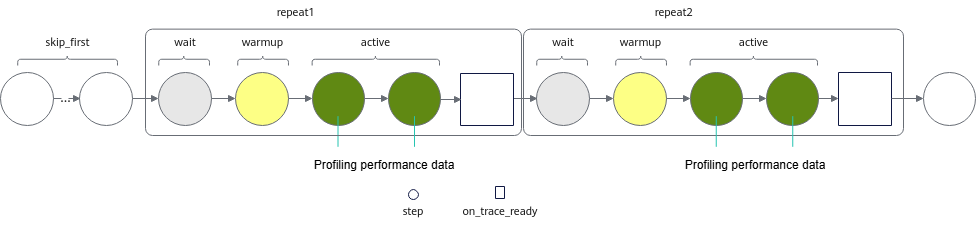

The sample code for the settings is as follows:

```python
with torch_npu.profiler.profile(
    activities=[
        torch_npu.profiler.ProfilerActivity.CPU,
        torch_npu.profiler.ProfilerActivity.NPU,
    ],
    schedule=torch_npu.profiler.schedule(
        wait=2,                        # Wait phase: skip 2 steps.
        warmup=1,                      # Warmup phase: skip 1 step.
        active=2,                      # Record the activity data of 2 steps and call on_trace_ready afterwards.
        repeat=2,                      # Repeat the wait+warmup+active process 2 times.
        skip_first=1,                  # Skip 1 step.
        skip_first_wait=1              # Skip the first wait.
    ),
    on_trace_ready=torch_npu.profiler.tensorboard_trace_handler('./result')
    ) as prof:
        for _ in range(9):
            train_one_step()
            prof.step()                # Notify the profiler that one step is complete.
```

### Introduction to the Maintenance Logs of dynamic\_profile Dynamic Profiling <a id="dynamic-profile-profiling-maintenance-log-introduction"></a>

During dynamic\_profile dynamic profiling, the maintenance logs of dynamic\_profile are automatically recorded in the profiler\_config\_path directory. An example of the generated log directory structure is as follows:

```text
profiler_config_path/
├── log
│    ├── dp_ubuntu_xxxxxx_rank_*.log
│    ├── dp_ubuntu_xxxxxx_rank_*.log.1
│    ├── monitor_dp_ubuntu_xxxxxx_rank_*.log
│    ├── monitor_dp_ubuntu_xxxxxx_rank_*.log.1
├── profiler_config.json
└── shm
```

- dp\_ubuntu\_xxxxxx.log: Execution log of dynamic\_profile dynamic profiling, recording all actions (INFO), warnings (WARNING), and errors (ERROR) during dynamic profiling. File naming format: dp\_\{OS\}\_\{AI task process ID\}\_\{Rank\_ID\}.log.

    When an AI task starts, each Rank starts an AI task process. dynamic\_profile generates log files for each AI task process based on the AI task process ID.

- dp\_ubuntu\_xxxxxx.log.1: Log aging backup file. The storage limit of the dp\_ubuntu\_xxxxxx.log file is 200KB. When the limit is reached, the oldest log records are transferred to dp\_ubuntu\_xxxxxx.log.1. The storage limit of the dp\_ubuntu\_xxxxxx.log.1 file is also 200KB. When the limit is reached, the oldest log records are aged and deleted.
- monitor\_dp\_ubuntu\_xxxxxx.log: Modification log of the profiler\_config.json file. After dynamic\_profile dynamic profiling is enabled, it records in real time each modification time of the profiler\_config.json file, whether the modification takes effect, and the end of the dynamic\_profile process, as shown in the following example:

    ```log
    2024-08-21 15:51:46,392 [INFO] [2127856] _dynamic_profiler_monitor.py: Dynamic profiler process load json success
    2024-08-21 15:51:58,406 [INFO] [2127856] _dynamic_profiler_monitor.py: Dynamic profiler process load json success
    2024-08-21 15:58:16,795 [INFO] [2127856] _dynamic_profiler_monitor.py: Dynamic profiler process done
    ```

    File naming format: monitor\_dp\_\{OS\}\_\{monitor process ID\}\_\{Rank\_ID\}.log.

- monitor\_dp\_ubuntu\_xxxxxx.log.1: Log aging backup file. The storage limit of the monitor\_dp\_ubuntu\_xxxxxx.log file is 200KB. When the limit is reached, the oldest log records are transferred to monitor\_dp\_ubuntu\_xxxxxx.log.1. The storage limit of the monitor\_dp\_ubuntu\_xxxxxx.log.1 file is also 200KB. When the limit is reached, the oldest log records are aged and deleted.
- shm directory: To adapt to Python 3.7, dynamic\_profile generates an shm directory in the py37 environment, in which a binary file (DynamicProfileNpuShm+time) is generated to map shared memory. The file is automatically cleaned up after the program ends normally. When the program is terminated with pkill, because it is an abnormal termination, the program cannot release resources, and you need to manually clean up this file. Otherwise, starting dynamic\_profile with the same configuration path within a short time (&lt;1h) causes dynamic\_profile to become abnormal. For Python 3.8 and later versions, the binary file (DynamicProfileNpuShm+time) is stored in the /dev/shm directory. When the program is terminated with pkill, this file also needs to be manually cleaned up.

### Profiling Performance Data in the Ascend NPU Environment Using the Native torch.profiler Interface

The Ascend NPU environment is compatible with using the native torch.profiler interface to profile performance data, as follows:

1. Add the native torch.profiler interface to the training script.

   For detailed descriptions of the native torch.profiler interface, see *[torch.profiler](https://docs.pytorch.org/docs/stable/profiler.html)*.

2. Change the CUDA fields in the native torch.profiler interface to NPU accordingly.

> [!NOTE]
>
> Torch and torch_npu must be version 2.12.0 or later.

The following is executable sample code, and the highlighted positions are the added native torch.profiler interfaces.

```diff
from pathlib import Path

+import torch
+from torch import nn


class TinyModel(nn.Module):
    def __init__(self) -> None:
        super().__init__()
        self.network = nn.Sequential(
            nn.Linear(1024, 2048),
            nn.ReLU(),
            nn.Linear(2048, 1024),
            nn.ReLU(),
            nn.Linear(1024, 10),
        )

    def forward(self, inputs: torch.Tensor) -> torch.Tensor:
        return self.network(inputs)

def main() -> None:
    steps = 8
    batch_size = 32
    output_dir = Path("profiler_output")
    output_dir.mkdir(parents=True, exist_ok=True)
    device = torch.device("npu:0")
    model = TinyModel().to(device)
    optimizer = torch.optim.AdamW(model.parameters(), lr=1e-3)
    loss_function = nn.CrossEntropyLoss()
    inputs = torch.randn(batch_size, 1024, device=device)
    labels = torch.randint(0, 10, (batch_size,), device=device)

+    with torch.profiler.profile(
+        activities = [
+            torch.profiler.ProfilerActivity.CPU,
+            torch.profiler.ProfilerActivity.NPU,
+        ],
+        schedule=torch.profiler.schedule(wait=1, warmup=1, active=3, repeat=1),
+        on_trace_ready=torch.profiler.tensorboard_trace_handler(str(output_dir)),
+        record_shapes=True,
+        profile_memory=True,
+        with_stack=True,
+        with_modules=True,
+    ) as profiler:
        for step in range(steps):
            optimizer.zero_grad(set_to_none=True)
            predictions = model(inputs)
            loss = loss_function(predictions, labels)
            loss.backward()
            optimizer.step()
            torch.npu.synchronize()
+            profiler.step()

+    events = profiler.events()
+    for index, event in enumerate(events[:20]):
+        print(
+            f"[{index}] name={event.name}, "
+            f"device_type={event.device_type}, "
+            f"self_cpu_time_total={event.self_cpu_time_total:.3f} us, "
+            f"self_device_time_total={event.self_device_time_total:.3f} us, "
+            f"input_shapes={event.input_shapes}"
+        )

+    summary = profiler.key_averages(group_by_input_shape=True).table(
+        sort_by="self_device_time_total", row_limit=30
+    )
+    (output_dir / "operator_summary.txt").write_text(summary, encoding="utf-8")
+    print(summary)


if __name__ == "__main__":
    main()
```

## FAQs<a id="FAQ"></a>

### How to Avoid Performance Expansion When Performance Data Is Directly Written to Shared Storage in PyTorch Multi-Card Large Cluster Scenarios <a id="avoiding-performance-bloat-from-performance-data-directly-written-to-shared-storage"></a>

**Symptom**

In PyTorch multi-card large cluster scenarios, when the Ascend PyTorch Profiler interface is used to profile performance data and write it to disk, the performance data is written to disk by using on\_trace\_ready to execute the tensorboard\_trace\_handler function.

The duration of performance data profiling expands.

**Cause**

Because on\_trace\_ready is used to execute the tensorboard\_trace\_handler function, the write path directly points to the shared storage, and the large number of write requests from multiple cards causes response delays in the shared storage.

**Handling**

By customizing the write method of on\_trace\_ready, write the performance data to the local disk first and then copy the local performance data to the shared storage, which can solve the performance expansion problem. The sample code is as follows:

```python
import time
import torch
import torch_npu
import os
import random
import string
import shutil
import argparse
from torch_npu.profiler._profiler_path_creator import ProfPathCreator
def generate_random_filename(length=8):
    letters = string.ascii_lowercase
    random_letters = ''.join(random.choice(letters) for _ in range(length))
    return random_letters
def create_random_dictory():
    random_filename = generate_random_filename()
    file_path = os.path.join("/tmp/", f"{random_filename}")
    return file_path
def move_file_to_user_path(file_path, user_input_path):
    try:
        if not os.path.exists(user_input_path):
            os.makedirs(user_input_path)
        for item in os.listdir(file_path):
            source_item = os.path.join(file_path, item)
            destination_item = os.path.join(user_input_path, item)
            shutil.move(source_item, destination_item)
        os.rmdir(file_path)
        return True
    except Exception as e:
        print(str(e))
        return False
def train_one_step(i):
    print(f"[APP]train: {i} step...")
    a = torch.rand(2, 3).to("npu")
    b = torch.rand(2, 3).to("npu")
    c = a + b
    time.sleep(2)

# The user_tensorboard_trace_handler below is a custom function of on_trace_ready, where ori_path is a local path and dst_path is a shared storage path.
def user_tensorboard_trace_handler(ori_path, dst_path, dir_name: str = None, worker_name: str = None, analyse_flag: bool = True):
    ProfPathCreator().init(worker_name=worker_name, dir_name=dir_name)
    def handler_fn(prof_inst) -> None:
        if analyse_flag:
            prof_inst.prof_if.analyse()
        result = move_file_to_user_path(ori_path, dst_path)
        if result is True:
            print(f"The file has been successfully moved to the path: {dst_path}")
        else:
            print(f"Error moving the file: {result}")
    return handler_fn


def main():
    parser = argparse.ArgumentParser(description="Generate a random txt file and move it to the specified path.")
    parser.add_argument("path", help="Target path where the file will be moved")
    args = parser.parse_args()
    random_txt_file_path = create_random_dictory()
    # The on_trace_ready below calls the custom function user_tensorboard_trace_handler.
    prof = torch_npu.profiler.profile(on_trace_ready=user_tensorboard_trace_handler(random_txt_file_path, args.path, random_txt_file_path),
                                      schedule=torch_npu.profiler.schedule(skip_first=1, repeat=1, active=2, wait=0, warmup=0))
    prof.start()
    step_num = 5
    for i in range(step_num):
        train_one_step(i)
        prof.step()
    prof.stop()
if __name__ == "__main__":
    main()
```

### Performance Expansion Caused by Using Profiler in PyTorch <a id="performance-bloat-caused-by-using-profiler"></a>

**Symptom**

During model training, the step where Profiler starts and the step where Profiler ends take longer than other steps.

**Cause**

Before Profiler starts profiling, the Profiler initialization of the active or warmup in schedule has overhead, resulting in a certain degree of performance expansion.

In the automatic parsing scenario after Profiler profiling, the parsing phase has relatively large performance expansion.

**Handling**

When Profiler is enabled to profile performance data, if you need to reference the step duration, you can exclude the step durations corresponding to Profiler startup and parsing, and only reference the step durations in the middle part.
