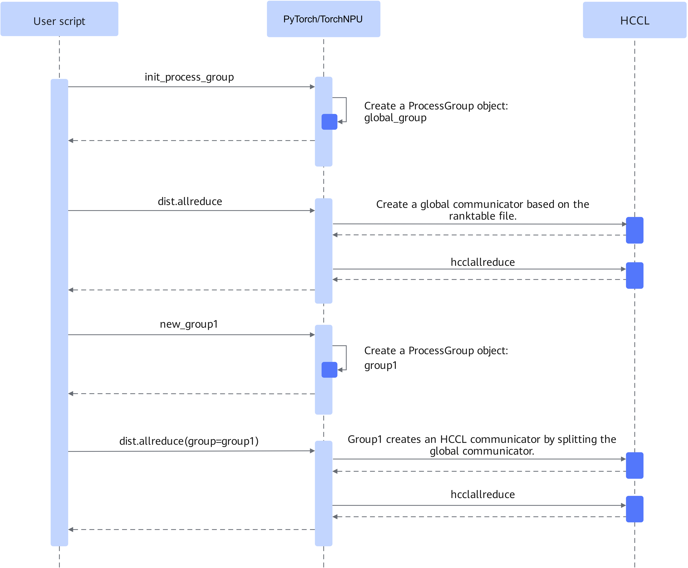

# Ranktable Link Setup

## Introduction

Supports establishing a communicator by configuring the ranktable file to accelerate the communicator establishment time, and makes the link setup time almost independent of cluster scale, thereby solving the performance bottleneck of establishing communicators in large clusters.

**Figure 1**  Flowchart for establishing a communicator using a ranktable file  


PyTorch establishes the global communicator through the ranktable file. Sub-communicators are established by splitting the global communicator.

## Application Scenarios

In large clusters, when the establishment of the model communicator becomes a performance bottleneck for model training, you can consider this feature.

## Usage Guide

The environment variable `RANK_TABLE_FILE` controls whether collective communicator links are established through ranktable file configuration.

- When not configured, collective communicator links are established through the default negotiation process.
- If it is configured and the full file path is valid, collective communicator links are established through the ranktable file.

This environment variable is not configured by default.

 For ranktable file configuration instructions, refer to the "[Cluster Information Configuration](https://gitcode.com/cann/hccl/blob/9.2.0/docs/en/user_guide/cluster_info_config/intro.md)" section in *CANN HCCL Communication Library*.

> [!CAUTION]
>
>- If the configured file path does not exist, collective communicator links are established through the default negotiation process.
>- If the configured file path exists but the configuration information is incorrect, collective communicator links are not established through the default negotiation process. Instead, a corresponding error is reported during actual communication.
>- The configured file path cannot be a symbolic link and must have read permission.

For details on using this environment variable, see the "[RANK\_TABLE\_FILE](../../../api/environment_variable/collective_communication/RANK_TABLE_FILE.md)" section in Environment Variables.

## Usage Examples

Example of enabling link establishment using the rank table file:

```bash
export RANK_TABLE_FILE=/home/ranktable.json
```

Example of disabling link establishment using the rank table file:

```bash
unset RANK_TABLE_FILE
```

## Constraints

This environment variable applies only to neural network scenarios built on the PyTorch framework and is used in distributed collective communication scenarios.
