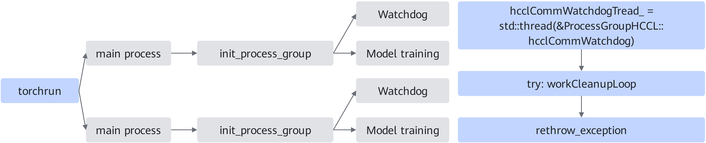

# WatchDog

## Introduction

It can quickly and stably detect errors without affecting the performance and accuracy of large-model training. The WatchDog monitoring process can significantly improve the reliability of PyTorch distributed training using HCCL. Essentially, WatchDog captures errors that occur in collective communication, raises an exception from the child process, and stops the main process training, thereby preventing distributed training from being blocked.

**Figure 1**  WatchDog working diagram  


The preceding figure shows how the WatchDog process works in distributed training. First, the WatchDog thread is started when each process initializes `process_group`, with one WatchDog thread monitoring the `process_group` in a single process. Then, the WatchDog thread asynchronously monitors collective communication anomalies in the `workCleanupLoop` subfunction. After capturing an anomaly, it re-throws the exception in the WatchDog main function, allowing the main training process to perceive the anomaly and quickly terminate the training task.

WatchDog supports not only operator execution anomaly monitoring, communication timeout monitoring, and timeout analysis, but also ERROR CQE detection. CQE detection checks the communication link status of the device network port. When the communication link is abnormal, it is usually reflected as an ERROR CQE.

## Application Scenarios

During LLM training, if the model gets stuck after a collective communication anomaly, the training cannot be terminated in time, resulting in resource waste. Using this feature can prevent this situation.

## Usage Guide

Whether WatchDog is enabled can be set through the environment variable TORCH\_HCCL\_ASYNC\_ERROR\_HANDLING.

The values of TORCH\_HCCL\_ASYNC\_ERROR\_HANDLING:

- 0: Disables asynchronous error handling.
- 1: Enables asynchronous error handling.

The default value is 0 when the PyTorch version is 1.11.0, and 1 when the PyTorch version is 2.1.0 or later.

For details on using this environment variable, see the "[TORCH\_HCCL\_ASYNC\_ERROR\_HANDLING](../../api/environment_variable/collective_communication/TORCH_HCCL_ASYNC_ERROR_HANDLING.md)" section in Environment Variables.

## Usage Examples

Enable asynchronous error handling:

```shell
export TORCH_HCCL_ASYNC_ERROR_HANDLING=1
```

## Constraints

- This environment variable is only applicable to neural network scenarios built on the PyTorch framework, with HCCL used as the communication backend.
- When enabling asynchronous error handling through this environment variable, you are advised to set the timeout of `new_group` and `init_process_group` to a value greater than the time configured by the `HCCL_CONNECT_TIMEOUT` and `HCCL_EXEC_TIMEOUT` environment variables to better identify the cause of HCCL timeouts. For details about `HCCL_CONNECT_TIMEOUT`, see the "[HCCL_CONNECT_TIMEOUT](https://gitcode.com/cann/hccl/blob/9.2.0/docs/en/user_guide/hccl_env/HCCL_CONNECT_TIMEOUT.md)" section in the *CANN HCCL Collection Communication Library*. For details about `HCCL_EXEC_TIMEOUT`, see the "[HCCL_EXEC_TIMEOUT](https://gitcode.com/cann/hccl/blob/9.2.0/docs/en/user_guide/hccl_env/HCCL_EXEC_TIMEOUT.md)" section in the *CANN HCCL Collection Communication Library*.
