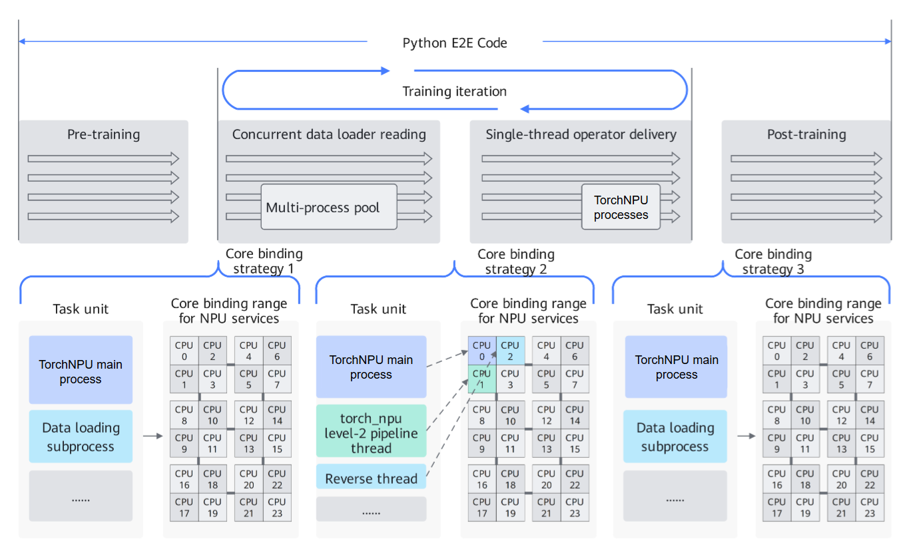

# Automatic Core Binding

## Introduction

TorchNPU can enable coarse-grained or fine-grained core binding by setting the environment variable `CPU_AFFINITY_CONF`. This configuration avoids thread preemption, improves the cache hit rate, avoids memory access across NUMA (Non-Uniform Memory Access) nodes, reduces task scheduling overhead, and optimizes task execution efficiency.

The following binding schemes are available:

- **Coarse-grained binding**: Binds all tasks to all CPU cores in the CPU binding range of the NPU service, preventing thread preemption between tasks on different NPU cards.
- **Fine-grained binding**: Further optimizes coarse-grained binding by anchoring TorchNPU hot threads (for example, the main thread and second-level pipeline threads) to fixed CPU cores in the CPU binding range of the NPU service. That is, the main thread is bound to the first CPU core in the binding range, the second-level pipeline threads are bound to the second CPU core, and so on. Non-hot threads (for example, dataloader threads) are bound to the remaining CPU cores in the range and are isolated from hot threads, which reduces inter-core switching overhead.

    > [!NOTE]  
    > NPU service core binding range: When the core binding feature is enabled, the default core binding range for the service of each NPU card is the corresponding range obtained by evenly dividing the total number of CPU cores by the total number of NPU cards. For example, if the environment has 160 CPU cores and 8 NPU cards, the core binding range for the service of NPU card 0 is [0,19], that is, the first range after dividing into eight equal parts. The core binding range for the service of NPU card 1 is [20,39], and so on. In addition, you can specify the core binding range for the service of a particular card by adding parameters in the environment variable. For details, see [Usage Guide](#usage-guide).

**Figure 1**  Schematic diagram of thread core binding timing and policy design  


## Application Scenarios

This feature is recommended when the host takes a long time to dispatch tasks or when the service time varies greatly between cards.

## Usage Guide

Environment variable `CPU_AFFINITY_CONF=<mode>,force:<value0>,npu<value1>:<value2>-<value3>,npu_affine:<value4>`

- `<mode>`: Required parameter. Specifies the binding mode.
    - `0` or not set: Disables CPU binding.
    - `1`: Enables coarse-grained binding.
    - `2`: Enables fine-grained binding.

- `force:<value0>`: Optional parameter. Specifies whether to force binding and skip conflict detection.
    - Not set (default) or set to `0`: Keeps the original behavior. When the configured binding range conflicts with the current CPU affinity of the process, the binding is skipped and a WARNING log is generated.
    - `1`: Skips conflict detection and forcibly applies the binding configuration. It applies to scenarios such as container core isolation, where the available cores are limited by Cgroup (Control Groups). This prevents conflict detection misjudgment caused by the Cgroup limitation on the number of available CPU cores, which would otherwise invalidate the binding configuration.

    > [!NOTE]
    >
    > `force:1` only skips software-level conflict detection. It cannot break through the hard limit of the OS or Cgroup. The actual binding result is still constrained by the CPU core range allowed by the operating system.

- `npu<value1>:<value2>-<value3>`: Optional parameter. Specifies a custom CPU binding range for the NPU service. The custom binding range takes effect only when the binding feature is enabled, that is, when `mode` is set to `1` or `2`.
    - `npu<value1>:<value2>-<value3>` binds the threads of card `value1` to the CPU cores in the closed interval from `value2` to `value3`. For example, `npu0:0-2` indicates that the binding range of the service threads of NPU card 0 is [0,2].
    - You can configure multiple binding ranges for one NPU card. For example, if you set the environment variable `CPU_AFFINITY_CONF=1,npu0:0-2,npu0:4-5`, the binding range of NPU card 0 is [0,2] and [4,5].
    - You can configure binding ranges for multiple NPU cards. For example, if you set the environment variable `CPU_AFFINITY_CONF=1,npu0:0-0,npu2:1-2,npu2:4-4`, the binding range of NPU card 0 is changed to [0,0], the binding range of NPU card 2 is changed to [1,2] and [4,4], and the binding ranges of other NPU cards remain unchanged.

<!-- npu="910b" id1 -->
- `npu_affine:<value4>`: Optional parameter. Specifies whether to enable NPU affinity binding.
    - `0` or not set: Disables affinity binding.
    - `1`: Enables affinity binding.
<!-- end id1 -->

The core binding feature is disabled by default. If you need to improve performance through core binding, you are advised to use fine-grained binding.

> [!NOTE]  
>
>- The CPU core groups corresponding to NUMA nodes can be viewed using the `lscpu` command.
>- When performing core binding, note whether the topology of the virtual machine is consistent with that of the physical machine. By default, the core group corresponding to npu0 or device 0 is NUMA0. However, virtual machine environments such as Docker may change the mapping relationship. It is recommended to customize the core binding range based on the mapping relationship.
>- Before binding, the core binding range is checked. If any CPU core in the core binding range is non-affine, the thread is determined to already have affinity, and the core binding corresponding to this environment variable is not triggered (the default behavior when the `force` parameter is not configured). In container core isolation scenarios, this detection may misjudge. You can set `force:1` to skip the detection.
>- The optimization effect of core binding varies across different models. In some service scenarios, additional threads may exist, and thread preemption may instead cause performance degradation.
>- For user-defined threads, because child threads inherit the affinity of the main thread, it is recommended to manage the CPU affinity of child threads by calling torch\_npu.utils.set\_thread\_affinity and torch\_npu.utils.reset\_thread\_affinity around where child threads are started. For details, see the "[torch\_npu.utils.set\_thread\_affinity](https://gitcode.com/Ascend/op-plugin/blob/master/docs/en/custom_APIs/torch_npu-utils/torch_npu-utils.set_thread_affinity.md)" section and the "[torch\_npu.utils.reset\_thread\_affinity](https://gitcode.com/Ascend/op-plugin/blob/master/docs/en/custom_APIs/torch_npu-utils/torch_npu-utils.reset_thread_affinity.md)" section in Custom APIs.
>- The affinity core binding range can be viewed using the `npu-smi info -t topo` command.

## Usage Examples

- Coarse-grained binding example:

    ```shell
    export CPU_AFFINITY_CONF=1
    ```

- Fine-grained binding example:

    ```shell
    export CPU_AFFINITY_CONF=2
    ```

- Custom NPU service core binding range example:

    For example, the binding range of NPU card 0 is [0,1], the binding range of NPU card 1 is [2,5] and [7,8], the binding range of NPU card 3 is [9,9], and the binding ranges of other NPU cards use the default settings. Set the binding ranges as follows:

    ```bash
    export CPU_AFFINITY_CONF=1,npu0:0-1,npu1:2-5,npu1:7-8,npu3:9-9
    ```

- Forced core binding example in container core isolation scenarios:

    When the container limits the available cores through Cgroup, set `force:1` to skip conflict detection and forcibly apply the binding configuration:

    ```shell
    export CPU_AFFINITY_CONF=2,force:1,npu0:0-3
    ```
<!-- npu="910b" id4 -->
- NPU affinity binding example:

    ```shell
    export CPU_AFFINITY_CONF=1,npu_affine:1
    ```
<!-- end id4 -->
<!-- npu="910b" id5 -->
## Constraints

Affinity core binding only supports <term>Atlas A2 training products</term>.
<!-- end id5 -->
