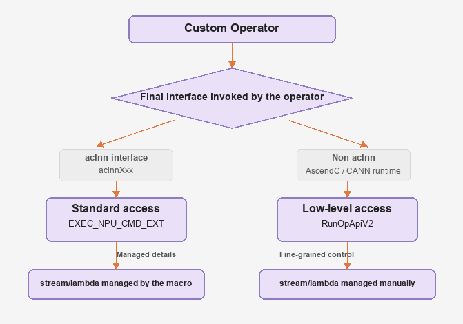

# Overview

C++ operator developers need to follow the guidelines to complete the adaptation of custom operators to the TaskQueue pipeline, ensuring that custom operators can be correctly enqueued and achieve performance gains when TaskQueue is enabled. After the adaptation is complete, model developers can control operator behavior through `TASK_QUEUE_ENABLE`, and the usage is consistent with built-in operators.
Based on the `TASK_QUEUE_ENABLE` control mechanism introduced in [TaskQueue Parallel Delivery](../taskqueue_parallel_delivery.md), two paths are provided for integrating custom operators into TaskQueue: standard access (based on `EXEC_NPU_CMD_EXT`, applicable only to aclnn) and lower-layer access (based on `RunOpApiV2`, applicable to Ascend C kernels or non-aclnn CANN interfaces).

## Application Scenarios

Custom operators are divided into two access paths based on the interfaces they ultimately call:

- [Standard access: EXEC_NPU_CMD_EXT](standard_access.md): Designed specifically for adapting aclnn-series operators to the TaskQueue pipeline. This interface encapsulates the underlying `RunOpApiV2` function and provides an out-of-the-box simplified calling method, enabling rapid integration of custom operators, reducing development complexity, and offering the simplest adaptation.

- [Lower-layer access: RunOpApiV2](lower_layer_access.md): This access method applies to non-aclnn scenarios such as Ascend C kernel launch. It directly calls the `RunOpApiV2` function without encapsulation, and applies to scenarios with higher performance requirements where resources (such as the stream and lambda lifecycle) need to be managed manually, making performance more controllable.

| Access Path | Applicable Scenario | Key Difference |
|---------|---------|---------|
| Standard access: EXEC_NPU_CMD_EXT | The operator ultimately calls the aclnn interface | The macro automatically manages the stream and lambda capture; the adaptation is the simplest |
| Lower-layer access: RunOpApiV2 | Ascend C kernel launch / non-aclnn CANN interfaces | The stream and lambda lifecycle must be managed manually; performance is more controllable |

