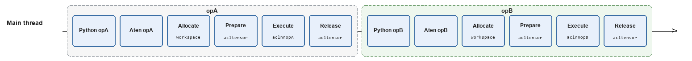
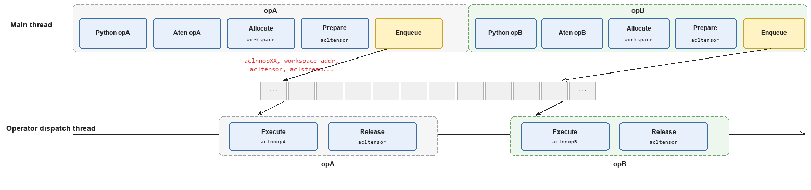
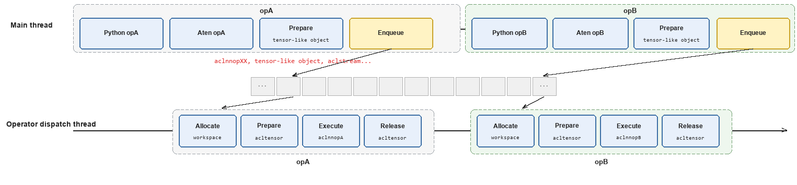

# TaskQueue Parallel Delivery

## Introduction

In scenarios with large models and dense operator calls (such as Transformer-like large-model inference/training), the operator dispatch time on the Host side is significant, causing lower NPU device utilization. TaskQueue is a software mechanism designed by TorchNPU to accelerate operator dispatch. It splits the operator dispatch process into the main thread and the operator dispatch thread, using a queue for data transfer, so that operator preparation work and aclnn Host API calls are executed in parallel, thereby offsetting part of the dispatch time and reducing the CPU instruction cache miss rate. In actual business scenarios, enabling TaskQueue can bring performance improvements (in typical scenarios, dispatch latency is reduced by 5%-20%). Adopting [Scenario 3: Asynchronous Operator Dispatch Process](#scenario-3-asynchronous-operator-dispatch-process-task_queue_enable2) can further improve dispatch performance, but attention must be paid to the peak memory growth caused by the independent memory pool.

By default, all threads and Streams on the same device share one queue; queues on different devices or in different processes are independent of each other. TaskQueue mainly applies to the following situations:

- **During training/inference**: Host-side operator dispatch is latency-sensitive, and the time of aclnn host API calls needs to be offset.
- **When operators are dense**: The model has a large number of operators with short per-operator time (such as element-wise operators in large models), and the Host side can easily become the performance bottleneck.
- **When optimizing cache**: The performance loss caused by the CPU instruction cache miss rate needs to be reduced.

## Application Scenarios

### Scenario 1: Serial Operator Dispatch Process (TASK_QUEUE_ENABLE=0)



In this scenario, the operator dispatch process is executed and returned layer by layer through PyTorch functional calls, with all calls completed in one thread, similar to GPU behavior. This thread is usually:

- **Inference applications**: The main thread of the Python business process, or a Python thread manually created by the user.
- **Training applications**: The forward phase uses the main thread of the Python business process, and the backward phase uses the backward thread created internally by PyTorch.

### Scenario 2: Asynchronous Operator Dispatch Process (TASK_QUEUE_ENABLE=1, default)



In this scenario, part of the workload (mainly aclnn Host API calls, including the actual launch of runtime kernels) is migrated to the operator dispatch thread. Data is passed between the two threads through the queue, reducing waiting time in a pipelined manner and improving execution efficiency.

> [!NOTE]
> 
> The workspace memory is still allocated on the main thread, using the memory pool of the current stream, which is the same as the operator input/output memory pool.

### Scenario 3: Asynchronous Operator Dispatch Process (TASK_QUEUE_ENABLE=2)



Based on Scenario 2, the calculation and allocation of workspace memory are offloaded to the operator dispatch thread.

Because operator input/output memory is allocated on the main thread while workspace memory is allocated on the operator dispatch thread, if the same memory pool is shared, workspace may incorrectly reuse the input of the same operator or released memory, causing memory conflicts. Therefore, this mode requires an independent workspace memory pool design, and custom operators that are not built into TorchNPU should not use this mode.

## Usage Guide

Whether to enable TaskQueue and further improve performance can be configured by setting the `TASK_QUEUE_ENABLE` environment variable.

- When set to "0", the task_queue operator dispatch queue optimization is disabled.
- When set to "1", compared with disabling (`TASK_QUEUE_ENABLE=0`), almost all actual business scenarios can achieve performance improvements. This setting takes effect on all built-in operators by default.
- When set to "2", performance can be further improved compared with "1". Because an independent memory pool design is adopted, if some operators use large workspace memory, setting to "2" may cause peak memory growth compared with "1". It is recommended to try this only in scenarios where the model is stably trained and sufficient memory remains.

> [!NOTE]
> 
> - This environment variable is set to "1" by default.
> - When set to "1" or "2", non-built-in operators need to be adapted by referring to [Integrating Custom Operators into TaskQueue](./taskqueue_op_developer/_menu_taskqueue_op_developer.md). After adaptation, they are also controlled by `TASK_QUEUE_ENABLE`.
> - For troubleshooting, see [FAQ](faq.md).

## Usage Examples

- Disable the task_queue operator dispatch queue optimization

```shell
# Disable TaskQueue
export TASK_QUEUE_ENABLE=0
```

- Enable the task_queue operator dispatch queue optimization

```shell
# Enable TaskQueue
export TASK_QUEUE_ENABLE=1
```

- Enable the task_queue mechanism to further optimize the operator dispatch process

```shell
# Enable TaskQueue to further optimize the operator delivery process
export TASK_QUEUE_ENABLE=2
```

## Constraints

When the environment variable is set to "2", it is incompatible with NPUGraph (aclgraph), and they cannot be enabled at the same time.
