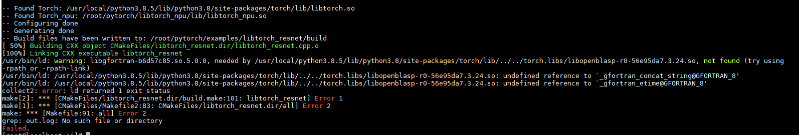

# FAQs

## Build Issues

### Issue 1: torch.libs/libopenblasp-r0-56e95da7.3.24.so Link Error or Missing libgfortran

**Symptom**

When performing libtorch inference tests in an aarch64 environment, the build depends on torch.libs/\*.so libraries, which need to be loaded manually.

- Error screenshot

    

- Error message

    ```text
    [100%] Linking CXX executable libtorch_resnet
    /usr/bin/ld: warning: libgfortran-b6d57c85.so.5.0.0, needed by /usr/local/python3.8.5/lib/python3.8/site-packages/torch/lib/../../torch.libs/libopenblasp-r0-56e95da7.3.24.so, not found (try using     -rpath or -rpath-link)
    /usr/bin/ld: /usr/local/python3.8.5/lib/python3.8/site-packages/torch/lib/../../torch.libs/libopenblasp-r0-56e95da7.3.24.so: undefined reference to `_gfortran_concat_string@GFORTRAN_8'
    /usr/bin/ld: /usr/local/python3.8.5/lib/python3.8/site-packages/torch/lib/../../torch.libs/libopenblasp-r0-56e95da7.3.24.so: undefined reference to `_gfortran_etime@GFORTRAN_8'
    collect2: error: ld returned 1 exit status
    make[2]: *** [CMakeFiles/libtorch_resnet.dir/build.make:101: libtorch_resnet] Error 1
    make[1]: *** [CMakeFiles/Makefile2:83: CMakeFiles/libtorch_resnet.dir/all] Error 2
    make: *** [Makefile:91: all] Error 2
    ```

**Solution**

Add the link to the torch.libs/\*.so library in the CMakeLists.txt build file. The code example is as follows:

```cmake
set(CMAKE_CXX_FLAGS "${CMAKE_CXX_FLAGS} ${TORCH_CXX_FLAGS}")

# Add the search path of the torch.libs/*.so library during compilation and linking. Replace the library path in the following command with the actual path.
link_directories(/usr/local/python3.8.5/lib/python3.8/site-packages/torch.libs)  

add_executable(libtorch_resnet libtorch_resnet.cpp)
target_link_libraries(libtorch_resnet "${TORCH_LIBRARIES}")
target_link_libraries(libtorch_resnet "${TORCH_NPU_LIBRARIES}")
```

### Issue 2: Missing Project Files in the third_party Directory During Build or the Need to Switch the Project Commit ID

**Symptom**

During the build process, submodules are missing or the submodule version needs to be changed.

Error message

```text
Traceback (most recent call last):
  File "/opt/_internal/cpython-3.9.21/lib/python3.9/runpy.py", line 197, in _run_module_as_main
    return _run_code(code, main_globals, None,
  File "/opt/_internal/cpython-3.9.21/lib/python3.9/runpy.py", line 87, in _run_code
    exec(code, run_globals)
  File "/home/pytorch/torchnpugen/gen_backend_stubs.py", line 948, in <module>
    main()
  File "/home/pytorch/torchnpugen/gen_backend_stubs.py", line 400, in main
    run(options.source_yaml, options.output_dir, options.dry_run,
  File "/home/pytorch/torchnpugen/gen_backend_stubs.py", line 823, in run
    merge_custom_yaml(source_yaml, op_plugin_yaml_path)
  File "/home/pytorch/torchnpugen/utils.py", line 153, in merge_custom_yaml
    PathManager.check_directory_path_readable(op_plugin_path)
  File "/home/pytorch/torchnpugen/utils.py", line 94, in check_directory_path_readable
    cls.check_path_owner_consistent(path)
  File "/home/pytorch/torchnpugen/utils.py", line 80, in check_path_owner_consistent
    raise RuntimeError(msg)
RuntimeError: The path does not exist: /home/pytorch/third_party/op-plugin/op_plugin/config/v2r7/op_plugin_functions.yaml
```

**Solution**

Run the following command in the PyTorch directory to initialize and update all submodules:

```bash
git submodule update --init --recursive
```

To switch the commit ID of a third_party project, navigate to the corresponding project directory and run:

```bash
git checkout <commit_id>
```

### Issue 3: Build Error Caused by Line Breaks

**Symptom**

Build error: unrecognized line breaks.

Error message

```text
ci/build.sh: line 2: $'\r': command not found
: invalid optione 3: set: -
set: usage: set [-abefhkmnptuvxBCHP] [-o option-name] [--] [arg ...]
ci/build.sh: line 4: $'\r': command not found
ci/build.sh: line 9: $'\r': command not found
ci/build.sh: line 11: syntax error near unexpected token `$'{\r''
'i/build.sh: line 11: `function parse_script_args() {
```

**Possible Cause**

Windows line break issue. The file uses Windows-style line breaks (CRLF: \r\n), but Linux bash only recognizes Unix-style line breaks (LF: \n), causing "\r" to be executed as part of the command.

**Solution**

You can try using the dos2unix tool to resolve this.

```bash
# Install the dos2unix tool
yum install -y dos2unix

# Convert text files in batches (select the files to convert based on your requirements and the error messages)
find /home/pytorch -type f \
  \( -name "*.sh" -o -name "*.py" -o -name "*.cpp" -o -name "*.h" \
  -o -name "*.c" -o -name "*.cmake" -o -name "CMakeLists.txt" \
  -o -name "configure" -o -name "*.txt" -o -name "*.yaml" -o -name "*.yml" \
  -o -name "*.md" -o -name "*.cfg" -o -name "*.in" \) \
  -exec dos2unix {} + 2>/dev/null

# Clear the previous build cache (the CMake cache may retain incorrect configurations)
rm -rf /home/pytorch/build

# Recompile
bash ci/build.sh
```

### Issue 4: Build Error: CMake\_minimum\_required

**Symptom**

A build error occurs due to a CMake version mismatch.

Error message

```text
CMake Error at third_party/Tensorpipe/third_party/libuv/CMakeLists.txt:1 (cmake_minimum_required):
  Compatibility with CMake < 3.5 has been removed from CMake.
```

**Possible Cause**

This means the CMake version in your container is relatively new (≥ 3.27). Starting from CMake 3.27, projects with a cmake_minimum_required lower than 3.5 are no longer compatible, and CMake exits directly with an error.

**Solution**

You can try to resolve this by adding `cmake_args.append('-DCMAKE_POLICY_VERSION_MINIMUM=3.5')` in the `run` function of `class CPPLibBuild` in the setup.py file, so that CMake processes the old cmake_minimum_required declaration in compatibility mode.

### Issue 5: Build Error: Linker Issue

**Symptom**

Build error: unable to correctly recognize the link symbol.

Error message

```text
/home/pytorch/third_party/torchair/torchair/third_party/ascend/include/ascendcl/external/acl/error_codes/rt_error_codes.h:1:1: error: expected unqualified-id before ‘.’ token
```

**Possible Cause**

The file was originally a symbolic link. On Windows, Git automatically converted it into a text file containing the path.

**Solution**

```bash
# Fix broken symbolic links (find files whose content is a relative path and rebuild them as symbolic links)
find /home/pytorch -type f -name "*.h" -exec grep -l '^\.\./' {} \; 2>/dev/null | while read f;do
    target=$(cat "$f")
    ln -sf "$target" "$f"
done
```

Or try replacing with actual content:

For example, replace the content in `third_party\torchair\torchair\third_party\ascend\include\ascend/include/ascendcl/external/acl/error_codes/rt_error_codes.h` with the content from `third_party\torchair\torchair\third_party\ascend\include\air\external\ge\ge_error_codes.h`.

### Issue 6: Fatal Error: 'filesystem' file not found

**Symptom**

Build error: "filesystem" file missing.

Error message

```text
fatal error: 'filesystem' file not found
```

**Possible Cause**

This error is usually caused by an outdated GCC version. Run the following command to check the current GCC version:

```bash
gcc --version
```

**Solution**

If the GCC version is lower than 8, see the [Installing GCC](https://ubuntu.com/developers/docs/howto/gcc-setup/) documentation to install GCC 8 or later.

## Installation Issues

### Issue 1: The Built whl Package Does Not Match the Current Environment

**Symptom**

After the build is complete, the corresponding whl package cannot be installed.

Error message

```text
ERROR: torch_npuxxx.whl is not a supported wheel on this platform
```

**Possible Cause**

The Python environment used during the build does not match the Python environment used during installation.

**Solution**

Before compiling and installing the package, confirm the Python version required by the target environment, and specify the corresponding Python version using the `--python` parameter during the build:

```bash
bash ci/build.sh --python=3.xx
```

### Issue 2: ImportError: libhccl.so: cannot open shared object file: No such file or directory

**Symptom**

When importing torch_npu, the system reports that the libhccl.so file is missing.

Error message

```text
ImportError: libhccl.so: cannot open shared object file: No such file or directory
```

**Possible Cause**

The current environment does not meet the requirements for running TorchNPU. During the build, TorchNPU depends on torch, while at runtime it depends on the matching NPU driver and firmware and the CANN software.

**Solution**

Check whether the matching versions of the NPU driver and firmware and the CANN software (Toolkit, ops, and NNAL) have been installed, and configure the CANN environment variables correctly. For details, see [CANN Software Installation](https://www.hiascend.com/document/detail/en/CANNCommunityEdition/910/softwareinst/instg/instg_0000.html?OS=openEuler&InstallType=netyum).

### Issue 3: Core Dump Error When Importing torch_npu

**Symptom**

After compiling and installing TorchNPU, running "import torch_npu" causes the system to report a core dump error.

Error message

```text
Segmentation fault
(core dumped)
```

**Possible Cause**

The GCC version used during the build does not meet expectations. pybind performs an ABI check, and different GCC versions have different abi_version values, causing the check to fail.

**Solution**

Use the corresponding GCC version for compilation. For the specific matching versions, see [GCC and CMake Version Requirements](building_from_source.md#gcc_cmake).

### Issue 4: "import torch_npu" Error: torch_npu._C Not Found

**Symptom**

After installing TorchNPU, "import torch_npu" reports an error related to torch_npu._C.

Error message

```text
Traceback (most recent call last):
  File "<stdin>", line 1, in <module>
  File "/home/pytorch/torch_npu/__init__.py", line 58, in <module>
    import torch_npu.utils.patch_getenv
  File "/home/pytorch/torch_npu/utils/__init__.py", line 12, in <module>
    from torch_npu.npu.utils import get_cann_version
  File "/home/pytorch/torch_npu/npu/__init__.py", line 158, in <module>
    from .utils import (obfuscation_initialize, obfuscation_calculate, obfuscation_finalize, 
  File "/home/pytorch/torch_npu/npu/utils.py", line 11, in <module>
    import torch_npu._C
ModuleNotFoundError: No module named 'torch_npu._C'
```

**Possible Cause**

Because the installed TorchNPU has the same name as a folder in the project, "import torch_npu" cannot be run in the project directory.

**Solution**

Enter an appropriate working directory and retry. For example, run `cd test` or `cd /home/test` first, and then run "import torch_npu".

### Issue 5: Querying the Installed TorchNPU Version

**Symptom**

Query the installed TorchNPU version.

**Query Method**

1. Run the following command to view the TorchNPU installation package version number.

    ```bash
    pip list | grep torch_npu
    ```

    The output shows the TorchNPU installation package version number as follows.

    ```text
    torch_npu     2.12.0
    ```

2. Query the corresponding TorchNPU version based on the TorchNPU installation package version number. For details about the compatibility, see [TorchNPU Version Compatibility Table](https://gitcode.com/Ascend/pytorch/blob/master/COMPATIBILITY.md#torchnpu-%E7%89%88%E6%9C%AC%E9%85%8D%E5%A5%97%E8%A1%A8).
