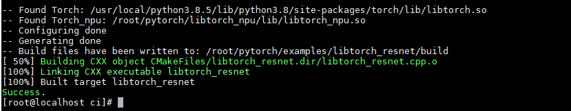

# Building libtorch\_npu

libtorch\_npu is the C++ version of the TorchNPU plugin, which includes the header files, library files, and CMake configuration files required to run the TorchNPU plugin. Through libtorch\_npu, you can use the C++ interfaces exposed by the TorchNPU plugin.

## Build Procedure

1. Refer to [Building from Source](../building_from_source.md) to complete the installation of the dependencies, PyTorch, and TorchNPU.
2. Install CMake 3.18.0 or later. For details, see [Installing CMake](https://cmake.org/download/).
3. Obtain the libtorch\_npu source code.

    ```bash
    git clone -b master https://gitcode.com/Ascend/pytorch.git
    cd pytorch
    git submodule update --init --recursive
    ```

4. Run the build to generate the libtorch\_npu installation package.
    > [!NOTE]
    > 
    > Currently, libtorch\_npu uses CXX11\_ABI=0 by default and supports configuring CXX11\_ABI=1. The command is as follows:
    >
    > ```bash
    > export _GLIBCXX_USE_CXX11_ABI=1
    > ```
    >
    > You can select the ABI version based on actual conditions. The ABI must be consistent with that of the PyTorch framework.

    ```bash
    python3 build_libtorch_npu.py
    ```

    The release version is built by default. If you need the debug version, add the DEBUG=1 environment variable. After the build is complete, the libtorch\_npu directory is generated in the current directory, containing the following files.

    - include: Generated C++ header files.
    - lib: Generated C++ library files.
    - share: Contains Torch\_npuConfig.cmake, which is used to obtain the necessary header files, library files, and other configuration files during the build.

## libtorch Inference Test

Take the "pytorch/examples/libtorch\_resnet" model under the master branch of the TorchNPU source repository as an example to describe the quick use of libtorch inference.

1. You need to install torch, TorchNPU, torchvision, hypothesis, expecttest, and packaging in advance.
    - For the installation of torch, TorchNPU, and torchvision, see [Building from Source](../building_from_source.md) and [Installing torchvision](https://pytorch.org/get-started/locally/).
    - To install hypothesis, expecttest, and packaging, run the following commands. If you install as a non-root user, append `--user` to the command, for example: **pip3 install expecttest --user**.

        ```bash
        pip3 install expecttest
        pip3 install packaging
        pip3 install hypothesis
        ```

2. Add the NPU build configuration to the build file.

    For the build file that has been adapted for NPU, see "pytorch/examples/libtorch\_resnet/**CMakeLists.txt**", which can be used directly for the build.

    If you use a custom CMakeLists.txt build file, you need to add the following content to reference the libtorch\_npu plugin for subsequent NPU-based build work.

    ```cmake
    set(torch_npu_path path_to_libtorch_npu)         # Set the path of libtorch_npu
    include_directories(${torch_npu_path}/include)   # Set the path of the header files referencing libtorch_npu
    link_directories(${torch_npu_path}/lib)          # Set the path of the library files referencing libtorch_npu
    
    target_link_libraries(libtorch_resnet torch_npu) # Link the TorchNPU library
    ```

3. To initialize and run the model on an NPU device, you need to modify the GPU APIs in the C++ code to the APIs adapted for NPU. The current script has already made the corresponding modifications. You can refer to the following content to modify your actual development scripts. For the model code file that has been adapted for NPU, see "pytorch/examples/libtorch\_resnet/**libtorch\_resnet.cpp**".

    The code example is as follows. Include the torch\_npu header file and set the Device for initialization. When NPU usage ends, you need to call torch\_npu::finalize\_npu\(\) to release resources. Otherwise, an error message may be reported.

    ```Cpp
    // To use the libtorch_npu interfaces, you need to include the libtorch_npu header file
    #include<torch_npu/torch_npu.h>
    
    // Initialize the NPU device before using it
    torch_npu::init_npu("npu:0");
    
    // Construct the NPU device by passing an NPU string
    auto device = at::Device("npu:0");
    
    // Deinitialize the NPU device after use
    torch_npu::finalize_npu();
    ```

    **Table 1**  C++ API Description

    |API|Description|
    |--|--|
    |torch_npu::init_npu()|Initialization is required before using the NPU device. The input value format is npu:*id*, where id is the NPU card number.|
    |at::Device()|Constructs an NPU device by passing an NPU string. The input value format is npu:*id*, where id is the NPU card number.|
    |torch_npu::finalize_npu()|Deinitialization is required after using the NPU device. The input value format is npu:*id*, where id is the NPU card number.|

4. Run the build and perform inference.

    The "pytorch/examples/libtorch\_resnet/**resnet\_trace.py**" script is used to export the TorchScript file, which can be used for libtorch inference.

    For the compilation and inference scripts, see "pytorch/ci/**libtorch\_resnet.sh**". The provided script has integrated the export of the TorchScript file, compilation, and inference. Run the following command to compile and perform inference:

    ```bash
    bash libtorch_resnet.sh
    ```

    The following output indicates a successful build.

    **Figure 1**  Command output
    
    

    > [!NOTE]
    >
    > In the aarch64 environment, an error is reported that the torch.libs/\*.so library does not exist. See [torch.libs/libopenblasp-r0-56e95da7.3.24.so does not exist](../faq.md#issue-1-torchlibslibopenblasp-r0-56e95da7324so-link-error-or-missing-libgfortran).
