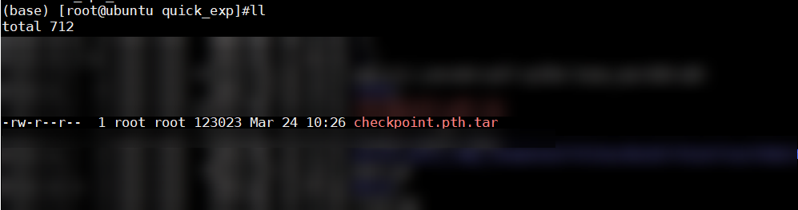

# Quick Start

## Environment Preparation

This example is based on the Atlas 800T A2 training server.

Complete the following installation and environment configuration first. If you have already done so, proceed directly to data preparation.

- NPU driver firmware and CANN: See [*CANN Software Installation*](https://www.hiascend.com/document/detail/zh/CANNCommunityEdition/910/softwareinst/instg/instg_0000.html?OS=openEuler&InstallType=netyum), and load the environment variables as instructed in the guide.
- PyTorch framework and TorchNPU plugin: See [Quick Installation](https://www.hiascend.com/developer/software/ai-frameworks/pytorch/download?versionId=182&ids=89dda9ba9de741349efa03687a487678%2C202%2C106%2C1%2C6%2C177%2C).
- torchvision: Install the CPU version that matches the PyTorch version. For details, see [Installing torchvision](../installation_guide/installing_torchvision.md).

## Data Preparation

This example is based on the MNIST handwritten digit dataset. On the first run, the script downloads the data through `download=True`, which requires access to the dataset download site. The data is saved in `mnist/MNIST/raw/` under the current working directory. After the data has been fully downloaded, subsequent runs reuse the local data.

If the training server cannot access the network, you can first run the following command in a networked environment where torchvision is installed, then copy the generated entire `mnist` directory to the working directory where the training script runs on the training server, and change `download=True` to `download=False` in the training script.

```bash
python3 -c "from torchvision.datasets import MNIST; MNIST(root='mnist', train=True, download=True)"
```

## Model Migration Training

This section uses a CNN model recognizing MNIST handwritten digits as an example to demonstrate how to migrate a GPU training script to run on Ascend NPUs through automatic migration. Complete the applicable modifications in steps 1 to 3 first, and then perform step 4. Select whether to enable mixed precision based on the hardware applicability instructions in step 3.

> [!NOTE]
>
> In the `diff` code blocks below, `+` indicates an added line, `-` indicates a deleted line, and `...` indicates omitted original code. These markers are used to indicate the modification locations and should not be written into `train.py`. Ordinary `python` code blocks can be copied directly; please preserve the code indentation.

1. Create a new script train.py and write the following original GPU script code into it.

    ```python
    # Import modules
    import torch
    import torch.nn as nn
    from torch.utils.data import DataLoader
    import torchvision
    
    # Initialize the running device
    device = torch.device('cuda:0')   
    
    # Define the model network
    class CNN(nn.Module):
        def __init__(self):
            super(CNN, self).__init__()
            self.net = nn.Sequential(
                # Convolutional layer
                nn.Conv2d(in_channels=1, out_channels=16,
                          kernel_size=(3, 3),
                          stride=(1, 1),
                          padding=1),
                # Pooling layer
                nn.MaxPool2d(kernel_size=2),
                # Convolutional layer
                nn.Conv2d(16, 32, 3, 1, 1),
                # Pooling layer
                nn.MaxPool2d(2),
                # Flatten multi-dimensional input
                nn.Flatten(),
                nn.Linear(32*7*7, 16),
                # Activation function
                nn.ReLU(),
                nn.Linear(16, 10)
            )
        def forward(self, x):
            return self.net(x)
    
    # Download dataset
    train_data = torchvision.datasets.MNIST(
        root='mnist',
        download=True,
        train=True,
        transform=torchvision.transforms.ToTensor()
    )
    
    # Define training parameters
    batch_size = 64   
    model = CNN().to(device)  # Define model
    train_dataloader = DataLoader(train_data, batch_size=batch_size)    # Define DataLoader
    loss_func = nn.CrossEntropyLoss().to(device)    # Define loss function
    optimizer = torch.optim.SGD(model.parameters(), lr=0.1)    # Define optimizer
    epochs = 10  # Set the number of epochs
    
    # Set up the loop
    for epoch in range(epochs):
        for step, (imgs, labels) in enumerate(train_dataloader, start=1):
            imgs = imgs.to(device)    # Move the image data to the specified device
            labels = labels.to(device)    # Move the label data to the specified device
            outputs = model(imgs)    # Forward computation
            loss = loss_func(outputs, labels)    # Loss function calculation
            optimizer.zero_grad()
            loss.backward()    # Loss function backward computation
            optimizer.step()    # Update optimizer
            if step % 100 == 0 or step == len(train_dataloader):
                print(f"Epoch [{epoch + 1}/{epochs}], Step [{step}/{len(train_dataloader)}], Loss: {loss.item():.4f}")
    
    # Save the model checkpoint
    torch.save({
                   'epoch': epochs,
                   'arch': CNN,
                   'state_dict': model.state_dict(),
                   'optimizer' : optimizer.state_dict(),
                },'checkpoint.pth.tar')
    print("Training completed. Checkpoint saved to checkpoint.pth.tar")
    ```

2. Add the following code to the import area at the top of `train.py`, ensuring that it is placed before `device = torch.device('cuda:0')`.

    ```diff
     import torch
     import torch.nn as nn
     from torch.utils.data import DataLoader
     import torchvision
    +import torch_npu
    +from torch_npu.contrib import transfer_to_npu    # Enable automatic migration
    ```

    Importing `transfer_to_npu` enables automatic migration, mapping the relevant CUDA calls in this example to the NPU. Therefore, `cuda:0` in the script can be retained, and the model and data actually run on the NPU. If automatic migration is not enabled, you can refer to [Manual Migration](https://gitcode.com/Ascend/ModelZoo-PyTorch/blob/master/PyTorch/docs/zh/model_migration/manual_migration.md) for related operations.

3. Add the following code to train.py to enable AMP mixed precision.

    > [!NOTE]
    >
    > - If you are using <term>Atlas training products</term>, due to their architectural characteristics, you need to perform this step to enable mixed precision after the migration is complete and before training begins.
    > - If you are using <term>Atlas A2 training products</term>, <term>Atlas A3 training products</term>, or <term>Ascend 950DT</term>, you can choose whether to enable mixed precision. If you choose not to enable mixed precision, you can skip this step.
    > - For a detailed introduction to mixed precision, see [Mixed Precision Adaptation](https://gitcode.com/Ascend/ModelZoo-PyTorch/blob/master/PyTorch/docs/zh/mixed_precision_adaptation/adaptation_introduction.md).

    AMP (automatic mixed precision) includes two main operations: `autocast` selects the appropriate computation precision for operators in forward computation; `GradScaler` reduces the risk of low-precision gradient underflow by scaling the loss, and restores the gradient scale when updating parameters.

    Add the AMP module in the import area, and define `GradScaler` after the model and optimizer definitions and before the training loop:

    ```diff
     import torch_npu
    +from torch_npu.npu import amp
     from torch_npu.contrib import transfer_to_npu
     ...
     loss_func = nn.CrossEntropyLoss().to(device)    # Define the loss function
     optimizer = torch.optim.SGD(model.parameters(), lr=0.1)    # Define the optimizer
    +scaler = amp.GradScaler()    # Define GradScaler
     epochs = 10
    ```

    Replace the entire training loop starting from `for epoch in range(epochs):` in step 1 with the following code, and keep the model saving code after the loop in its original position. Note that both the forward computation and the loss computation are placed inside `with amp.autocast():`, while backpropagation is performed outside it.

    ```python
    for epoch in range(epochs):
        for step, (imgs, labels) in enumerate(train_dataloader, start=1):
            imgs = imgs.to(device)
            labels = labels.to(device)
            with amp.autocast():
                outputs = model(imgs)    # Forward computation
                loss = loss_func(outputs, labels)    # Loss function calculation
            optimizer.zero_grad()
            scaler.scale(loss).backward()    # Scale the loss and perform backpropagation
            scaler.step(optimizer)    # Restore the gradient scale and update parameters, and skip the update when the gradient is non-finite
            scaler.update()    # Dynamically update the scaling factor
            if step % 100 == 0 or step == len(train_dataloader):
                print(f"Epoch [{epoch + 1}/{epochs}], Step [{step}/{len(train_dataloader)}], Loss: {loss.item():.4f}")
    ```

4. Run the following command in the directory where `train.py` is located to start training. For the first experience, you can change `epochs = 10` to `epochs = 1` to verify one round of the training process first.

    ```bash
    python3 train.py
    ```

    During training, the current epoch, training step, and loss are printed every 100 batches and at the last batch of each epoch, making it easy to observe the training progress. Here, loss is the loss value of the current batch.

    When default parameters are used, the log format is as follows (the loss values are for illustration only, and the actual results vary with each run):

    ```text
    Epoch [1/10], Step [100/938], Loss: 0.4123
    Epoch [1/10], Step [200/938], Loss: 0.2856
    ...
    Epoch [10/10], Step [938/938], Loss: 0.0732
    Training completed. Checkpoint saved to checkpoint.pth.tar
    ```

    The loss may fluctuate across batches and is not required to decrease each time. If `nan` or `inf` appears, check the data, learning rate, and mixed precision configuration.

    This training ends normally, outputs a save completion message, and generates or updates `checkpoint.pth.tar` in the current working directory, indicating that the migration training process in this example has been completed. This file contains information such as model parameters, optimizer state, and the number of training epochs. Determine the result based on the logs of this run and the file modification time to avoid mistaking an old file for the result of this run. The model recognition performance still needs to be evaluated on an independent test set, and this example does not include an evaluation step.

    

## Advanced Development

- If you want to explore more features of PyTorch model training migration, go to the [PyTorch Training Model Migration and Tuning Guide](https://gitcode.com/Ascend/ModelZoo-PyTorch/blob/master/PyTorch/docs/en/README.md) document for details.
- If you want to explore more features of large model training, see [Table 1](#table1) for details.

    **Table 1**  Model migration guide<a id="table1"></a>

    | Large Model | Component | Migration Guide |
    | -- | -- | -- |
    |Megatron-LM distributed large model|MindSpeed Core affinity acceleration module|See *[Distributed Training Acceleration Library Migration Guide](https://gitcode.com/Ascend/MindSpeed/blob/26.1.0_core_r0.12.1/docs/en/user-guide/model-migration.md)*.|
    |Megatron-LM large language model|MindSpeed LLM suite|See *[MindSpeed LLM Documentation Guide](https://gitcode.com/Ascend/MindSpeed-LLM/blob/26.1.0/docs/en/docs_guide.md)*.|
    |Megatron-LM multimodal model|MindSpeed MM suite|See *[MindSpeed MM Migration and Tuning Guide](https://gitcode.com/Ascend/MindSpeed-MM/blob/26.1.0/docs/en/pytorch/model_migration.md)*.|
    |Large language model or multimodal model|veRL suite|See *[veRL Migration Guide](https://github.com/verl-project/verl/blob/main/README.md)*.|
