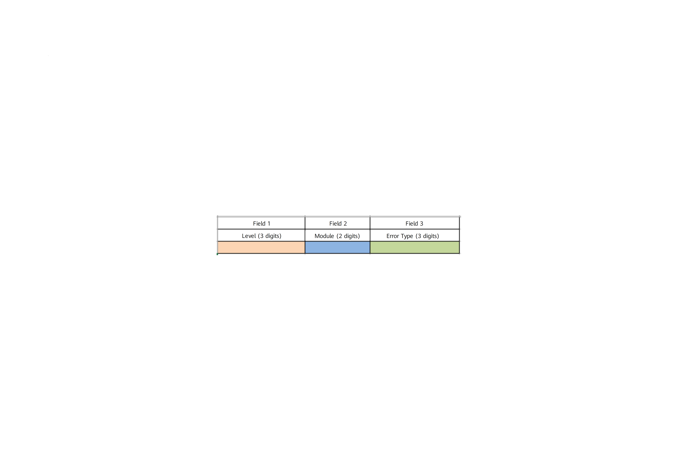
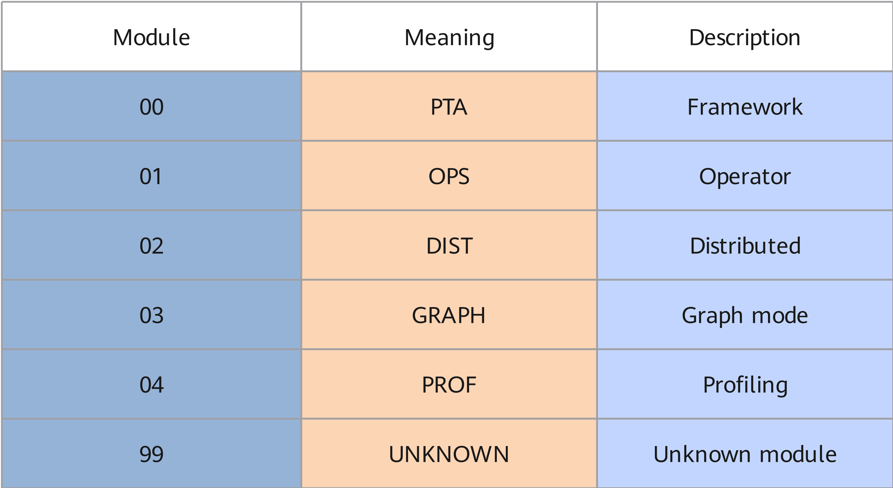
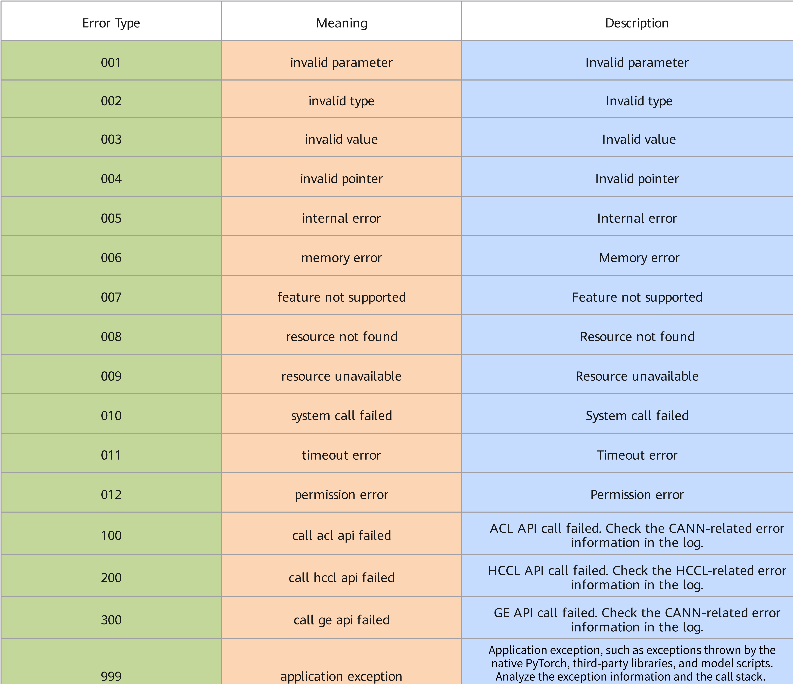

# Usage Notes

## Generation Mechanism

When exceptions or errors occur while the user is building models, running inference, executing training scripts, or performing other operations, for example, input errors are detected (incorrect command-line input parameters, incorrect API input parameters, incorrect input files, unsupported operators, unsupported shapes/formats, and so on) or environment errors occur, the system displays the error code information of the error on the user interface. In actual problem locating, you need to locate the problem based on the specific error information and plog logs.

## Display Mode

> [!NOTE]
>
> Generally, ERR\*\*005 indicates an internal error. You can submit an issue on the [Ascend Community](https://gitcode.com/Ascend/pytorch/issues) for help.
> The error code information described in this topic has been fully displayed when an error is printed on the screen, including possible causes, solutions, and so on. Therefore, this topic only lists the related content for reference.

Due to different scenarios, test cases, and fault causes, the printed error code information differs. Therefore, in this topic, \\[%s\\] variables are used to replace the actual printed logs, and the actual logs prevail.

For example, the ERR00002 error code is expressed in the manual as follows:

\[ERROR\] \[%s\] \(PID:\[%s\], Device:\[%s\], RankID:\[%s\]\) ERR\[%s\]\[%s\] \[%s\] \[%s\]

The following is an example of an actual error reported on the user interface. The error information consists of five parts. For details, see [Table 1](#error-message-detailed-description).

```text
[ERROR] 2024-03-07-01:31:48 (PID:116072, Device:0, RankID:-1) ERR00002 PTA invalid type
```

**Table 1**  Error information details <a id="error-message-detailed-description"></a>

|Error Information|Description|
|:---|:---|
|Log Level|Example: [ERROR].|
|Log Timestamp|Example: 2024-03-07-01:31:48.|
|Device Information|Example: (PID:116072, Device:0, RankID:-1).<br>- PID: process ID of the process that reports the error.<br>- Device: number of the device where the process that reports the error resides, obtained through the ACL interface. If the acquisition fails, the default value -1 is printed.<br>- RankID: sequence number of the device where the process that reports the error resides in the communicator, obtained through the environment variable RANK. If it is not configured, the default value -1 is printed.|
|Error Code|Example: ERR00002.<br>The error code is expressed in 8 characters. For the meaning of each field, see [Figure 1](#field-descriptions):<br>- Field 1 is ERR, indicating the error class.<br>- Field 2 is a two-digit number, indicating the error module. For details, see [Figure 2](#field-2-meaning).<br>- Field 3 is a three-digit number, indicating the error type. For details, see [Figure 3](#field-3-meaning).|
|Error Code Meaning|Example: PTA invalid type.|

**Figure 1**  Meanings of the fields <a id="field-descriptions"></a>  


**Figure 2**  Meaning of Field 2 <a id="field-2-meaning"></a>  


**Figure 3**  Meaning of Field 3 <a id="field-3-meaning"></a>  

