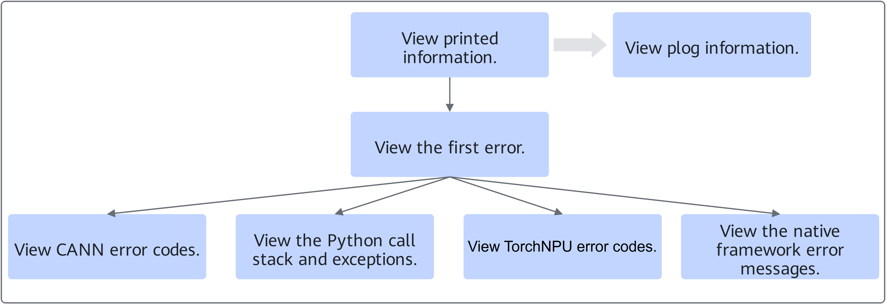
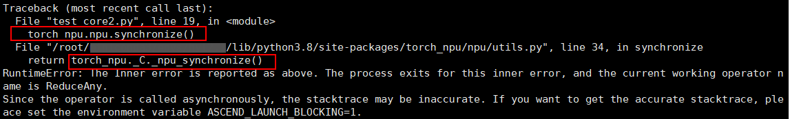
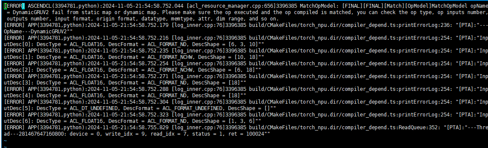

# Error Information Analysis Process

## Analysis Process

After obtaining the error information, you can perform self-service problem analysis by referring to the following process, so that developers can quickly locate and resolve faults.

**Figure 1**  Error information analysis process  


1. View the error information printed on the screen. Check the first error first, then view the information by category based on the specific information, and finally analyze the fault cause.
2. If the command output cannot finally determine the cause of the fault, you can continue to view the plog logs for analysis.

## Analysis Example

This section uses the command output shown in the following figure as an example to describe how to analyze error information.

**Figure 2**  Example of command output  


1. View the first error in the command output.

    ```text
    EZ3002: 2024-11-05-22:31:29.035.909 Optype [%s] of Ops kernel [%s] is unsupported. Reason: %s.
    ```

    "EZ3002" is a CANN software error code. You can refer to the "[Error Code Reference](https://gitcode.com/cann/docs/blob/9.2.0/docs/en/troubleshooting/error_code_desc.md)" section in *CANN Fault Handling* to analyze the fault based on the corresponding error code information. If the source of the problem is still unclear, you can further check other command output.

2. View the Python call stack and exception information.

    **Figure 3**  Python call stack  
    

    The screen shows that `torch_npu.npu.synchronize()` is called first, and then the call to `torch_npu._C._npu_synchronize()` fails. The exception information shows that the operator running when the error occurred is ReduceAny. Based on this, you can find the corresponding exception component. If there is no clear error indication, you need to continue checking the subsequent calls.

3. View the TorchNPU error code.

    ```text
    ERR00100 PTA call acl api failed
    ```

    "ERR00100" is a TorchNPU error code. If there is a clear error indication, you can troubleshoot the fault based on the specific fault cause.

4. In addition, this indicates that TorchNPU reports an error when calling the underlying interface. You can also view the plog logs and analyze the fault cause based on the first error in the logs.

    **Figure 4**  Finding the error component in plog logs  
    

    The error component in the printed information above is ASCENDCL, and the error information is the operator DynamicGRUV2. Based on this, you can find the corresponding exception component. If you still cannot determine the fault component based on the error information, submit [GitCode Issues](https://gitcode.com/Ascend/pytorch/issues) for help.

> [!NOTE]  
> If the command output shows a native framework error, resolve it according to the direction indicated by the error information. If it involves Ascend-related issues, you can view the first Ascend error information other than this.
