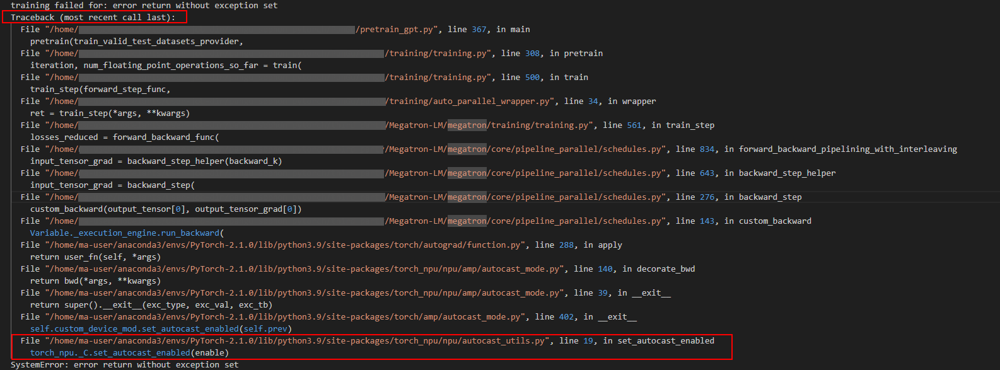
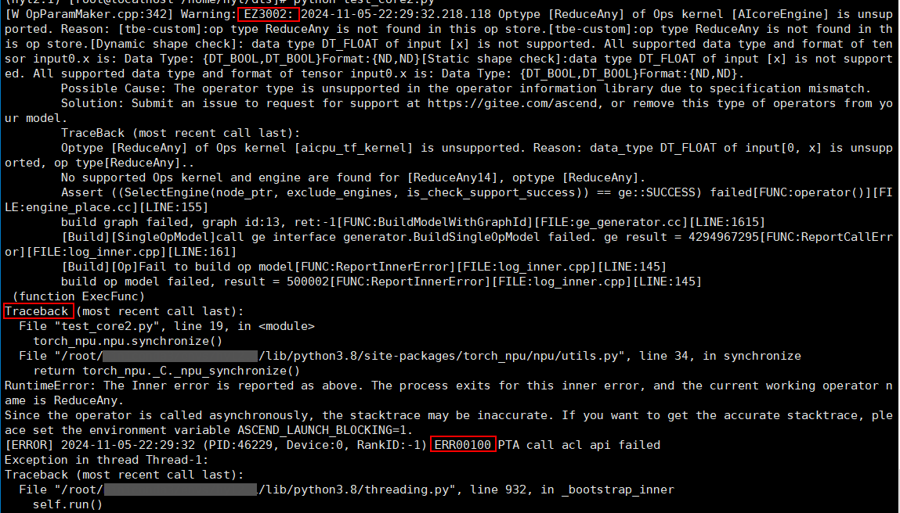

# Command Output

Command output is usually extensive. Many components output error information on the screen, which can be roughly classified into the following categories:

- Python call stack and exception information
- TorchNPU error code
- CANN software error code
- Native framework error information

## Python Call Stack and Exception Information

When Python reports an error, the stack at that time is printed on the screen. Users can view the stack of the Python application by searching for the keyword "Traceback". If multiple stack information items exist, view the first Traceback first, as shown in [Figure 1](#viewing-stack-information-of-python-applications).

**Figure 1**  Viewing the stack information of the Python application <a id="viewing-stack-information-of-python-applications"></a>  


In the command output example above, you can see that the last call stack is on the `set_autocast_enabled` interface of TorchNPU. In general, you can submit an issue on the [Ascend Community](https://gitcode.com/Ascend/pytorch/issues) for help.

If the last call stack is on native torch, trace upward along the stack to find the Ascend-related stack. If the entire stack contains no Ascend-related stack, check whether the model training script itself has problems.

## TorchNPU Error Code

During model training, the printed error code information may vary with scenarios, modes, and fault causes. Therefore, you need to locate the problem by combining the specific error information and plog logs. For details about TorchNPU error codes, see [Error Code Description](../../error_code_description/_menu_error_code_description.md).

The error code is expressed in the command output as follows:

\[ERROR\] \[%s\] \(PID:\[%s\], Device:\[%s\], RankID:\[%s\]\) ERR\[%s\]\[%s\] \[%s\] \[%s\]

## CANN Software Error Code

Due to different scenarios, test cases, and fault causes, the printed error code information differs. Therefore, in the example, \[%s\] variables are used to replace the actual printed logs, and the actual logs replaced by \[%s\] prevail. For details about CANN software error codes, see the "[Error Code Reference](https://gitcode.com/cann/docs/blob/9.2.0/docs/en/troubleshooting/error_code_desc.md)" section in *CANN Fault Handling*.

For example, the E10035 error code is expressed in the manual as follows:

E10035: \[PID:  _xxxxxx_\]  _timestamp_  The \[--dynamic\_batch\_size\], \[--dynamic\_image\_size\], or \[--dynamic\_dims\] argument has  \[%s\] profiles, which is less than the minimum \[%s\].

As shown in [Figure 2](#cann-software-error-code-display-example), there are Python call stack errors, a TorchNPU error code (ERR00100), and a CANN software error code (EZ3002). You can see from the following example that the CANN software error code is at the front, so you should pay main attention to its error information. From the error information, you can see that an unsupported operator exists. In general, you can obtain the logs and click [Link](https://www.hiascend.com/support) to contact technical support.

**Figure 2**  Example of CANN software error code in command output <a id="cann-software-error-code-display-example"></a>  


## Native Framework Error Information

Check whether the Python call stack involves native framework error information, as shown in the following command output (taking PyTorch 2.1.0 as an example). You can click [Link](https://github.com/pytorch/pytorch/issues) for more technical support.

```Python
import torch
t1 = torch.tensor([[1, 2], [3, 4]],dtype=torch.bfloat16)
t2 = torch.tensor([2, 3],dtype=torch.bfloat16)
torch.isin(t1, t2)
Traceback (most recent call last):
  File "<stdin>", line 1, in <module>
RuntimeError: Unsupported input type encountered for isin(): BFloat16
```
