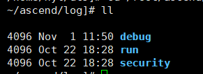
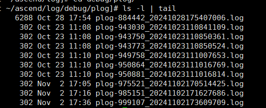
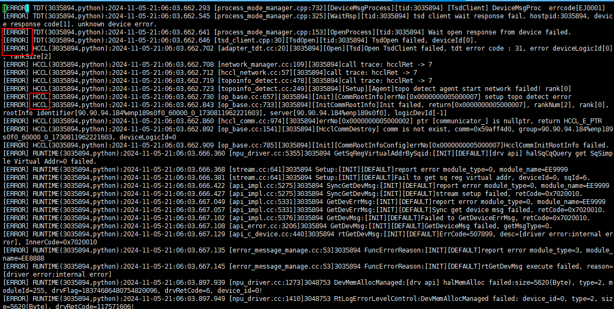
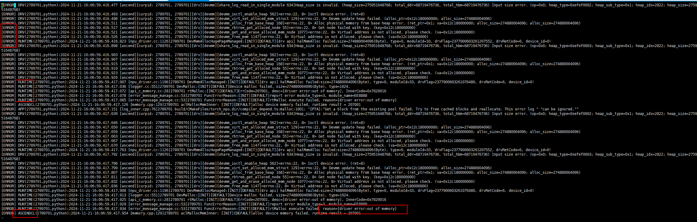

# plog Log Information

After the application finishes running, you can view its application logs under "$HOME/ascend/log" by default, as shown in the following figure.

**Figure 1**  Application logs  

The plog logs can be viewed under "$HOME/ascend/log/debug/plog", as shown in the following figure. This path stores the debugging logs generated by applications running on the Host side, mainly including logs of components in compiler (such as GE, FE, AI CPU, TBE, and HCCL), components in Runtime (such as AscendCL, GE, and Runtime), AI frameworks (such as TorchNPU), and Driver user-mode logs.

**Figure 2**  Obtaining plog logs  

As shown in [Figure 3](#plog-log-example-hccl), you can view the log level (for example, "ERROR") and the name of the module that generates the log (for example, "HCCL").

**Figure 3**  Example of plog logs (HCCL)   

**Figure 4**  Example of plog logs (underlying OOM error)

> [!NOTE]
> For more details about logs, see *[CANN Log Reference](https://gitcode.com/cann/runtime/blob/9.2.0/docs/en/log_ref/log_overview.md)*.
