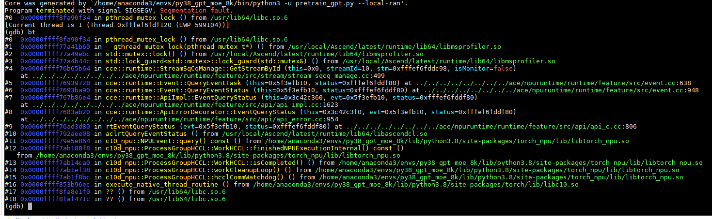

# Locating Core Dump Faults

If an exception occurs during application running, that is, "Segmentation fault" is displayed on the screen, a core dump has occurred. If "Segmentation fault" is not displayed on the screen, no Python stack exists, no ERROR-level logs exist in the plog logs, and a process receives signal 11, a core dump has also occurred.

## Obtaining the Core File

1. Configure the generation of core dump files.

    Run the following command to check the current configuration:

    ```bash
    ulimit -c
    ```

    If the value is unlimited, the size of the generated core dump file is set to unlimited. In this case, if the process crashes, a core dump file will be generated.

    If the value is 0, no core dump file will be saved when an exception occurs. Run the following command to configure it:

    ```bash
    ulimit -c unlimited
    ```

2. Set the storage location and name of the core dump file.

    > [!NOTE]
    >
    > - The following commands require root permissions. Use sudo or switch to the root user in advance.
    > - Ensure that the `{path_to_coredump}` directory has been created in advance; otherwise, the coredump file cannot be generated.

    ```bash
    # Temporarily modify the name of the generated core dump file
    sysctl -w kernel.core_pattern=core-%e.%p.%h.%t
    # Set the directory where core dump files are generated
    echo "/{path_to_coredump}/core.%t.%e.%p" >/proc/sys/kernel/core_pattern
    ```

    In the command, `%e.%p.%h.%t` or `%t.%e.%p` are variables for the file name, and `{path_to_coredump}` is the generation directory. You can set them as needed.

3. Generate the core dump file.

    Run the model script. If the model reports an error or the process crashes, a core dump file will be generated.

    > [!NOTE]
    >
    > - By default, the core file configuration is not enabled, and no core dump file will be generated.
    > - In a container scenario, ensure that the path where the core dump file is generated is mounted outside the container, so that the file still exists after the container is destroyed.

## Debugging the Core File with gdb

The gdb command-line debugging is mainly used for core dump scenarios. After the script is executed, a core dump file is generated in the current directory. Use gdb to debug the file and print the stack. The method is as follows:

1. Install GDB by referring to the [GDB official documentation](https://sourceware.org/gdb/).
2. Debug the core dump file.

    Run the following command to enter the gdb mode and debug the core dump file.

    ```bash
    gdb python3 core*.*    # Modify the core dump file name according to your own settings
    ```

    After the command is executed, the gdb tool enters the interactive mode. You can run related commands to view the code where the exception occurs, the function, the file name, and the line number in the file, which facilitates problem locating.

    > [!NOTE]
    >
    > The debugging environment must be consistent with the environment where the core dump file is generated. For example, in a container scenario, you need to enter the corresponding container for debugging.

3. View the stack by running the following command:

    ```gdb
    (gdb) bt        # View the stack
    (gdb) thread apply all bt     # View the stacks of all processes
    ```

    Locate the error position based on the function stack in the command output.

    **Figure 1**  Viewing the stack
    
