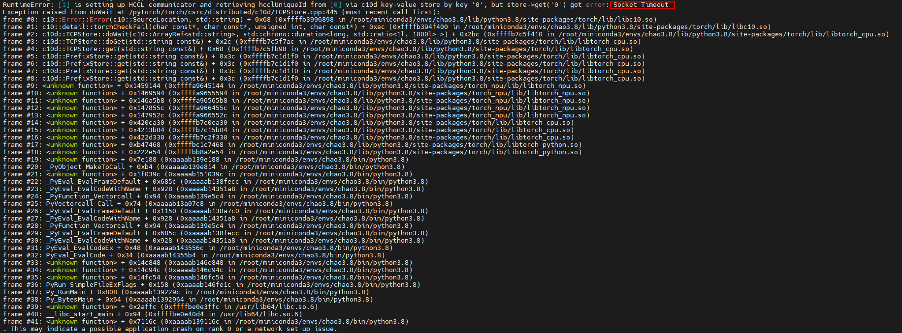

# Communicator Link Establishment Timeout

## Symptom

Keyword "**Socket Timeout**"

## Cause Analysis

During multi-card model training, a communicator link establishment timeout error occurs. Possible causes:

- The network between card 0 and other cards is abnormal, and other cards report a wait timeout error.
- Card 0 exits abnormally, and other cards report a wait timeout error.
- Card 0 establishes the communicator more slowly than other cards, and other cards report a wait timeout error.

## Solution

1. Check the network status between card 0 and other cards.
2. Check whether card 0 has exited abnormally.
3. Check whether card 0 is slow in establishing the communicator.
