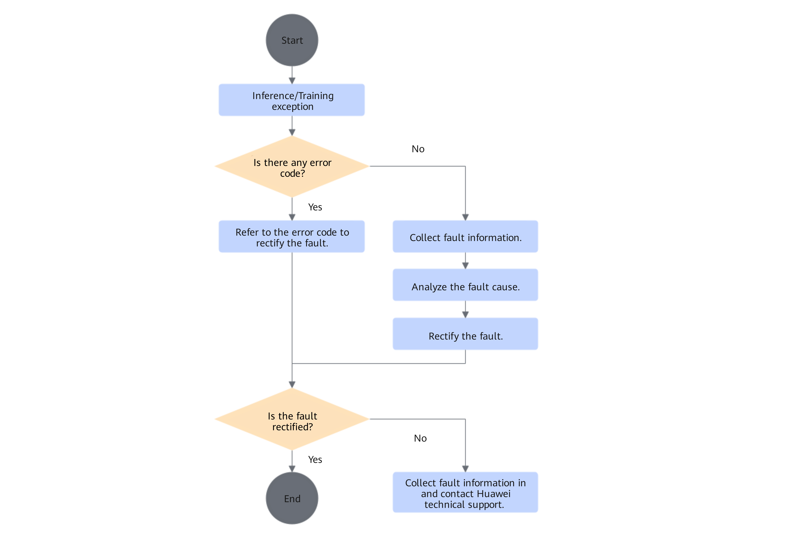

# Troubleshooting Process

This topic uses various exception and fault phenomena that developers may encounter during inference and training as the entry point, and provides self-service problem locating and handling methods to help developers quickly locate and resolve faults. The content includes **error code information printed on the screen and its handling methods**, **one-click log collection**, and **usage of various problem locating tools**.

**The overall troubleshooting process mainly includes the following phases: collecting fault information, analyzing fault causes, troubleshooting, and recording the troubleshooting process.** For the detailed process, see [Figure 1](#troubleshooting-process-flowchart).

**Figure 1**  Troubleshooting Process   

- Handle the fault by referring to the "Error Codes" section

    For details about the "error codes" of the CANN software, see the "[Error Code Reference](https://gitcode.com/cann/docs/blob/9.2.0/docs/en/troubleshooting/error_code_desc.md)" section in *CANN Fault Handling*.

    For details about the "error codes" of the TorchNPU plugin, see [Error Code Description](error_code_description/_menu_error_code_description.md).

- Collect fault information

    Fault information is an important basis for fault handling. The troubleshooting personnel should collect as much fault information as possible, including but not limited to logs, environment information, and so on.

    For log information, a top-down log analysis method is generally used to gradually narrow down to the underlying fault phenomenon based on the service process.

    For details about log levels, see the "[Setting Log Levels](https://gitcode.com/cann/runtime/blob/9.2.0/docs/en/log_ref/setting_log_levels.md)" section in *CANN Log Reference*.

    For details about log paths and log files, see the "[Viewing Logs (Ascend EP)](https://gitcode.com/cann/runtime/blob/9.2.0/docs/en/log_ref/viewing_logs_ep.md)" section in *CANN Log Reference*.

    Regarding command output, the alarm information of TorchNPU is printed normally by default. In a cluster scenario, the alarm information is printed on the screen of the first node.

    Use the msnpureport tool to transfer the system logs on the Device side to the Host side for viewing. For details, see [msnpureport Tool Usage](https://support.huawei.com/enterprise/en/ascend-computing/atlas-800t-a2-pid-254184887?category=reference-guides).

- Analyze fault causes

    Analyzing fault causes refers to the process of identifying the fault cause from many possible causes. By analyzing and comparing various possible fault causes through certain methods or means, possible factors are continuously ruled out until the specific cause of the fault is determined.

- Troubleshoot the fault

    Troubleshooting refers to the process of clearing faults based on different fault causes.

- Record the troubleshooting process

    After troubleshooting, record the key points of the troubleshooting process, and provide prevention and improvement measures for such faults to avoid recurrence of similar faults.

> [!NOTE]  
> You can also share your troubleshooting cases on the [Developer Community Forum](https://www.hiascend.com/forum/) to share your experience for other developers' reference, forming a virtuous cycle, enriching community content, and achieving mutual benefit.
> The third-party tools (such as eseye u and Netron) involved in the troubleshooting steps provided in this topic are examples only and are not mandatory. Use them for reference based on your actual situation, or replace them with other similar tools.
