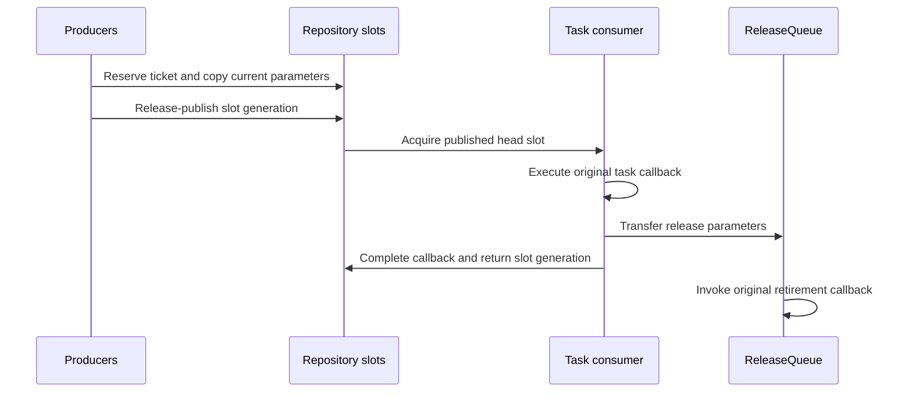

# Experimental sequence task queues

The opt-in bounded MPSC queue uses per-slot sequence numbers for producer
payload transfer, allowing producers to copy into independently reserved slots
without the old enqueue transfer mutex. Repository still executes one task at a time;
ReleaseQueue still retires copied parameters after execution. Task callbacks,
parameter ownership, stream ordering and error reporting remain in the adapter.
This change does not implement a CANN-internal queue.

## Build and compatibility

The original implementation remains the default. To build the experimental
implementation, use a clean build directory and set:

```sh
TORCH_NPU_EXPERIMENTAL_LOCKFREE_QUEUE=ON python setup.py build
```

The setup entry point forwards the same option to the CMake libraries and the
separately compiled Python extension. Direct CMake builds can pass
`-DTORCH_NPU_EXPERIMENTAL_LOCKFREE_QUEUE=ON`. Rebuild every translation unit
that includes NPUQueue.h and all consumers of its concrete classes: this
compile-time option changes private class layouts. Do not mix libraries or
extensions built with different option values.

## Data flow



A producer owns a reserved slot until it publishes either its complete payload
or an aborted-slot marker. The consumer observes published payload through an
acquire load. A slot cannot be reused until the callback finishes. Draining
must observe completion, rather than only the consumer claiming the head.
Production capacities remain 4096 tasks and 8192 release slots.

The queue is bounded. Full producers wait and stop requests reject new work.
The first recorded failure is propagated to waiters; copying or consuming a
failed item must not strand a reserved ticket. Discarding metadata is distinct
from invoking parameter-release callbacks. Repository shutdown coordinates
its worker threads before freeing their backing parameter storage. Restarting
a core requires the previous producer and consumer calls to have finished.

Stop and join all queue workers while the Python interpreter is still alive;
concurrent interpreter finalization is not a supported shutdown protocol.

Error snapshots and lifecycle transitions still use synchronization. A mutex
protects the single-consumer lease and head inspection; producers publish their
payload without acquiring that mutex. Ticket exhaustion is checked before a
reservation can wrap and raises an overflow error; stop/join/restart is required
for a new generation. An unpublished earlier ticket can delay later tickets; neither this queue nor the
whole adapter claims a formal lock-free or wait-free progress guarantee.

## Standalone verification

The core tests require C++17 and pthreads, without PyTorch or an NPU:

```sh
cmake -S test/cpp/queue -B build/queue-tests
cmake --build build/queue-tests --parallel 2
ctest --test-dir build/queue-tests --output-on-failure
```

These tests cover host-side concurrency and ownership protocols. Full adapter
builds, real-device execution, error recovery and representative workloads are
separate integration checks. Host-simulator timing does not establish a
real-NPU performance improvement. This experimental option should remain off
in production until those checks and community review are complete.
