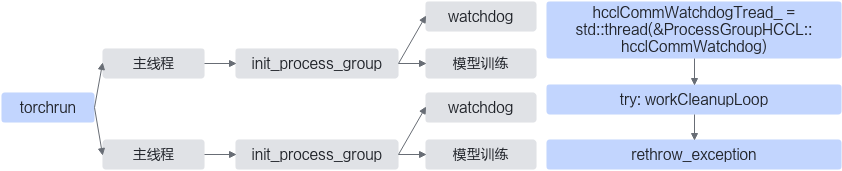

# WatchDog

## 简介

在不影响大模型训练性能和精度的前提下，能快速、稳定地发现错误。WatchDog监控进程，可显著提高使用HCCL的PyTorch分布式训练的可靠性。WatchDog 在各 worker 中异步监控 HCCL 集合通信。发现错误后，可按异步错误处理模式报告错误、清理通信器或终止进程。

**图 1** WatchDog工作示意图  


上图展示了WatchDog进程在分布式训练中如何工作。首先，WatchDog线程在每一个进程初始化process\_group时拉起，一个WatchDog线程监控一个进程中的process\_group。WatchDog 线程在 `workCleanupLoop` 中监视集合通信异常，依据下文的处理模式决定清理故障通信器或终止当前 worker。

WatchDog不仅支持算子执行异常监测、通信超时监测、超时分析，还支持ERROR CQE检测。CQE检测是指检测Device网口通信链路情况，当通信链路异常时，通常反映为ERROR CQE。

## 使用场景

大模型训练过程中，模型集合通信异常后卡住，不能及时结束训练，造成资源损耗。使用该特性可避免该情况发生。

## 使用指导

通过环境变量TORCH\_HCCL\_ASYNC\_ERROR\_HANDLING可以设置是否启用WatchDog。

TORCH\_HCCL\_ASYNC\_ERROR\_HANDLING取值情况：

- 0：关闭异步错误处理。
- 1：清理故障通信器并终止进程。
- 2：清理故障通信器，保留进程。
- 3（默认）：终止进程，跳过故障通信器清理。

此环境变量使用详情请参考《环境变量》中的“[TORCH\_HCCL\_ASYNC\_ERROR\_HANDLING](../../api/environment_variable/collective_communication/TORCH_HCCL_ASYNC_ERROR_HANDLING.md)”章节。

## 使用样例

开启异步错误处理：

```shell
export TORCH_HCCL_ASYNC_ERROR_HANDLING=1
```

## 约束说明

- 此环境变量仅适用于基于PyTorch框架构建的神经网络的场景，且使用HCCL作为通信后端。
- 通过此环境变量开启异步错误处理时，为了更好地明确HCCL超时原因，建议将new\_group和init\_process\_group传参的timeout时间设置为大于HCCL\_CONNECT\_TIMEOUT和HCCL\_EXEC\_TIMEOUT环境变量配置的时间。HCCL\_CONNECT\_TIMEOUT具体请参考《CANN HCCL集合通信库》中的“[HCCL\_CONNECT\_TIMEOUT](https://gitcode.com/cann/hccl/blob/9.2.0/docs/zh/user_guide/hccl_env/HCCL_CONNECT_TIMEOUT.md)”章节，HCCL\_EXEC\_TIMEOUT具体请参考《CANN HCCL集合通信库》中的“[HCCL\_EXEC\_TIMEOUT](https://gitcode.com/cann/hccl/blob/9.2.0/docs/zh/user_guide/hccl_env/HCCL_EXEC_TIMEOUT.md)”章节。
