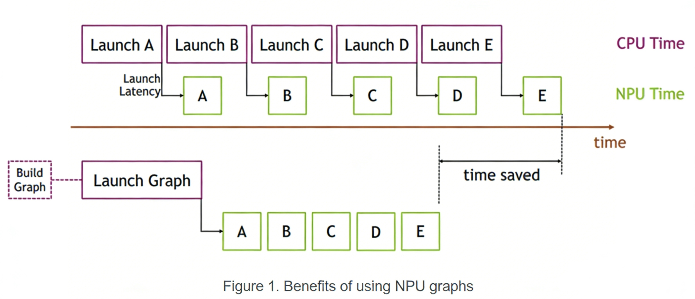

# NPUGraph

## 简介

NPUGraph是一种在Eager Mode（单算子执行模式）下使用的静态图捕获技术，将一系列NPU内核定义并封装为一个单元（即操作图），通过单一CPU操作启动多个NPU操作，从而减少启动开销。更多核心原理可参见[CUDA Graphs](https://pytorch.org/blog/accelerating-pytorch-with-cuda-graphs/)。

### 工作流程

1. **捕获（Capture）**：将NPU流置于捕获模式后，内核调用被记录为计算图结构。
2. **重放（Replay）**：捕获完成后，通过`g.replay()`多次重放相同计算逻辑。每次重放的内核序列、执行顺序与捕获时完全一致，无需重复的图构建和内核启动准备。

    重放时的内存管理是核心要点：捕获阶段分配的张量内存地址在重放时保持不变。若需要在不同step之间使用新数据，必须通过`copy_()`将新数据写入捕获时占用的内存地址，而不能直接对张量重新赋值（如`tensor = new_data`），否则变量将指向新内存地址，重放仍在旧地址上操作导致数据失效。该机制在`make_graphed_callables`内部实现中自动处理。对于前向和反向传播，当检测到输入张量的`data_ptr()`与捕获时不同时，自动执行`copy_()`更新。

3. **更新（Update）**：对于需要动态参数（如序列长度）的算子（如FlashAttention），NPUGraph通过专用的update机制在重放前刷新参数值，无需重新捕获整张图。该机制由[_npugraph_handlers](https://gitcode.com/Ascend/op-plugin/blob/master/docs/zh/custom_APIs/torch_npu-npu/torch_npu-npu_npugraph_handlers.md)中的算子Handler自动管理，用户通过`auto_dispatch_capture=True`启用。

    <!-- npu="950" id1 -->
    在<term>Ascend 950PR&950DT系列产品</term>场景下，支持**tiling下沉**的算子还可以通过另一种方式处理序列长度变化。Tiling用于决定如何将算子的计算任务分配给设备上的各个计算核。采用tiling下沉后，依赖序列长度的任务切分计算会在设备侧执行，并成为捕获图的一部分。每次重放时，设备从NPU张量中读取当前的实际长度，重新计算任务分配，因此这类算子无需通过graph update机制刷新参数。

    例如，CANN的`cann_ops_transformer`扩展提供了`flash_attn_metadata`和`flash_attn`接口。将两个调用一起捕获到同一张图中：`flash_attn_metadata`在设备侧AI CPU上生成任务切分信息（metadata），`flash_attn`使用该信息执行注意力计算。重放前，只需将新的实际长度写入已有的NPU张量，无需设置`auto_dispatch_capture=True`，也无需调用图更新接口。具体用法见下方[通过tiling下沉使用FlashAttention](#示例通过tiling下沉使用flashattention)，参数及约束请参见CANN的[FlashAttention接口文档](https://gitcode.com/cann/ops-transformer/blob/master/attention/flash_attn/docs/torchapi_flash_attn.md)。

    该方式仅适用于支持tiling下沉的算子及配置。重放时，张量形状、数据类型、内存地址和静态属性仍需保持不变；可以变化的是算子支持的输入张量内容，例如实际序列长度。
    <!-- end id1 -->

### 核心优势

图重放机制通过牺牲动态图执行的灵活性，换取显著的CPU开销降低：

1. **固定计算图结构**：内核序列和依赖关系在捕获阶段确定。对于支持变化的输入值，可以通过张量拷贝或上述update机制进行更新，而图结构保持不变。重放时无需在Host侧重复进行参数校验、内核选择等操作。
2. **高效执行流程**：重放时直接调用底层启动接口，将整个图任务批量提交至NPU，跳过CPU端多层调度开销。

NPUGraph的优势可以通过下图展示：



> [!NOTE]
>
> CPU逐个启动一系列短核时，CPU启动开销会在核之间造成显著间隙。而使用NPUGraph替代这串核序列，最初需要花更多时间构建图并一次性启动整个图，但后续执行会非常快，因为核间的间隙非常小。当同一操作序列重复多次（例如训练步数非常多）时，差异更为明显。构建和启动图的初始成本将在整个训练迭代次数中摊销。

## 使用场景

**推荐使用NPUGraph的场景：**

- 网络结构完全或部分为静态图（图安全）
- 存在CPU瓶颈（特别是短内核密集型任务）
- 小批量训练场景（NPU利用率低）
- 输入形状固定的推理或训练任务
- 高迭代次数的重复计算任务
- 仅支持aclnn算子入图

**NPUGraph不适用的场景：**

- 动态形状输入（每批次尺寸变化）
- 动态控制流（条件分支、循环结构可变）
- 需要频繁CPU-NPU同步的操作

## 接口说明

NPUGraph提供了三种方式：

- NPUGraph类（`torch_npu.npu.NPUGraph`）：底层控制，手动管理，捕获整段连续计算图。
- graph上下文管理器（`torch_npu.npu.graph`）：简化版捕获。简单通用的上下文管理器，可在其作用域内捕获NPU操作。
- make_graphed_callables（`torch_npu.npu.make_graphed_callables`）：高级封装，自动处理细节。若网络部分不适合捕获（例如，由于动态控制流、动态网络拓扑、CPU同步或关键的CPU端逻辑），可使用该高级API。与CUDA Graphs社区一致，自动处理图捕获细节和输入数据的`copy_()`更新。

三种方式的适用场景和操作方式对比请参见下表。

| API | 手动操作 | 自动处理 | 适用场景 |
|-----|--------|---------|---------|
| NPUGraph类（`capture_begin/end`）| 手动创建Stream、调用`capture_begin/end`、管理内存池、处理同步 | ACLGraph捕获和重放 | 多Stream协同、分区域捕获 |
| `graph()`上下文管理器 | 决定捕获边界 | 自动创建Stream，同步与缓存处理 | 快速上手，单流场景 | 
| `make_graphed_callables()`|传入callables和样例输入| 自动完成warmup、捕获前后向图、处理数据copy_更新 | 含动态控制流的安全子图捕获 | 

## 使用样例

**方式一：使用NPUGraph类（底层API）**

`torch_npu.npu.NPUGraph`是底层原始类，提供对捕获流程的精细控制。使用时需手动管理Stream、调用`capture_begin()`和`capture_end()`。

```python
import torch
import torch_npu

def graph_capture_simple():
    s = torch_npu.npu.Stream()

    with torch_npu.npu.stream(s):
        a = torch.full((1000,), 1, device="npu")
        g = torch_npu.npu.NPUGraph()
        torch_npu.npu.empty_cache()
        g.capture_begin()
        b = a
        for _ in range(10):
            b = b + 1
        g.capture_end()
    torch_npu.npu.current_stream().wait_stream(s)

    g.replay()

    print(f"b.sum().item() == {b.sum().item()}.")

graph_capture_simple()
```

**方式二：使用graph上下文管理器**

相比手动调用`capture_begin()`和`capture_end()`，该方式更加简洁，自动处理Stream同步和缓存清理。

```python
import torch
import torch_npu

def graph_simple():
    a = torch.full((1000,), 1, device="npu")
    g = torch_npu.npu.NPUGraph()
    with torch_npu.npu.graph(g):
        b = a
        for _ in range(10):
            b = b + 1

    g.replay()

    print(f"b.sum().item() == {b.sum().item()}.")

graph_simple()
```

**方式三：使用make_graphed_callables（安全子图捕获）**

该API将安全部分封装为图化可调用对象，其余部分保持eager执行。

```python
import torch
import torch_npu
from torch_npu.contrib import transfer_to_npu
import torch.nn as nn
import torch.optim as optim
from itertools import chain

def main():
    # 1. 环境检查: 验证NPU可用性
    if not torch.npu.is_available():
        print("# NPU不可用，请在支持NPU的环境中运行本示例")
        return
    print(f"# PyTorch版本: {torch.__version__}")
    print(f"# torch_npu版本: {torch_npu.__version__}")
    print(f"# NPU设备数量: {torch.npu.device_count()}")

    # 2. 可复现性设置
    torch.manual_seed(42)
    torch.npu.manual_seed(42)

    # 3. 模型定义与NPU迁移
    N, D_in, H, D_out = 640, 4096, 2048, 1024
    module1 = nn.Linear(D_in, H).npu()
    module2 = nn.Linear(H, D_out).npu()
    module3 = nn.Linear(H, D_out).npu()

    loss_fn = nn.MSELoss().npu()
    optimizer = optim.SGD(
        chain(module1.parameters(), module2.parameters(), module3.parameters()),
        lr=0.1
    )

    # 4. 准备捕获用静态张量(requires_grad状态需与实际输入匹配)
    x = torch.randn(N, D_in, device='npu')  # module1输入无需梯度
    h = torch.randn(N, H, device='npu', requires_grad=True)  # module2/3输入需梯度

    # 5. 使用make_graphed_callables捕获子图
    print("# 捕获NPUGraph子图")
    module1 = torch_npu.npu.make_graphed_callables(module1, (x,))
    module2 = torch_npu.npu.make_graphed_callables(module2, (h,))
    module3 = torch_npu.npu.make_graphed_callables(module3, (h,))
    print("# NPUGraph子图捕获完成")

    # 6. 准备真实训练数据
    real_inputs = [torch.randn_like(x) for _ in range(10)]
    real_targets = [torch.randn(N, D_out, device='npu') for _ in range(10)]

    # 7. 执行训练迭代(含动态分支)
    print("# 开始10次迭代(使用NPUGraphed Callables)")
    for i, (data, target) in enumerate(zip(real_inputs, real_targets)):
        optimizer.zero_grad(set_to_none=True)

        # 前向: module1无条件执行
        tmp = module1(data)  # 图化前向

        # 动态分支: 根据中间结果选择module2或module3
        # ⚠️ 注意: NPUGraph要求分支结构在捕获时确定; 此处分支仅影响复用哪个图，
        #        各分支内部计算图保持静态，因此安全可用
        if tmp.sum().item() > 0:
            tmp = module2(tmp)  # 图化前向
        else:
            tmp = module3(tmp)  # 图化前向

        loss = loss_fn(tmp, target)
        loss.backward()  # 对应选中模块的图化反向 + module1反向
        optimizer.step()

        if i == 0 or i == 9:
            param_sum = sum(p.sum().item() for p in chain(
                module1.parameters(), module2.parameters(), module3.parameters()))
            print(f"# 迭代{i+1}: 模型参数总和={param_sum:.6f}, 损失={loss.item():.6f}")

    print("# 所有迭代完成")
    print("# NPUGraphed Callables功能验证成功")

if __name__ == "__main__":
    main()
```

<!-- npu="950" id2 -->
**补充示例：通过tiling下沉使用FlashAttention**<a id="示例通过tiling下沉使用flashattention"></a>

本示例将`flash_attn_metadata`和`flash_attn`一起捕获，并使用不同的实际KV序列长度重放同一张图。K/V张量始终保留128个token的容量，NPU张量`seqused_kv`指定当前重放时每个batch样本实际使用的token数量。

请在该算子支持的<term>Ascend 950PR&950DT系列产品</term>上运行示例，使用版本匹配的PyTorch、torch_npu和提供`FlashAttnMetadata`、`FlashAttn`算子的CANN环境，并按照[安装说明](https://gitcode.com/cann/ops-transformer/blob/master/torch_extension/README.md)安装`cann_ops_transformer`扩展。

```python
import torch
import torch_npu
import cann_ops_transformer


@torch.no_grad()
def main():
    torch_npu.npu.set_device(0)
    batch_size, q_len, kv_capacity = 2, 1, 128
    num_heads_q, num_heads_kv, head_dim = 8, 2, 128

    # 保留这些张量，每次重放都复用同一块内存。
    q = torch.randn(
        batch_size, q_len, num_heads_q, head_dim,
        dtype=torch.bfloat16, device="npu",
    )
    k = torch.randn(
        batch_size, kv_capacity, num_heads_kv, head_dim,
        dtype=torch.bfloat16, device="npu",
    )
    v = torch.randn_like(k)
    seqused_q = torch.full(
        (batch_size,), q_len, dtype=torch.int32, device="npu",
    )
    seqused_kv = torch.full(
        (batch_size,), kv_capacity, dtype=torch.int32, device="npu",
    )

    # 两个算子必须使用一致的序列长度、布局和掩码配置。
    params = dict(
        seqused_q=seqused_q,
        seqused_kv=seqused_kv,
        max_seqlen_q=q_len,
        max_seqlen_kv=kv_capacity,
        mask_mode=0,
        win_left=-1,
        win_right=-1,
        layout_q="BSND",
        layout_kv="BSND",
        layout_out="BSND",
    )

    def attention():
        metadata = cann_ops_transformer.ops.flash_attn_metadata(
            num_heads_q, num_heads_kv, head_dim,
            batch_size=batch_size,
            **params,
        )
        out, _ = cann_ops_transformer.ops.flash_attn(
            q, k, v,
            metadata=metadata,
            softmax_scale=head_dim ** -0.5,
            return_softmax_lse=False,
            **params,
        )
        return out

    # 捕获前先预热，完成扩展首次调用时的编译和初始化。
    stream = torch_npu.npu.Stream()
    stream.wait_stream(torch_npu.npu.current_stream())
    with torch_npu.npu.stream(stream):
        for _ in range(3):
            attention()
    torch_npu.npu.synchronize()

    graph = torch_npu.npu.NPUGraph()
    with torch_npu.npu.graph(graph, stream=stream):
        graph_out = attention()

    for lengths in ([32, 64], [96, 128]):
        # 修改张量内容，保持捕获时的内存地址不变。
        new_lengths = torch.tensor(lengths, dtype=torch.int32, device="npu")
        seqused_kv.copy_(new_lengths)

        # 重放时，设备先生成metadata，再执行注意力计算。
        graph.replay()

        # 使用相同的输入和实际长度，与eager执行结果进行比较。
        eager_out = attention()
        torch_npu.npu.synchronize()
        torch.testing.assert_close(graph_out, eager_out, rtol=1e-2, atol=1e-2)
        print(f"KV实际长度为{lengths}：图重放结果与eager执行结果一致")


if __name__ == "__main__":
    main()
```

关键是将**metadata生成和注意力计算一起捕获**。如果只在捕获前生成一次metadata，实际长度变化后，图中的任务切分信息仍会保持原值。本示例在每次重放时都会在设备侧重新生成metadata，并将其交给注意力算子使用，无需重新执行Python的`attention()`函数。

实际长度必须在已分配的序列容量范围内。需要使用新的Q/K/V数据时，与`seqused_kv`一样，在重放前将数据拷贝到已有张量中。如果修改张量形状，或修改布局、掩码模式等静态配置，则需要重新捕获。示例中的eager调用和结果比较仅用于验证，正常的重放循环中无需保留。

<!-- end id2 -->